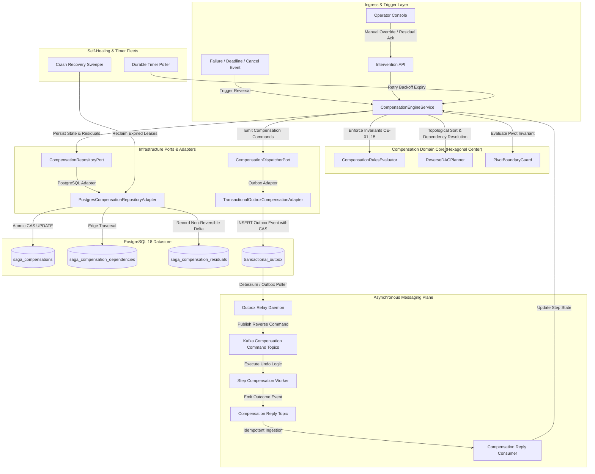
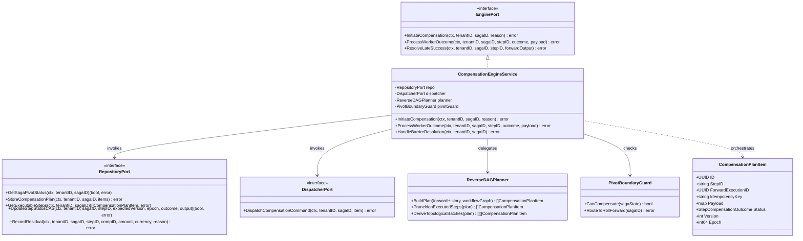
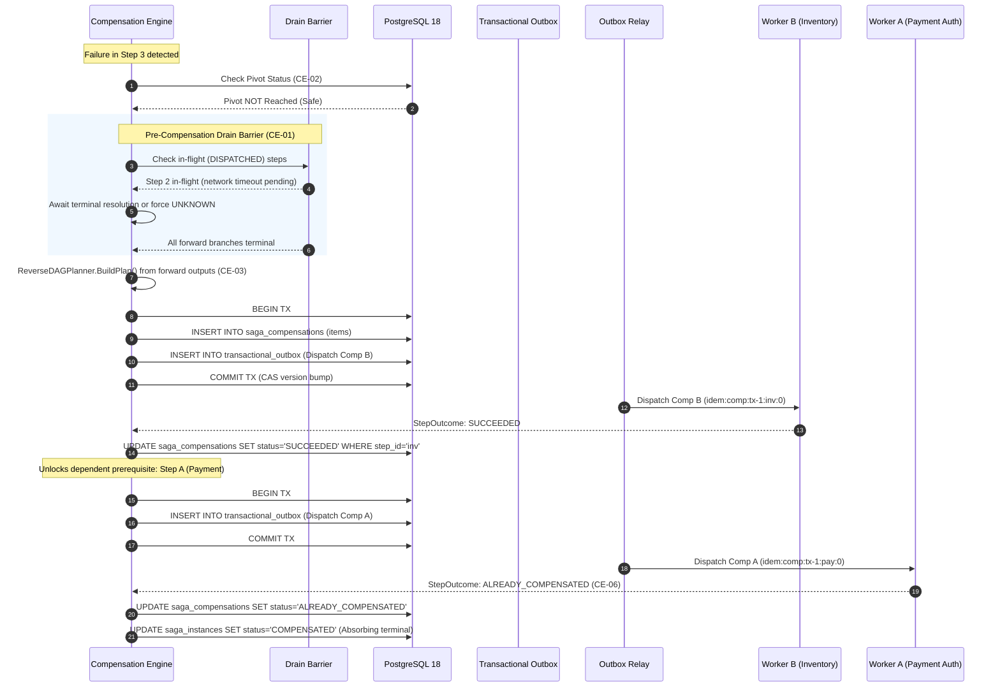
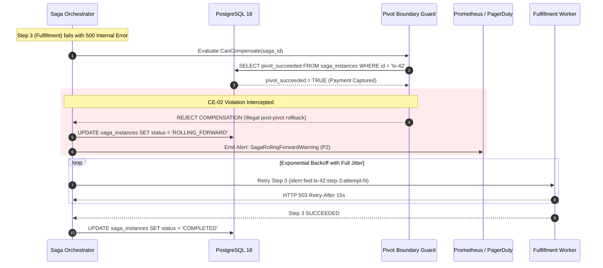
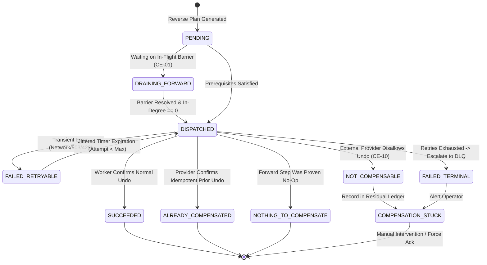

# Compensation Engine — Architectural & Visual Diagrams

This document contains architectural blueprints, component models, and sequence workflows for the **Compensation Engine** in the Distributed Transaction Engine platform, supporting [ADR-0005](file:///home/btpl-lap-22/live/System-Architect/distributed-transaction-engine/docs/features/compensation-engine/adr.md) and [Business Logic Decision Tree v2](file:///home/btpl-lap-22/live/System-Architect/distributed-transaction-engine/docs/features/compensation-engine/business-logic.md).

---

## 1. High-Level Architecture (HLD): Hexagonal Outbox Model

The Compensation Engine operates as an isolated domain core interacting exclusively through persistence and dispatch ports. This guarantees transactional atomicity across state updates, outbox dispatches, and residual ledgering.



---

## 2. Low-Level Component & Service Engine (LLD)

This class diagram illustrates the domain entity relationships, ports, and hexagonal adapter contracts governing the compensation subsystem.



---

## 3. End-to-End Reverse Compensation Sequence (With Drain Barrier)



---

## 4. Post-Pivot Failure: Transition to Durable Roll-Forward

When a failure strikes after the pivot transaction has committed, backward compensation is illegal. The system switches permanently to forward recovery.



---

## 5. Late Forward Reply Resolution (CE-08 Reactive Compensation)

```mermaid
sequenceDiagram
    autonumber
    participant Worker as Slow Worker (Hotel Reservation)
    participant Engine as Compensation Engine
    participant DB as PostgreSQL 18
    participant Recon as Reconciliation Ledger

    Note over Engine: Step timed out after 30s; marked UNKNOWN
    Note over Engine: Compensation ran; saga marked COMPENSATED
    
    Worker->>Engine: Late Reply: "Hotel Room 402 Booked" (SUCCEEDED)
    Engine->>DB: Read saga status
    DB-->>Engine: status = 'COMPENSATED'
    
    rect rgb(255, 245, 230)
        Note over Engine, Recon: CE-08 Reactive Rollback Protocol
        Engine->>DB: INSERT INTO saga_compensations (step_id='hotel', status='PENDING')
        Engine->>Worker: Dispatch Reactive Compensation (idem:comp:tx-1:hotel:reactive)
        Worker-->>Engine: Confirmed Hotel Room 402 Cancelled
        Engine->>DB: UPDATE saga_compensations SET status = 'SUCCEEDED'
        Engine->>Recon: Append entry to audit_log (Late reconciliation resolved)
    end
```

---

## 6. Compensation Unit State Machine (Full Lifecycle)


