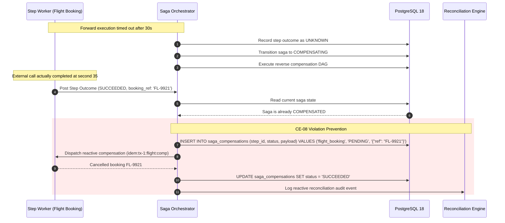

# Compensation Engine — Failure Cases, Edge Conditions & Mitigations

This document details failure cases, race conditions, edge scenarios, and recovery protocols for the Saga Compensation Engine.

---

## 1. Failure Modes & Resilience Matrix

| Failure ID | Failure Description | Direct Impact | Invariants Challenged | Architectural Mitigation & Detection |
|---|---|---|---|---|
| **FAIL-CE-001** | **Post-Pivot Cancellation Race**: Client sends `CANCEL` request immediately after the pivot step commits in PostgreSQL. | If unvalidated, pre-pivot steps are refunded while the pivot (e.g., capture) remains settled, causing direct monetary loss. | **CE-02, E0.1** | **Mitigation:** Atomic pivot guard check inside PostgreSQL transaction: `SELECT pivot_succeeded FROM saga_instances WHERE id = $1 FOR UPDATE`. If `pivot_succeeded = TRUE`, return `HTTP 409 Conflict: SAGA_PAST_PIVOT`. Transition saga to `ROLLING_FORWARD`. Post-pivot reversal must be routed to human returns workflow. |
| **FAIL-CE-002** | **Late Forward Success**: Forward step in Branch B was timed out (`UNKNOWN`), compensation ran and completed, but downstream Branch B worker finishes 10s later and writes `SUCCEEDED`. | An uncompensated side effect exists in downstream service after the saga marked `COMPENSATED`. | **CE-08** | **Mitigation:** Any late write to `saga_step_executions` for a saga in `COMPENSATING` or `COMPENSATED` state triggers an immediate reactive compensation dispatch for that step, or flags a `RESIDUAL_EFFECT_DETECTED` alert in the Reconciliation Engine. |
| **FAIL-CE-003** | **Downstream Rejects Reversal (`NOT_COMPENSABLE`)**: External airline rejects ticket cancellation because passenger already checked in or departure window elapsed. | Automated compensation cannot proceed; naive retries hammer the partner API with 4xx errors. | **CE-06, CE-07** | **Mitigation:** The step worker parses response and returns typed outcome `NOT_COMPENSABLE`. Engine stops retrying this step, persists reason in `last_error_code`, marks compensation as `NOT_COMPENSABLE`, and escalates saga to `NEEDS_HUMAN_ATTENTION`. Independent steps continue compensating. |
| **FAIL-CE-004** | **Forward Outcome Data Missing**: Step 2 (Payment Auth) timed out at network level; forward response payload containing `authorization_id` was never saved in database. | Compensation cannot construct payload (CE-03) because refund requires `authorization_id`. | **CE-03, CE-05** | **Mitigation:** Ambiguous step resolution. Engine queries downstream provider's search/status API using the forward idempotency key (`idem:<saga_id>:<step_id>:fwd`) to retrieve `authorization_id`. If record not found downstream, step is marked `NOTHING_TO_COMPENSATE`. |
| **FAIL-CE-005** | **Compensation Idempotency Collision**: Re-using the forward idempotency key for compensation dispatch. | Payment gateway checks idempotency key, matches previous capture/auth record, and returns HTTP 200 without executing the refund. | **CE-04** | **Mitigation:** Strictly separate key spaces: forward execution uses suffix `:fwd`, compensation uses `:comp`. Key generation schema is strictly enforced: `fmt.Sprintf("idem:%s:%s:comp", sagaID, stepID)`. |
| **FAIL-CE-006** | **Cascading Downstream Outage During Compensation**: Downstream inventory service is offline (503 Service Unavailable) during rollback. | Compensation cannot complete immediately; holding resources indefinitely risks starvation. | **CE-07, CE-10** | **Mitigation:** Step enters `FAILED_RETRYABLE`. Exponential backoff with full jitter up to 5 attempts. If still failing, saga transitions to `COMPENSATION_STUCK`. It does NOT block unrelated parallel compensations from executing. Background sweeper re-polls `FAILED_RETRYABLE` every 60s. |
| **FAIL-CE-007** | **Duplicate Compensation Triggers**: Failure in Step 4 and saga deadline expiration occur simultaneously on two separate worker nodes. | Two concurrent compensation plans constructed, triggering duplicate compensation commands. | **Check 0.2, E0.2** | **Mitigation:** Single-leader transition guard with OCC: `UPDATE saga_instances SET status = 'COMPENSATING' WHERE id = $1 AND status = 'RUNNING'`. Exactly one worker wins; the second receives 0 rows affected and aborts. |

---

## 2. Deep Dive: Late Forward Execution Resolution

---

## 3. Operational Recovery & DLQ Escalation

When compensation fails with `NOT_COMPENSABLE` or exhausts max retries:
1. Engine moves saga to `COMPENSATION_STUCK`.
2. Emits alert `SagaCompensationStuckAlert` to PagerDuty with tenant ID and residual impact.
3. Operator uses [`manual-intervention`](file:///home/btpl-lap-22/live/System-Architect/distributed-transaction-engine/docs/features/manual-intervention) API:
   - `POST /api/v1/sagas/{id}/intervene/force-compensate` (after manual provider refund).
   - `POST /api/v1/sagas/{id}/intervene/acknowledge-residual` (records unrecoverable financial loss in audit ledger and completes saga with `FAILED_COMPENSATED_RESIDUAL`).

