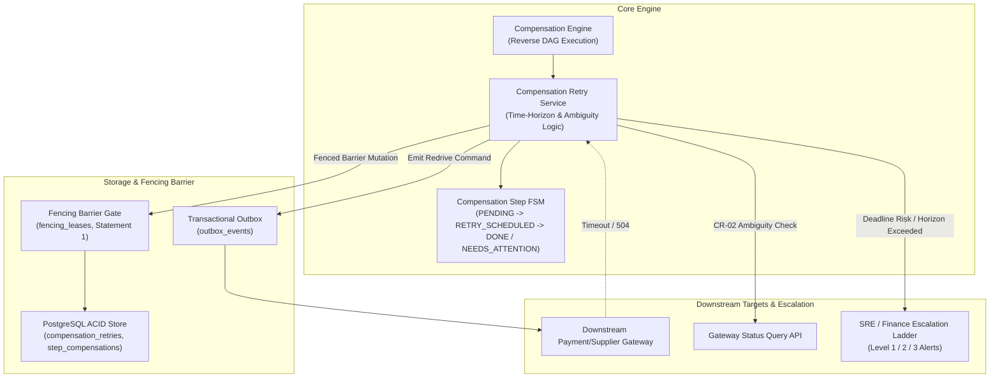
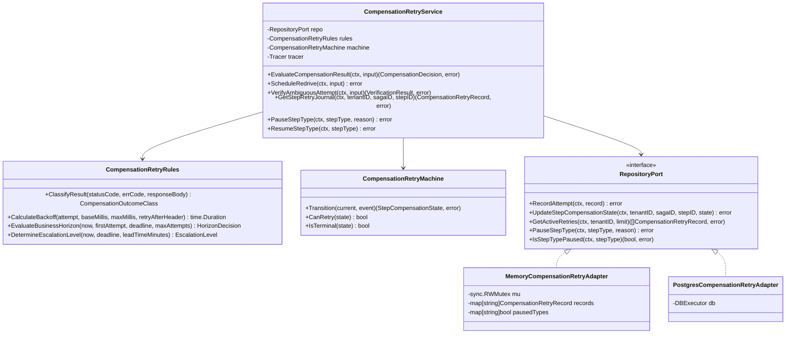
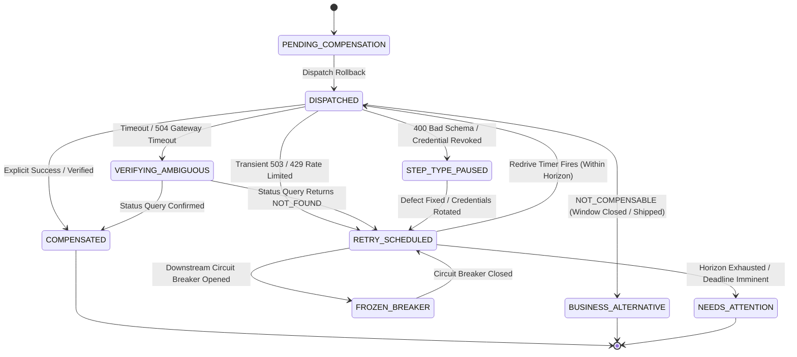
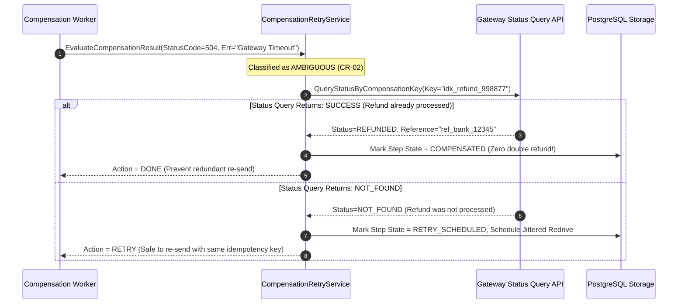
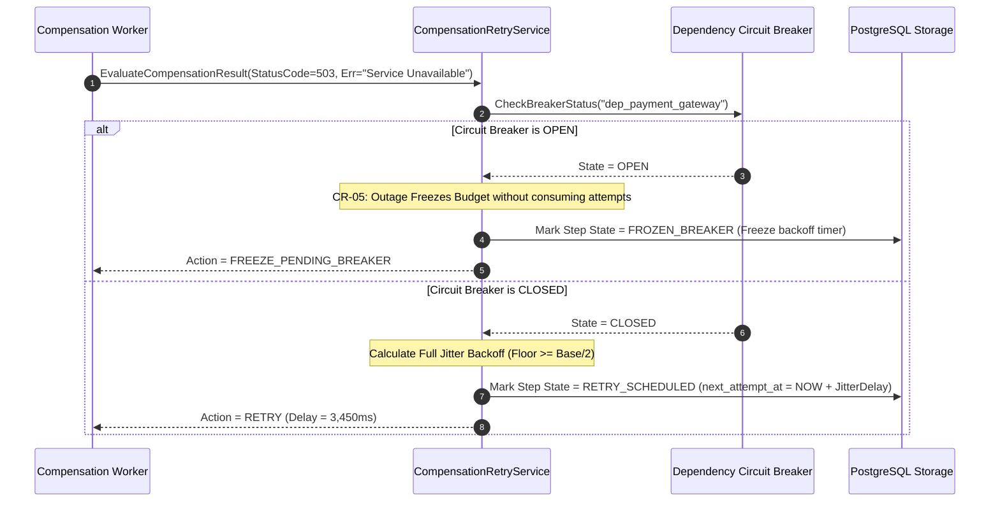
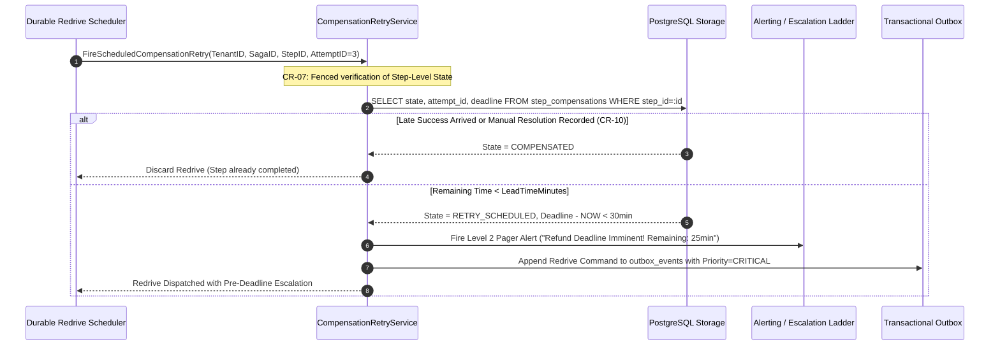

# Compensation Retry — Architecture & System Diagrams

## 1. High-Level Architecture (HLD)

---

## 2. Low-Level Architecture (LLD)

---

## 3. Compensation Step State Machine (FSM)

---

## 4. Sequence Diagram 1: Ambiguity Verification & Status Query

---

## 5. Sequence Diagram 2: Jittered Backoff & Dependency Breaker Interplay

---

## 6. Sequence Diagram 3: Redrive Execution & Pre-Deadline Escalation Ladder

