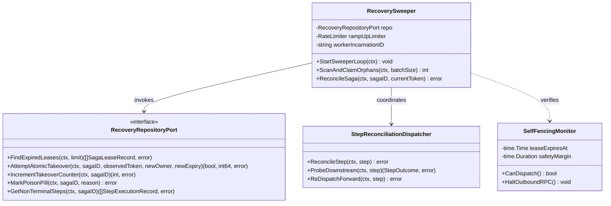
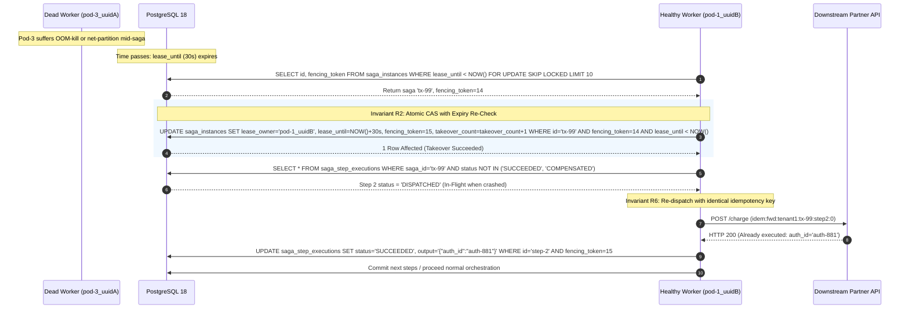
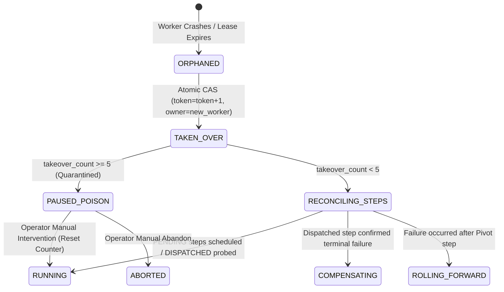

# Crash Recovery — Architectural & Visual Diagrams

This document details the architectural blueprints, component models, and sequence workflows for the **Continuous Leaderless Crash Recovery Engine** in the Distributed Transaction Engine platform, supporting [ADR-0004](file:///home/btpl-lap-22/live/System-Architect/distributed-transaction-engine/docs/features/crash-recovery/adr.md) and [Business Logic Decision Tree v2](file:///home/btpl-lap-22/live/System-Architect/distributed-transaction-engine/docs/features/crash-recovery/business-logic.md).

---

## 1. High-Level Architecture (HLD): Continuous Leaderless Recovery Fleet

Crash recovery operates continuously across all running worker replicas without a centralized master or consensus cluster (ZooKeeper/Raft). Workers discover orphaned sagas directly via indexed database queries.

```mermaid
flowchart TB
    subgraph Fleet ["Orchestrator Worker Fleet (K8s Replicas)"]
        W1["Worker Pod 1 (Incarnation: pod1_u1)"]
        W2["Worker Pod 2 (Incarnation: pod2_u2)"]
        W3["Dead / Partitioned Pod (pod3_u3)"]
    end

    subgraph DatabaseLayer ["PostgreSQL 18 Primary"]
        Sagas[("saga_instances<br/>lease_owner, lease_until, fencing_token")]
        Steps[("saga_step_executions<br/>status: PENDING | DISPATCHED | UNKNOWN")]
        Audit[("saga_recovery_audit_log")]
    end

    subgraph TakeoverProtocol ["Leaderless Takeover Protocol"]
        W1 -->|1. Polling: lease_until < NOW() SKIP LOCKED| Sagas
        W1 -->|2. Atomic CAS: fencing_token=token+1, owner=pod1_u1| Sagas
        W2 -->|Concurrent claim attempt on same row| Sagas
        Sagas -->>|0 rows affected: lock contention resolved| W2
    end

    subgraph DownstreamServices ["Dispatched Step Handlers"]
        W1 -->|3. Re-dispatch UNKNOWN with same idempotency key| PartnerAPI["Payment / Inventory Services"]
        PartnerAPI -->|Deduplicate & return authoritative outcome| W1
    end

    subgraph PoisonQuarantine ["Poison Pill Circuit Breaker"]
        W1 -->|takeover_count >= 5| Quarantine["PAUSED_POISON State"]
        Quarantine -->|Emit P1 Alert| PagerDuty["Alertmanager / On-Call"]
    end
```

---

## 2. Low-Level Component & Service Engine (LLD)



---

## 3. Atomic Lease Takeover Sequence with Monotonic Fencing



---

## 4. Zombie Worker Interception & Monotonic Self-Fencing

```mermaid
sequenceDiagram
    autonumber
    participant Zombie as Zombie Worker (pod-3_uuidA)
    participant DB as PostgreSQL 18
    participant Sweeper as Active Worker (pod-1_uuidB)
    participant Downstream as Downstream Gateway

    Note over Zombie: Suffers 40s Stop-the-World GC Pause
    Note over DB: Lease expires at sec 30; Sweeper takes over at sec 32 (token: 14 -> 15)
    
    Note over Zombie: Zombie wakes up at sec 40!
    
    rect rgb(255, 235, 235)
        Note over Zombie: Invariant R4: Monotonic Self-Fencing Check
        Zombie->>Zombie: Check clock: now() > lease_until - margin
        alt Self-Fencing Halts Dispatch (Early Guard)
            Zombie-->>Zombie: Lease lapsed! Abort outbound calls immediately.
        else Clock Skew / Missed Local Guard
            Zombie->>Downstream: POST /charge (Outbound mutation)
            Downstream-->>Zombie: 200 OK
            Zombie->>DB: UPDATE saga_instances SET version=version+1 WHERE id='tx-99' AND fencing_token=14
            DB-->>Zombie: 0 Rows Affected (Rejected! Fencing token is 15)
            Note over Zombie: Zombie state write denied; database remains consistent!
        end
    end
```

---

## 5. Poison Pill Quarantine Sequence (Invariant R10)

```mermaid
sequenceDiagram
    autonumber
    participant Sweeper as Recovery Sweeper
    participant DB as PostgreSQL 18
    participant Alert as Prometheus Alertmanager

    Sweeper->>DB: Takeover saga 'tx-666' (takeover_count incremented to 5)
    
    rect rgb(255, 240, 240)
        Note over Sweeper: Invariant R10: Poison Threshold Reached (count >= 5)
        Sweeper->>DB: UPDATE saga_instances SET status = 'PAUSED_POISON', reason = 'EXCEEDED_MAX_RECOVERIES' WHERE id = 'tx-666'
        Sweeper->>DB: INSERT INTO saga_recovery_audit_log (saga_id, event, details) VALUES ('tx-666', 'QUARANTINE_POISON', 'Repeated crashes during recovery')
        Sweeper->>Alert: Emit Metric: saga_quarantine_poison_total{saga_id='tx-666'}
    end

    Note over Sweeper: Sweeper skips step execution; saga quarantined from crashing fleet
```

---

## 6. Recovery Lifecycle State Machine



