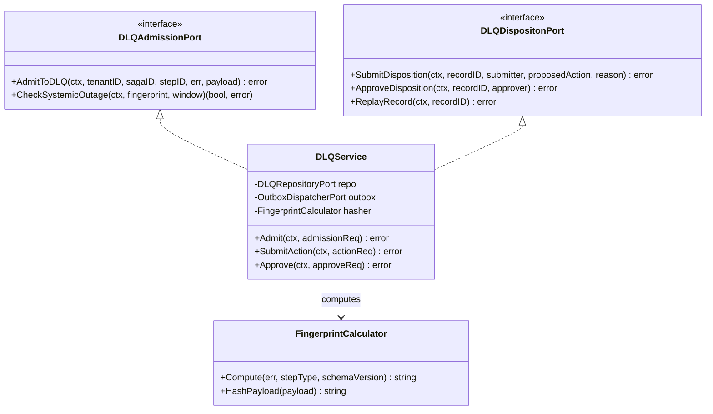
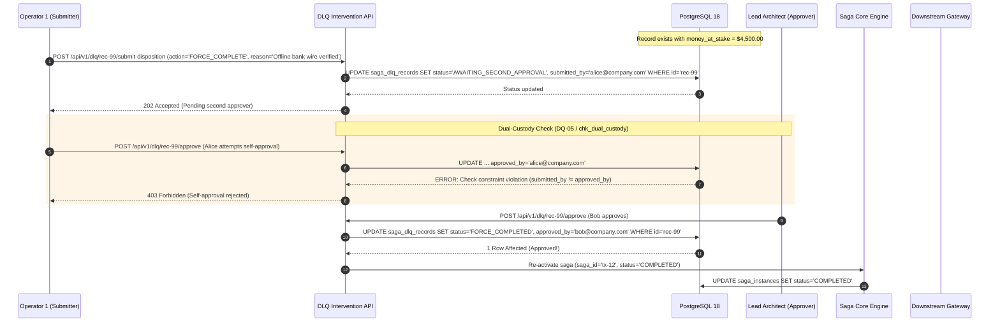
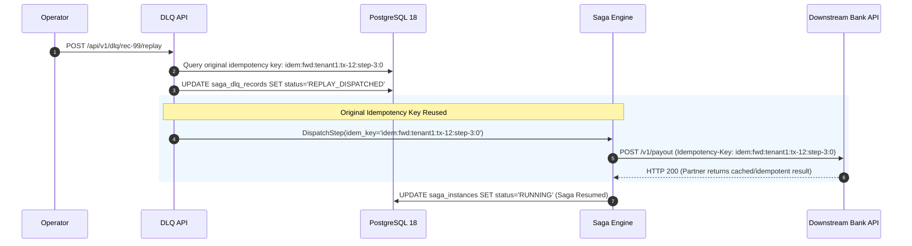
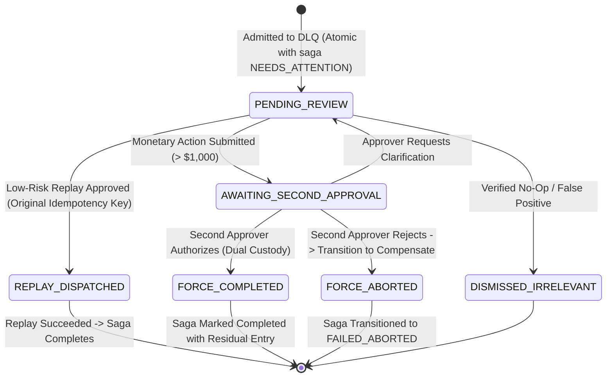

# Dead-Letter Queue (DLQ) — Architectural & Visual Diagrams

This document illustrates the architectural blueprints, component relationships, and human disposition workflows for the **Transactional Dead-Letter Queue (DLQ)** subsystem, supporting [ADR-0008](file:///home/btpl-lap-22/live/System-Architect/distributed-transaction-engine/docs/features/dead-letter-queue/adr.md) and [Business Logic Decision Tree v2](file:///home/btpl-lap-22/live/System-Architect/distributed-transaction-engine/docs/features/dead-letter-queue/business-logic.md).

---

## 1. High-Level Architecture (HLD): Transactional DLQ Engine

```mermaid
flowchart TB
    subgraph EngineCore ["Saga Execution Core"]
        Worker["Orchestrator Step Worker"]
        Evaluator["Failure & Fingerprint Evaluator"]
        Worker --> Evaluator
    end

    subgraph RelationalAdmission ["PostgreSQL Atomic Admission (DQ-01)"]
        Evaluator -->|Atomic BEGIN ... COMMIT| DB_Saga[("saga_instances<br/>status: NEEDS_ATTENTION")]
        Evaluator -->|Atomic INSERT| DB_DLQ[("saga_dlq_records<br/>status: PENDING_REVIEW")]
        Evaluator -->|Atomic INSERT| DB_Outbox[("transactional_outbox<br/>event: DLQ_ENQUEUED")]
    end

    subgraph StreamingPlane ["Notification Streaming Plane (DQ-02)"]
        DB_Outbox --> Relay["Outbox Relay"]
        Relay --> KafkaDLQ["Kafka dlq-notifications Topic"]
        KafkaDLQ --> SlackPager["Ops Slack / PagerDuty Dispatcher"]
    end

    subgraph HumanGovernance ["Dual-Custody Human Governance Portal"]
        Op1["Operator 1 (Submitter)"] -->|POST /api/v1/dlq/{id}/submit-disposition| DLQService["DLQ Intervention Service"]
        Op2["Operator 2 (Approver)"] -->|POST /api/v1/dlq/{id}/approve| DLQService
        DLQService -->|Verify Check Constraint: op1 != op2| DB_DLQ
        DLQService -->|Trigger Replay with Original Key| Worker
    end
```

---

## 2. Low-Level Component Model (LLD)



---

## 3. Dual-Custody Disposition Sequence Flow ($> \$1,000$ Financial Action)



---

## 4. Replay Execution Flow (Invariant DQ-04: Original Idempotency Key)



---

## 5. DLQ Record Lifecycle State Machine



