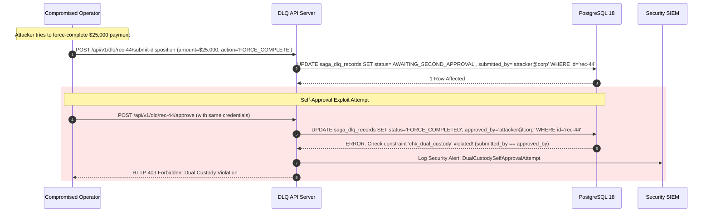

# Dead-Letter Queue (DLQ) — Failure Cases, Risk Vectors & Operational Runbooks

This document analyzes failure cases, attack vectors, operator mistakes, and recovery protocols for the Transactional Dead-Letter Queue (DLQ) system.

---

## 1. Failure Modes & Resilience Matrix

| Failure Mode ID | Scenario / Trigger | Immediate Impact | Invariants Challenged | Architectural Mitigation & Detection |
|---|---|---|---|---|
| **FAIL-DQ-001** | **Blind Replay with Regenerated Idempotency Key**: Operator clicks "Replay" in UI; UI generates a new UUID for the idempotency key. Downstream payment provider receives new key and debits customer card a second time. | Duplicate financial debit to end customer; chargeback penalties. | **DQ-04** | **Mitigation:** The DLQ API extracts the original immutable `idempotency_key` stored in `saga_dlq_records` and injects it into the replay command. Passing client-generated keys to the replay endpoint is strictly forbidden and rejected with `400 Bad Request`. |
| **FAIL-DQ-002** | **Single Rogue Operator Fraud (Bypassing Dual Custody)**: A compromised operator account attempts to force-complete a failed $\$50,000.00$ merchant payout without secondary authorization. | Unauthorized disbursement of funds; insider fraud. | **DQ-05, DQ-07** | **Mitigation:** Database-enforced check constraint `chk_dual_custody`. Any update transitioning state to `FORCE_COMPLETED` with `money_at_stake >= 1000.00` fails at the PostgreSQL engine level unless `submitted_by IS NOT NULL AND approved_by IS NOT NULL AND submitted_by != approved_by`. |
| **FAIL-DQ-003** | **Spurious Admission During Dependency Flap**: Downstream inventory service returns HTTP 503 for 10 seconds. Worker routes 500 requests directly to DLQ instead of scheduling retry backoff. | Operators flooded with hundreds of transient tickets; false-positive on-call wakeups. | **Section 0** | **Mitigation:** DLQ Admission Guard. Only errors categorized as permanent (e.g. 4xx business rejection, schema violation, max retry exhaustion) are eligible for DLQ. 503s and network timeouts MUST remain in the retry scheduler (`WAITING_RETRY`). |
| **FAIL-DQ-004** | **Payload In-Place Mutation Corruption**: Operator fixes a misspelled country code in the DLQ record by modifying the JSON payload in-place. Later audit cannot prove what the customer originally sent. | Total loss of cryptographic non-repudiation and SOX/PCI compliance audit failure. | **DQ-03, DQ-05** | **Mitigation:** Payloads are immutable. The table stores `payload_sha256`. Corrective actions require submitting an explicit `payload_patch` object that is stored in an append-only audit record, leaving the original payload intact. |
| **FAIL-DQ-005** | **Systemic Feed Poison Flooding**: An upstream partner deploys a breaking change, causing all 2,000 sagas/min to fail JSON schema validation. | DLQ table balloons by 100,000 rows in an hour; operator triage queues become completely unmanageable. | **DQ-06, DQ-09** | **Mitigation:** Systemic fingerprint circuit breaker. When $>20$ errors share the same `error_fingerprint` in a 5-minute rolling window, the engine automatically pauses dispatches for that step definition and creates a single consolidated incident ticket. |
| **FAIL-DQ-006** | **Dual-Write Trap on DLQ Admission**: Worker updates saga status to `NEEDS_ATTENTION` in PostgreSQL, but crashes before publishing to Kafka DLQ notification topic. | Downstream support teams never receive Slack/PagerDuty notification; transaction sits unnoticed. | **DQ-01, DQ-02** | **Mitigation:** Atomic outbox admission. Notification events are written to `transactional_outbox` inside the same database transaction that creates the DLQ record and marks the saga `NEEDS_ATTENTION`. |

---

## 2. In-Depth Failure Drill: Rogue Operator Dual-Custody Block



---

## 3. Operator Runbook: Triaging Systemic Incidents

When Prometheus fires `DLQSystemicIncidentTriggered`:

1. **Identify the paused step and fingerprint:**
   ```sql
   SELECT error_fingerprint, failure_class, COUNT(*), MIN(created_at), MAX(created_at)
   FROM saga_dlq_records
   WHERE status = 'PENDING_REVIEW'
   GROUP BY error_fingerprint, failure_class
   ORDER BY COUNT(*) DESC
   LIMIT 5;
   ```
2. **Inspect sample error message and payload schema:**
   ```sql
   SELECT error_message, payload 
   FROM saga_dlq_records 
   WHERE error_fingerprint = 'fp_schema_mismatch_v2' 
   LIMIT 1;
   ```
3. **Bulk Resolution after code patch deploy:**
   Once the downstream or orchestrator patch is released:
   `POST /api/v1/dlq/bulk-replay` with `{"error_fingerprint": "fp_schema_mismatch_v2"}`.

