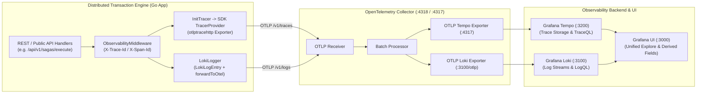

# ADR-0004: LGTM Observability Stack and OpenTelemetry Ingestion Fabric

| Field | Value |
|---|---|
| Status | Accepted |
| Date | 2026-11-02 |
| Deciders | Core Architecture Guild |
| Related ADRs | [ADR-0001 (Tech Stack)](file:///home/btpl-lap-22/live/System-Architect/distributed-transaction-engine/docs/tech-stack/ADR-0001-polyglot-execution-runtime.md) |
| Related System | [Distributed Tracing Feature](file:///home/btpl-lap-22/live/System-Architect/distributed-transaction-engine/docs/features/distributed-tracing) |

---

## 1. Context

In a distributed transaction engine spanning polyglot layers (Go, Rust, C++) and asynchronous Kafka event boundaries, failures often manifest across service hops. Without unified distributed tracing correlated directly with logs and infrastructure metrics, root-cause isolation becomes unmaintainable.

---

## 2. Decision Outcome

**Chosen option:** **OpenTelemetry Collector + LGTM Stack (Loki, Grafana, Tempo, Prometheus)**

- OpenTelemetry Collector acts as the universal ingestion gateway (OTLP HTTP/gRPC).
- Grafana Tempo provides trace span storage with native TraceQL.
- Grafana Loki indexes structured logs with `trace_id` derived fields linking directly to Tempo spans.
- Prometheus scrapes OpenTelemetry metrics, including Kafka, Redis, and PostgreSQL metrics.
- Grafana provides unified cross-signal visualization.

### Service Endpoints and Access

| Service | Port | Endpoint | Credentials | Purpose |
|---|---|---|---|---|
| Grafana UI | 3000 | `http://localhost:3000` | `admin` / `admin` | Dashboards & Trace Explorer |
| Prometheus | 9090 | `http://localhost:9090` | Anonymous | Metric targets & PromQL |
| OTel Ingestion HTTP | 4318 | `http://localhost:4318/v1/traces` | Anonymous | OTLP JSON / Protobuf traces |
| OTel Ingestion gRPC | 4317 | `localhost:4317` | Anonymous | High-throughput OTLP gRPC |
| OTel Health | 13133 | `http://localhost:13133/` | Anonymous | Collector readiness probe |
| Tempo | 3200 | `http://localhost:3200` | Anonymous | Trace storage API |
| Loki | 3100 | `http://localhost:3100` | Anonymous | Log ingestion & LogQL |

---

## 3. Distributed Tracing & Real-Time Log Pipeline Implementation

### A. Root-Cause Why Traces and Logs Were Missing in Grafana
Prior to this fix, API request failures produced no visible traces in Grafana Tempo or structured logs in Grafana Loki due to two missing pipeline links:
1. **Unregistered TracerProvider**: The application imported the OpenTelemetry API (`otel.Tracer`) but never registered an actual OpenTelemetry SDK `TracerProvider` with an OTLP trace exporter. As a result, all spans created in handlers and services dropped into OpenTelemetry's default internal `noop` tracer.
2. **Disconnected Log Shipper**: Application logs were written strictly to `stdout` without shipping to the OpenTelemetry Collector's log receiver (`http://127.0.0.1:4318/v1/logs`). Consequently, Loki received no structured log lines, and Grafana could not correlate errors with traces.

### B. Installed Dependencies & Package Upgrades (`go.mod`)
The following official OpenTelemetry Go SDK and exporter packages were installed:
- `go.opentelemetry.io/otel/sdk@v1.24.0`: Provides the core OpenTelemetry SDK, batch span processor, and resource metadata.
- `go.opentelemetry.io/otel/exporters/otlp/otlptrace/otlptracehttp@v1.24.0`: Exports trace spans over HTTP OTLP to the OpenTelemetry Collector at port `4318`.

### C. Architecture & Data Flow

### D. Features Added in Source Code
1. **Tracer Initialization in `src/main.go`**:
   - Integrated [`observability.InitTracer(rootCtx, cfg.Server.Name)`](file:///home/btpl-lap-22/live/System-Architect/distributed-transaction-engine/src/main.go#L199-L211) during startup.
   - Configured `sdktrace.WithBatcher(exporter)`, `sdktrace.WithSampler(sdktrace.AlwaysSample())`, and a graceful shutdown hook on process termination.
2. **OTLP Trace Exporter in `src/infra/observability/tracer.go`**:
   - Implemented [`InitTracer`](file:///home/btpl-lap-22/live/System-Architect/distributed-transaction-engine/src/infra/observability/tracer.go#L27) targeting `OTEL_EXPORTER_OTLP_ENDPOINT` (default `127.0.0.1:4318`), registering the global `otel.SetTracerProvider` and `TextMapPropagator`.
3. **Dual-Destination Loki Logger in `src/infra/observability/logger.go`**:
   - Logs are written locally to stdout in structured JSON format AND forwarded asynchronously to `http://<OTEL_EXPORTER_OTLP_ENDPOINT>/v1/logs`.
   - Each log entry is stamped with the exact `trace_id`, `span_id`, `tenant_id`, and error attributes, allowing 1-click drill-down from Loki logs directly to the Tempo trace in Grafana.

