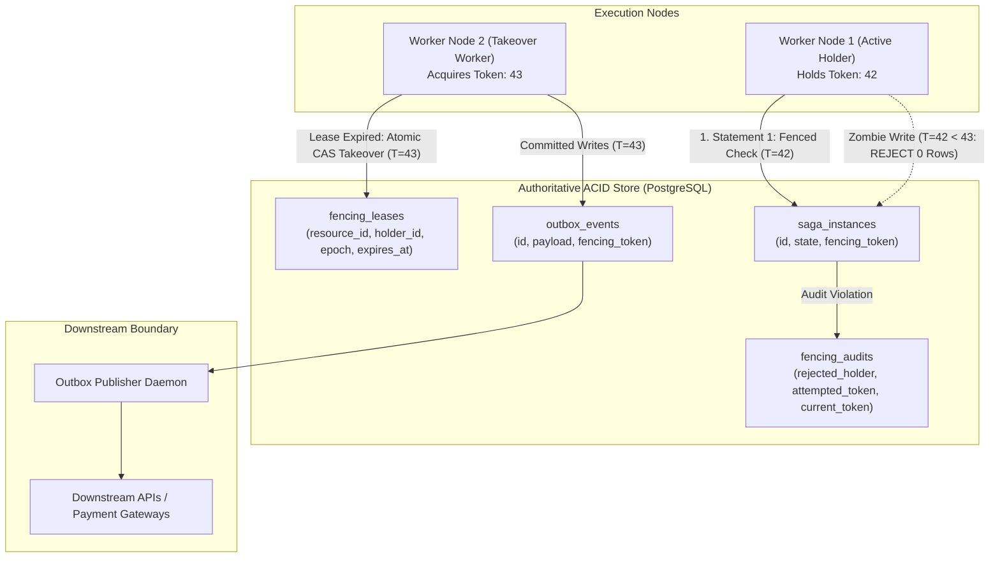
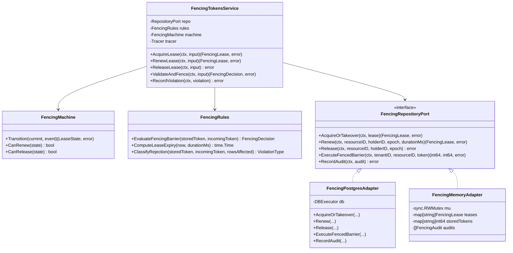
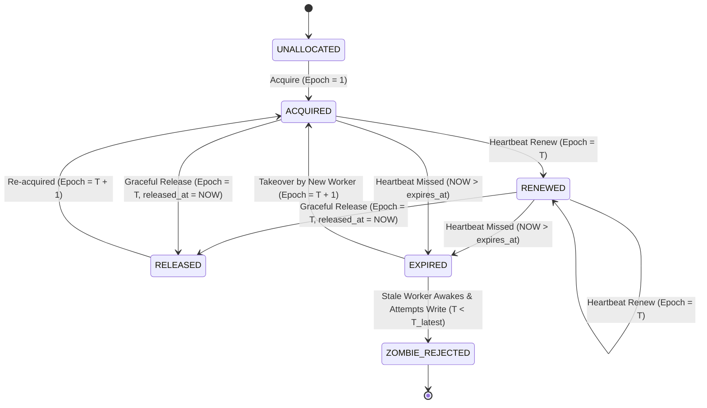
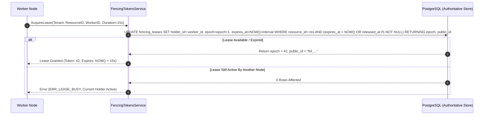
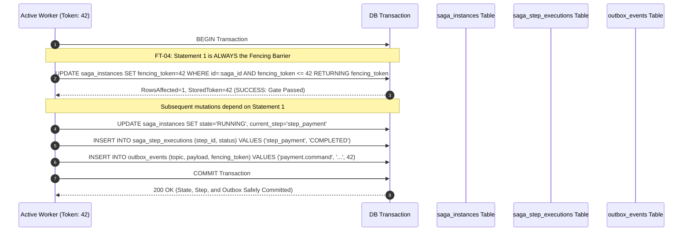
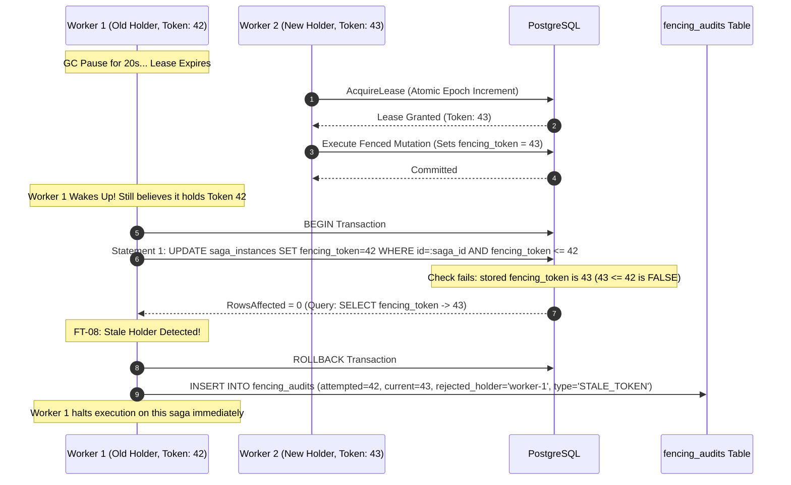

# Fencing Tokens — Architecture & System Diagrams

## 1. High-Level Architecture (HLD)

---

## 2. Low-Level Architecture (LLD)

---

## 3. Lease & Fencing Token State Machine (FSM)

---

## 4. Sequence Diagram 1: Atomic Acquisition and Token Issuance

---

## 5. Sequence Diagram 2: Fenced Protected Mutation Protocol

---

## 6. Sequence Diagram 3: Zombie Worker Interception & Quarantine

