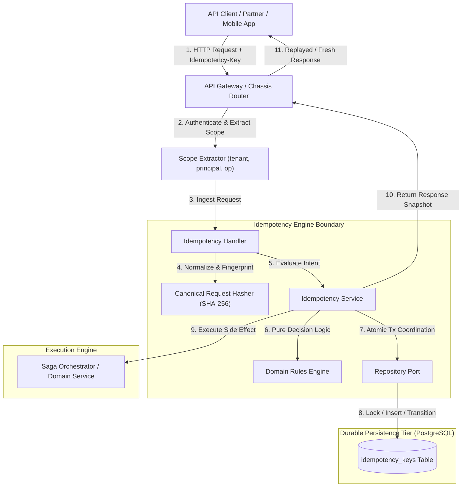
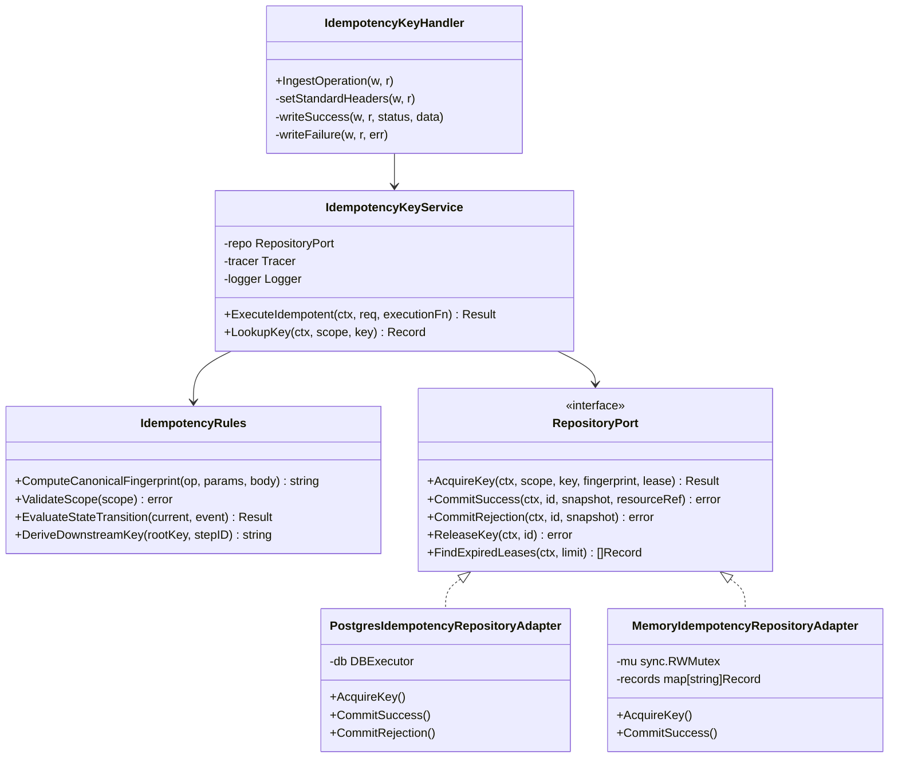
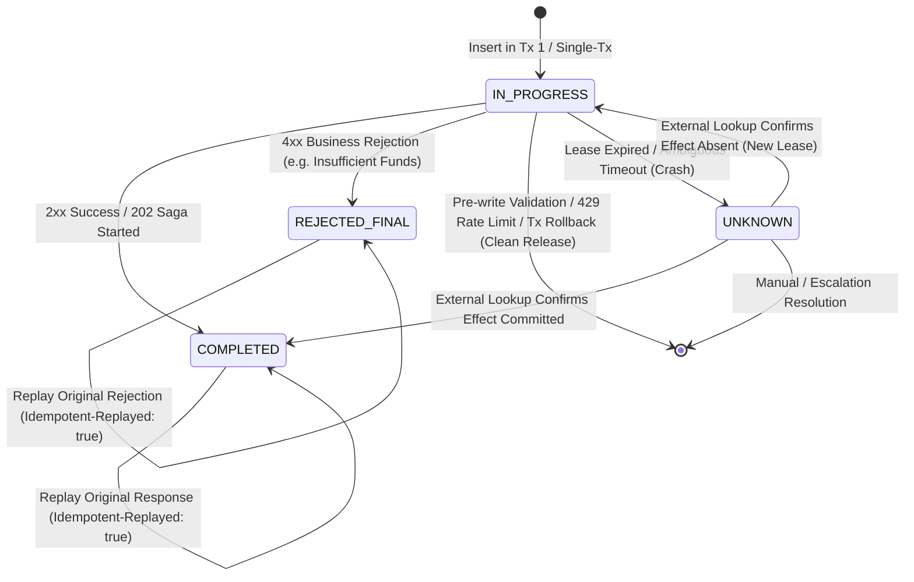
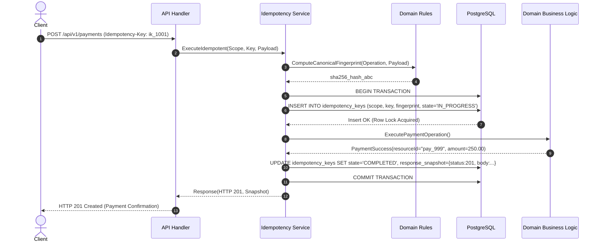
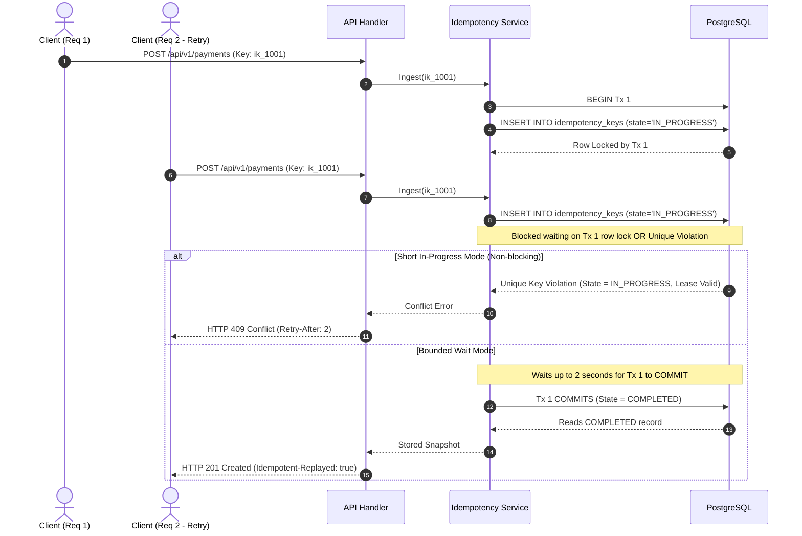
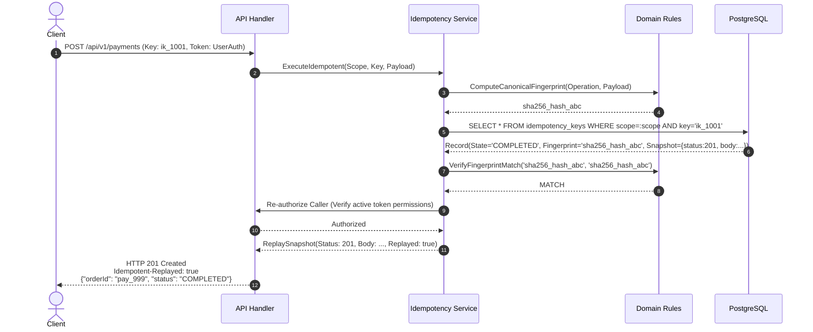
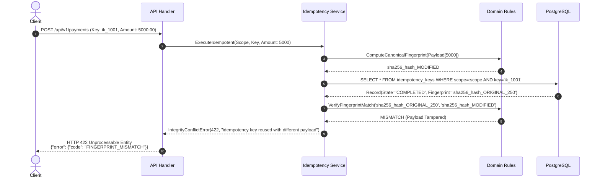

# Idempotency Keys — Architecture Diagrams

This document illustrates the High-Level Architecture, Low-Level Component Wiring, State Machine, and Sequence Diagrams for the Authoritative Idempotency Keys engine.

---

## 1. High-Level Design (HLD)

The Idempotency Keys engine acts as an authoritative, transaction-scoped gate for all state-changing API operations. It coordinates between the API Delivery Layer, the pure Domain Rules, PostgreSQL storage, and downstream execution engines (e.g. Saga Orchestrator).

---

## 2. Low-Level Component Architecture (LLD)

Hexagonal architecture decoupling HTTP routing, pure domain rules, state machine transitions, and database persistence.

---

## 3. Finite State Machine (FSM)

Authoritative lifecycle states of an idempotency key record.

---

## 4. Sequence Diagram 1: Fresh Request Execution (Single-Tx Model)

Client sends an operation with an idempotency key for the first time.

---

## 5. Sequence Diagram 2: Concurrent In-Flight Collision (Case B)

Two identical client requests arrive simultaneously before the first completes.

---

## 6. Sequence Diagram 3: Duplicate Replay with Re-Authorization (Case C)

Client retries an operation after network drop; response is re-authorized and replayed.

---

## 7. Sequence Diagram 4: Fingerprint Tamper Detection (HTTP 422 Unprocessable)

Client reuses an existing idempotency key with modified financial details.

