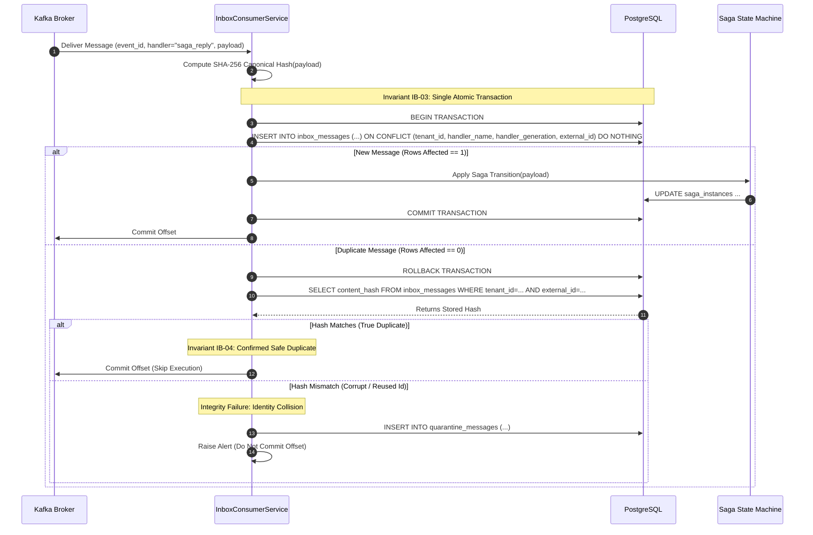

# Inbox Deduplication — Architectural & Visual Diagrams

This document contains high-level and low-level architectural diagrams for the **Inbox Deduplication Feature**, supporting [ADR-0007](file:///home/btpl-lap-22/live/System-Architect/distributed-transaction-engine/docs/features/inbox-deduplication/adr.md) and [Business Logic Tree v2](file:///home/btpl-lap-22/live/System-Architect/distributed-transaction-engine/docs/features/inbox-deduplication/business-logic.md).

---

## 1. High-Level Architecture (HLD)

The inbox deduplication layer sits at the boundary of event consumption and business transaction execution.

```mermaid
flowchart TD
    Broker(["Message Broker (Kafka / Queue)"]) -->|Deliver Message| Consumer["Reply Consumer Worker"]
    
    subgraph TransactionBoundary ["Single Database Transaction (Model M1)"]
        Consumer -->|1. Try Insert Inbox Record (ON CONFLICT DO NOTHING)| InboxTable[("inbox_messages")]
        InboxTable -->|2. Rows Affected == 1| ApplyEffect["Apply Business Mutations (saga_instances)"]
        ApplyEffect -->|3. Enqueue Next Outbox Command| Outbox[("transactional_outbox")]
    end

    subgraph DuplicateResolution ["Duplicate Path (Rows Affected == 0)"]
        Consumer -->|4. Read Stored Record| ReadStored["Read Existing Inbox Row"]
        ReadStored -->|5. Compare Hashes| HashCheck{"Stored Hash == Incoming Hash?"}
        HashCheck -->|Yes: Safe Duplicate| AckDuplicate["Acknowledge & Advance Offset (No Business Effect)"]
        HashCheck -->|No: Integrity Mismatch| Quarantine["Quarantine Message & Alert SRE (Key Held)"]
    end
```

---

## 2. Low-Level Execution Sequence Diagram



