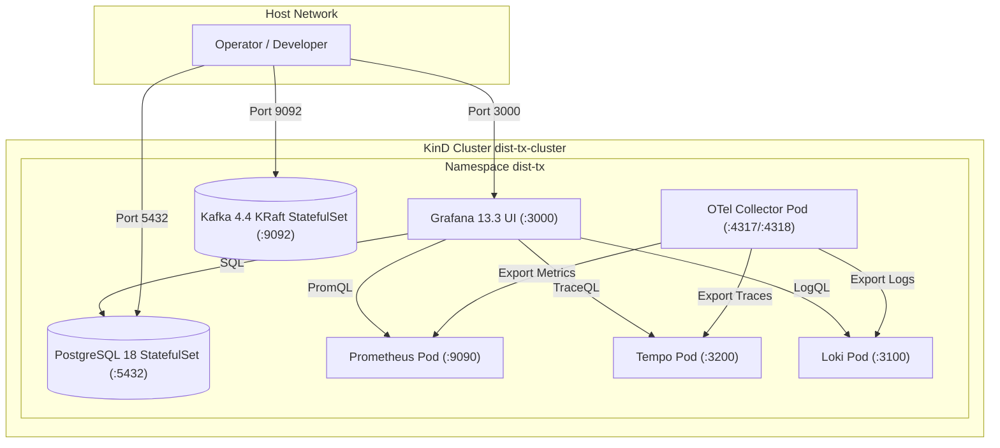

# ADR-0005: Kubernetes Cluster Deployment and In-Cluster Observability Fabric

| Field | Value |
|---|---|
| Status | Accepted |
| Date | 2026-11-02 |
| Deciders | Core Architecture Guild |
| Related ADRs | [ADR-0004 (Tech Stack)](file:///home/btpl-lap-22/live/System-Architect/distributed-transaction-engine/docs/features/tech-stack/ADR-0004-lgtm-opentelemetry-observability.md) |
| Related System | [Kubernetes Deployment & Observability](file:///home/btpl-lap-22/live/System-Architect/distributed-transaction-engine/deploy/k8s) |

---

## 1. Context

Transitioning from local Docker Compose to Kubernetes introduces service discovery differences (`svc.cluster.local`), cluster networking, and pod lifecycle semantics. 

Without an automated deployment and datasource provisioning strategy, operators encounter `Datasource not found` and `ImagePullBackOff` errors when querying Prometheus, Tempo, or Loki in Grafana.

---

## 2. Decision Outcome

**Chosen option:** **Automated Local KinD Multi-Node Architecture with Provisioned LGTM Fabric**

- **Cluster Orchestration:** Multi-node KinD cluster (`dist-tx-cluster`) mapping host ports (`8080`, `5432`, `9092`, `13133`, `3000`) to internal Kubernetes services.
- **Unified Lifecycle Runner:** [scripts/run/k8s.sh](file:///home/btpl-lap-22/live/System-Architect/distributed-transaction-engine/scripts/run/k8s.sh) coordinates zero-manual-intervention cluster creation, secret generation, manifests application, and in-cluster smoke tests.
- **Auto-Provisioned Grafana Datasources:** Mounted via `grafana-datasources` ConfigMap at `/etc/grafana/provisioning/datasources/datasources.yaml`, establishing pre-configured connections to:
  1. **Prometheus (`uid: prometheus`):** `http://prometheus:9090`
  2. **Tempo (`uid: tempo`):** `http://tempo:3200` with NodeGraph and ServiceMap enabled.
  3. **Loki (`uid: loki`):** `http://loki:3100` with derived fields mapping `trace_id` to Tempo spans.
  4. **PostgreSQL (`uid: postgres`):** `postgres:5432` (`dist_tx_engine`).

---

## 3. Kubernetes Services & In-Cluster Endpoints Directory

| Service | Pod Type | Cluster DNS Endpoint | Host Mapped Port | Purpose |
|---|---|---|---|---|
| **Grafana UI** | Deployment | `http://grafana.dist-tx.svc:3000` | `http://localhost:3000` | UI dashboards & TraceQL/LogQL explorer (User: `admin`, Password: `admin`) |
| **Prometheus** | Deployment | `http://prometheus.dist-tx.svc:9090` | `http://localhost:9090` | In-cluster PromQL metric engine |
| **Tempo** | Deployment | `http://tempo.dist-tx.svc:3200` | `tempo:3200` (internal) | Parquet columnar trace store |
| **Loki** | Deployment | `http://loki.dist-tx.svc:3100` | `loki:3100` (internal) | LogQL log ingestion & indexing |
| **PostgreSQL 18**| StatefulSet | `postgres.dist-tx.svc:5432` | `localhost:5432` | Primary ACID database (`postgres` / `supersecretpgpassword`) |
| **Apache Kafka 4.4**| StatefulSet| `kafka.dist-tx.svc:9092` | `localhost:9092` | KRaft event broker (Cluster ID: `4L622nShTUiAnsYh0mqveQ`) |
| **Redis 7.4** | Deployment | `redis.dist-tx.svc:6379` | `redis:6379` (internal) | In-memory dedup & lock store |
| **OTel Collector**| Deployment | `otel-collector.dist-tx.svc:4318` | `localhost:13133` (Health) | OTLP gRPC (`4317`) and HTTP (`4318`) receiver |

---

## 4. Execution Commands Runbook

### 1. Cluster Provisioning & Deployment
```bash
./scripts/run/k8s.sh up
```
*Creates the KinD cluster, provisions the `dist-tx` namespace, secrets, PostgreSQL 18, Kafka 4.4, Redis 7.4, Prometheus, Tempo, Loki, Grafana, and applies `deploy/k8s/base`.*

### 2. End-to-End Verification Test
```bash
./scripts/run/k8s.sh test
```
*Executes in-cluster PostgreSQL query test, Kafka KRaft message write & read, and Redis ping.*

### 3. Direct kubectl Verification Commands
```bash
# View all pods across the cluster
kubectl get pods -n dist-tx -o wide

# Test PostgreSQL in pod
kubectl exec -n dist-tx statefulset/postgres -c postgres -- psql -U postgres -d dist_tx_engine -c "SELECT version();"

# Test Kafka produce & consume inside pod
kubectl exec -n dist-tx statefulset/kafka -c kafka -- /bin/bash -c "echo 'smoke-test' | /opt/kafka/bin/kafka-console-producer.sh --bootstrap-server localhost:9092 --topic smoke-test && /opt/kafka/bin/kafka-console-consumer.sh --bootstrap-server localhost:9092 --topic smoke-test --partition 0 --offset 0 --max-messages 1"

# Forward Grafana to localhost:3000
kubectl port-forward svc/grafana 3000:3000 -n dist-tx
```

---

## 5. Architectural Topology Diagram


