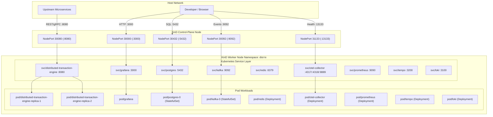
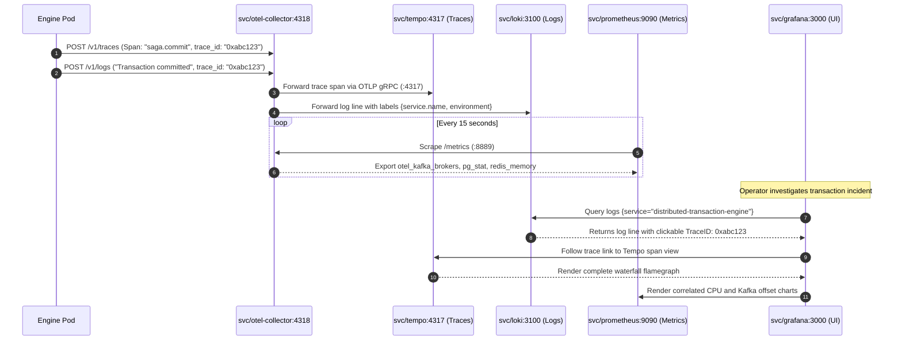
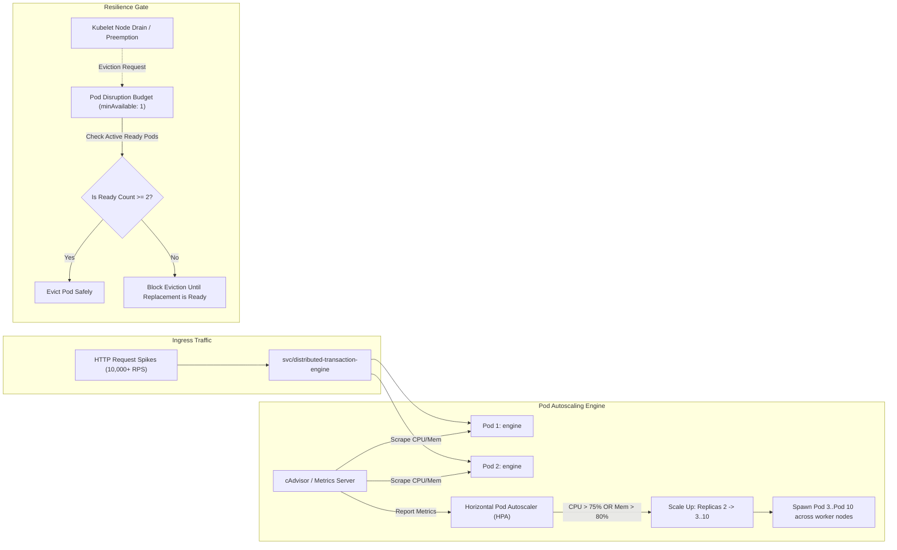

# Kubernetes Architecture, Network Topology & Component Connection Diagrams

## 1. End-to-End Ingress, NodePort & Service Discovery Architecture

This diagram details the connection logic from external clients down to individual pod network namespaces across KinD nodes.



---

## 2. In-Cluster Telemetry Pipeline & Cross-Service Correlation

This sequence details how logs, traces, and metrics flow across the OpenTelemetry Collector into Tempo, Loki, and Prometheus, and how Grafana correlates them.



---

## 3. Component Relationship & Storage Dependency Matrix

This diagram maps how the polyglot engine interacts with the primary database, distributed cache, and event broker inside the cluster.

```mermaid
graph TD
    subgraph Transaction Engine Pod
        GoLayer["Go 1.23 DAG Scheduler"]
        RustLayer["Rust 1.81 State Machine & Outbox"]
        CppLayer["C++20 Rollback Kernel"]
    end

    subgraph State & Coordination
        Redis[("Redis 7.4 (Idempotency Keys & Lock Fencing)")]
        PG[("PostgreSQL 18 (ACID Ledger & Outbox Table)")]
        Kafka[("Apache Kafka 4.4 (KRaft Partitioned Event Bus)")]
    end

    GoLayer -->|1. Check / Acquire Lock| Redis
    GoLayer -->|2. Invoke Invariants| RustLayer
    RustLayer -->|3. Calculate Compensation| CppLayer
    RustLayer -->|4. Atomic Commit (State + Outbox)| PG
    RustLayer -->|5. Relay Outbox Event| Kafka
    Kafka -.->|6. Kafka Partition Lag Scrape| OTelCol["OTel Collector Pod"]
```

---

## 4. Horizontal Pod Autoscaler (HPA) & Pod Disruption Budget (PDB) Topology

This diagram visualizes autoscaling trigger mechanics and pod eviction safety rules.


