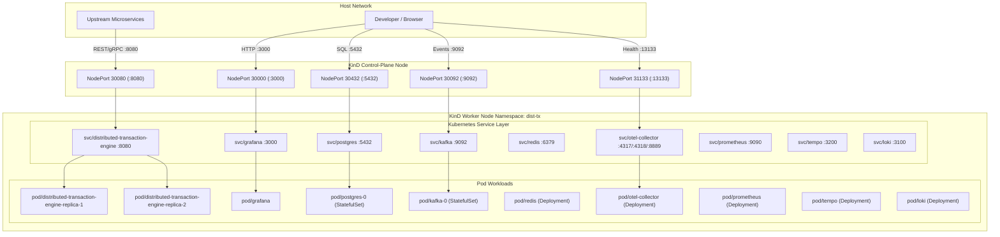
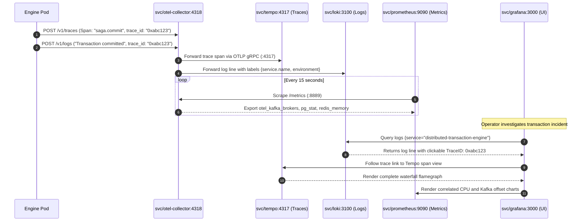
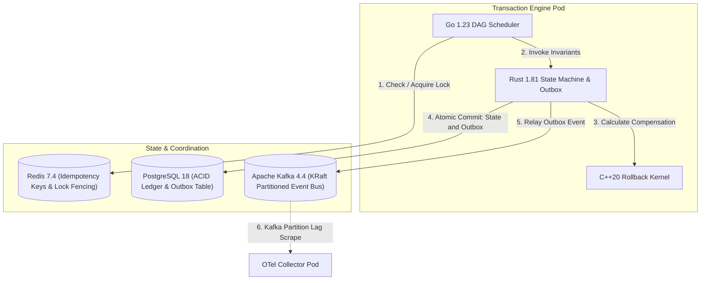
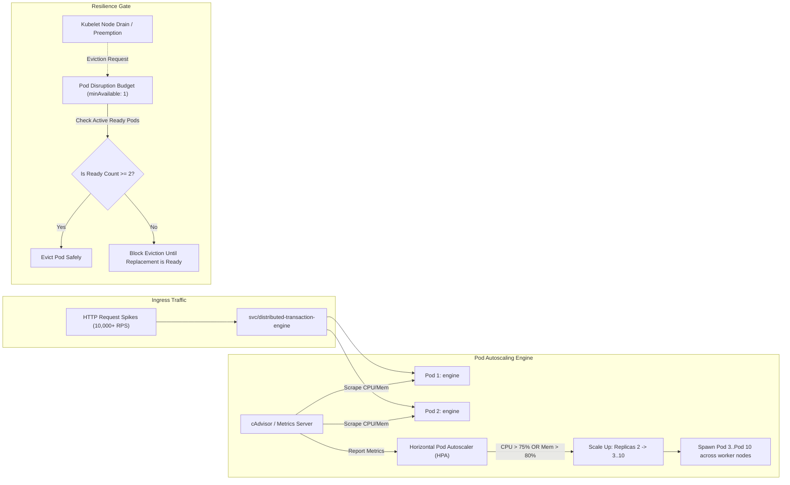

# Kubernetes Architecture, Network Topology & Component Connection Diagrams

## 1. End-to-End Ingress, NodePort & Service Discovery Architecture

This diagram details the connection logic from external clients down to individual pod network namespaces across KinD nodes.



---

## 2. In-Cluster Telemetry Pipeline & Cross-Service Correlation

This sequence details how logs, traces, and metrics flow across the OpenTelemetry Collector into Tempo, Loki, and Prometheus, and how Grafana correlates them.



---

## 3. Component Relationship & Storage Dependency Matrix

This diagram maps how the polyglot engine interacts with the primary database, distributed cache, and event broker inside the cluster.



---

## 4. Horizontal Pod Autoscaler (HPA) & Pod Disruption Budget (PDB) Topology

This diagram visualizes autoscaling trigger mechanics and pod eviction safety rules.



---

## 5. Traffic Flow: Before Scaling vs. After Scaling

This comparison illustrates how Kubernetes `kube-proxy`, `iptables`/IPVS routing, and endpoints balance traffic before vs. after HPA scales the engine deployment.

### A. Steady State Traffic (Before Scaling — 2 Replicas)

In normal traffic conditions (low CPU/Memory), Kubernetes maintains 2 endpoints evenly splitting the connection load (50% / 50%).

```mermaid
graph TB
    subgraph Client Traffic Tier
        Client["Incoming Requests (1,000 RPS)"]
    end

    subgraph Kubernetes Service & Routing (Before Scaling)
        Svc["svc/distributed-transaction-engine (ClusterIP: 10.96.6.65)"]
        KubeProxy["kube-proxy iptables rules (2 Endpoints)"]
    end

    subgraph Pod Workloads (2 Replicas)
        Pod1["Pod 1: engine-544d-1 (IP: 10.244.1.5) [50% Traffic]"]
        Pod2["Pod 2: engine-544d-2 (IP: 10.244.1.6) [50% Traffic]"]
    end

    subgraph Datastore Connections (Steady State)
        PG[("PostgreSQL 18 (:5432)")]
        Kafka[("Apache Kafka 4.4 (:9092)")]
        Redis[("Redis 7.4 (:6379)")]
    end

    Client --> Svc --> KubeProxy
    KubeProxy -->|Route 50%| Pod1
    KubeProxy -->|Route 50%| Pod2

    Pod1 -->|Conn Pool: 10| PG & Kafka & Redis
    Pod2 -->|Conn Pool: 10| PG & Kafka & Redis
```

---

### B. High Surge Traffic & Network Flow (After Scaling — 6 Replicas)

When traffic surges (e.g. 15,000 RPS) and CPU exceeds 75%, HPA scales the deployment to 6 replicas. The Kubernetes Endpoints controller updates iptables chains across all nodes, dynamically distributing traffic (16.6% per pod) with connection pool protection.

```mermaid
graph TB
    subgraph Client Traffic Tier
        SurgeClient["High Surge Requests (15,000+ RPS)"]
    end

    subgraph Kubernetes Service & Dynamic Load Distribution
        Svc["svc/distributed-transaction-engine (ClusterIP: 10.96.6.65)"]
        EndpointsController["Endpoints Controller (Endpoints Slice Updated)"]
        IPTables["kube-proxy iptables chain (Randomized Round-Robin ~16.6%)"]
    end

    subgraph Scaled Out Pod Replicas (6 Active Pods)
        Pod1["Pod 1 (10.244.1.5) [~16.6%]"]
        Pod2["Pod 2 (10.244.1.6) [~16.6%]"]
        Pod3["Pod 3 (10.244.1.20) [~16.6%]"]
        Pod4["Pod 4 (10.244.1.21) [~16.6%]"]
        Pod5["Pod 5 (10.244.1.22) [~16.6%]"]
        Pod6["Pod 6 (10.244.1.23) [~16.6%]"]
    end

    subgraph Backend Coordination & Backpressure Control
        Redis[("Redis 7.4 (Distributed Idempotency Keys)")]
        PG[("PostgreSQL 18 (PgBouncer Pool / Max Conn Guard)")]
        Kafka[("Apache Kafka 4.4 (KRaft Hashed Partitions 0..5)")]
    end

    SurgeClient --> Svc
    Svc --> EndpointsController --> IPTables
    
    IPTables --> Pod1
    IPTables --> Pod2
    IPTables --> Pod3
    IPTables --> Pod4
    IPTables --> Pod5
    IPTables --> Pod6

    Pod1 & Pod2 & Pod3 & Pod4 & Pod5 & Pod6 -->|Sub-millisecond Lock Tokens| Redis
    Pod1 & Pod2 & Pod3 & Pod4 & Pod5 & Pod6 -->|Transactional Outbox INSERT| PG
    Pod1 & Pod2 & Pod3 & Pod4 & Pod5 & Pod6 -->|Produce Hashed on tx_id| Kafka
```

