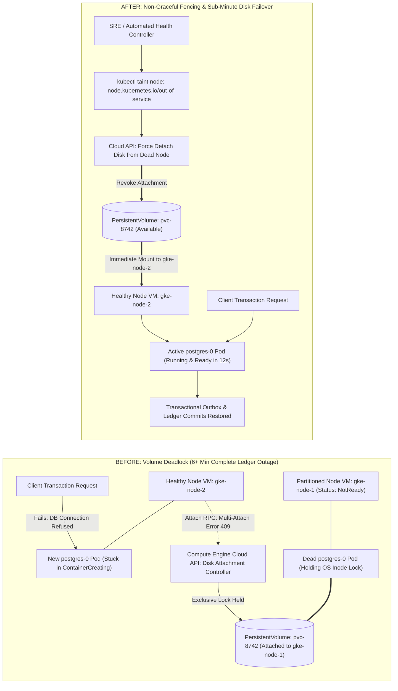
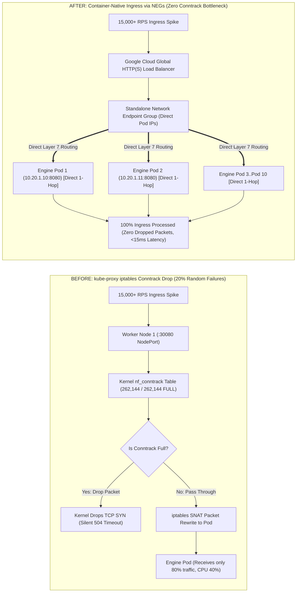
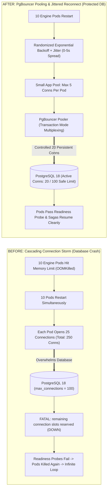
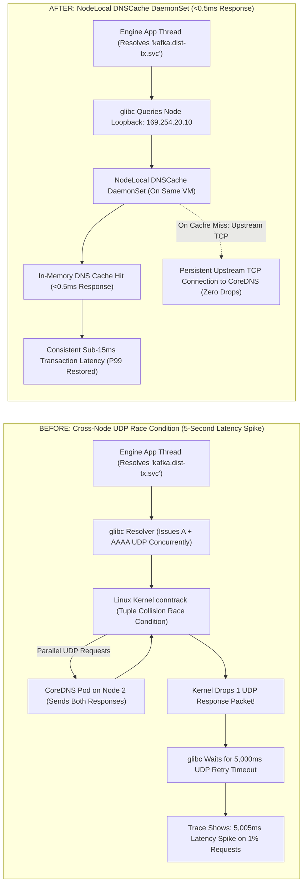

# Kubernetes Failure-First Root Cause Analysis & Deep-Dive Runbook

This document details critical real-world failure modes encountered in production Kubernetes deployments for the high-throughput polyglot Distributed Transaction Engine. For each failure mode, this guide covers the real-user scenario, root cause, exact resolution runbook, and an exhaustive, side-by-side Before-vs-After architecture diagram illustrating packet paths, state transitions, and component interactions.

---

## 1. StatefulSet Volume Deadlock (`Multi-Attach error for volume`)

### A. Real-User Scenario
A worker node running the primary PostgreSQL 18 StatefulSet pod (`postgres-0`) abruptly experiences a hardware kernel freeze or network partition. Kubernetes detects the node as `NotReady` and attempts to reschedule `postgres-0` onto a healthy node. However, the new pod remains stuck permanently in `ContainerCreating` with the following Kubelet event:
```
Warning  FailedAttachVolume  AttachVolume.Attach failed for volume "pvc-8742": 
         Volume "pvc-8742" is already exclusively attached to one node and can't be attached to another
```
The database is completely down, blocking all transaction commits and locking the saga state machine.

### B. Root Cause
Cloud persistent disks (`ReadWriteOnce`) can only be attached to a single VM at a time. Because the partitioned node did not cleanly unmount and detach the disk before failing, Google Cloud Compute Engine still considers the volume attached to the dead VM. The Kubernetes `attach-detach-controller` will wait up to 6 minutes by default before forcefully detaching the volume.

### C. How Real Engineers Solve It
1. **Immediate Disaster Recovery Command**: Apply the non-graceful node shutdown taint to signal Kubelet that the dead VM is gone, forcing the volume detachment immediately:
   ```bash
   # 1. Verify the partitioned node status
   kubectl get nodes

   # 2. Apply out-of-service taint to release volume locks
   kubectl taint nodes <DEAD_NODE_NAME> node.kubernetes.io/out-of-service=nodeshutdown:NoExecute

   # 3. If necessary, forcefully delete the stuck terminating pod
   kubectl delete pod postgres-0 -n dist-tx --force --grace-period=0
   ```
2. **Permanent Preventive Configuration**: Configure `podManagementPolicy: OrderedReady` and configure an automated Node Health Check controller (MHC) to handle automated fencing.

### D. Side-by-Side: Before vs. After Failure Resolution



---

## 2. `kube-proxy` iptables Conntrack Table Exhaustion

### A. Real-User Scenario
During a 15,000+ RPS transaction spike, upstream services and clients suddenly experience random HTTP `504 Gateway Timeout` errors. Looking at pod metrics, CPU is below 50% and memory is plenty, yet the cluster drops 20% of incoming requests. The node `dmesg` logs contain:
```
nf_conntrack: table full, dropping packet
```

### B. Root Cause
In standard Kubernetes `iptables` mode, every single incoming TCP connection and NAT rewrite occupies an entry in the Linux kernel `nf_conntrack` table. When traffic surges, short-lived HTTP connections keep conntrack entries in `TIME_WAIT` for up to 120 seconds. Once `nf_conntrack_count >= nf_conntrack_max`, the Linux kernel unconditionally drops all new incoming TCP SYN packets before they ever reach the container socket.

### C. How Real Engineers Solve It
1. **Immediate Kernel Tuning Command**:
   ```bash
   # Check current conntrack count vs max limit on the worker node
   sysctl net.netfilter.nf_conntrack_count net.netfilter.nf_conntrack_max

   # Quadruple the conntrack table size dynamically
   sudo sysctl -w net.netfilter.nf_conntrack_max=1048576

   # Reduce TCP established and time-wait timeouts
   sudo sysctl -w net.netfilter.nf_conntrack_tcp_timeout_established=300
   sudo sysctl -w net.netfilter.nf_conntrack_tcp_timeout_time_wait=30
   ```
2. **Permanent Architectural Solution**: Bypass `kube-proxy` completely by using Google Cloud container-native Network Endpoint Groups (NEGs), which route packets directly from the Google Cloud Load Balancer straight into the Pod IP without node-level SNAT.

### D. Side-by-Side: Before vs. After Failure Resolution



---

## 3. Cascading OOMKill & PostgreSQL Connection Storm

### A. Real-User Scenario
A sudden complex query or payload burst causes 10 engine pods to hit their container memory limit (`limits.memory: 2Gi`). Kubernetes sends `SIGKILL` (Exit Code 137). When Kubernetes restarts all 10 pods simultaneously, the entire system crashes: PostgreSQL stops accepting queries, returning:
```
FATAL: remaining connection slots are reserved for non-replication superuser connections
```
Every application pod fails its `/healthz` readiness probe, triggering an infinite restart crash loop.

### B. Root Cause
Each restarting engine replica establishes its database connection pool upon boot. If 10 pods with `max_connections = 25` boot at the exact same moment, 250 connections hit PostgreSQL simultaneously. PostgreSQL exceeds its configured `max_connections = 100`, refusing connections and crashing all dependent microservices.

### C. How Real Engineers Solve It
1. **Immediate Remediation Command**: Terminate idle connection sessions directly in PostgreSQL:
   ```bash
   # Terminate all non-active connections taking up connection slots
   kubectl exec -i -n dist-tx statefulset/postgres -c postgres -- psql -U postgres -d dist_tx_engine -c "
   SELECT pg_terminate_backend(pid) 
   FROM pg_stat_activity 
   WHERE state = 'idle' AND pid <> pg_backend_pid();"
   ```
2. **Permanent Architectural Solution**: Deploy a PgBouncer connection pooler between the engine pods and PostgreSQL. Limit the engine's application-level pool to 5–10 connections, and configure randomized exponential reconnect backoff with full jitter.

### D. Side-by-Side: Before vs. After Failure Resolution



---

## 4. CoreDNS UDP Query Drops & 5-Second Latency Spikes

### A. Real-User Scenario
Engineers observe that 99% of transactions complete in 15ms, but exactly 1% of transactions randomly take 5,005ms (a clean 5-second delay). Distributed traces in Tempo reveal that the 5-second delay occurs during the internal hostname lookup for `kafka.dist-tx.svc.cluster.local`.

### B. Root Cause
Linux `glibc` issues A and AAAA DNS queries concurrently via UDP. Due to a well-known race condition in the Linux kernel `nf_conntrack` module, when two UDP packets with the same tuple are sent simultaneously, one of the replies is dropped by the kernel as an invalid state transition. `glibc` then waits for its 5-second UDP retransmit timeout before retrying.

### C. How Real Engineers Solve It
1. **Immediate Pod Workaround**: Inject `single-request-reopen` into the pod's `dnsConfig`:
   ```yaml
   dnsConfig:
     options:
       - name: single-request-reopen
       - name: ndots
         value: "2"
   ```
2. **Permanent Cluster-Wide Solution**: Deploy the `node-local-dns` DaemonSet. It runs a lightweight DNS caching agent on each node VM listening on loopback IP `169.254.20.10`, using persistent TCP connections to upstream CoreDNS pods and completely eliminating UDP packet race conditions.

### D. Side-by-Side: Before vs. After Failure Resolution


