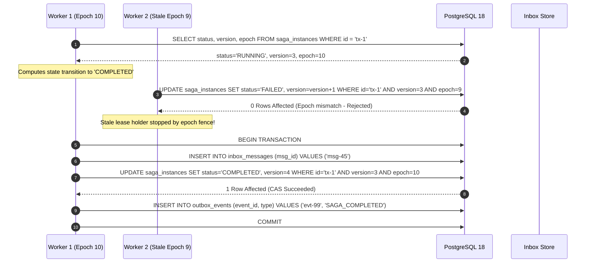
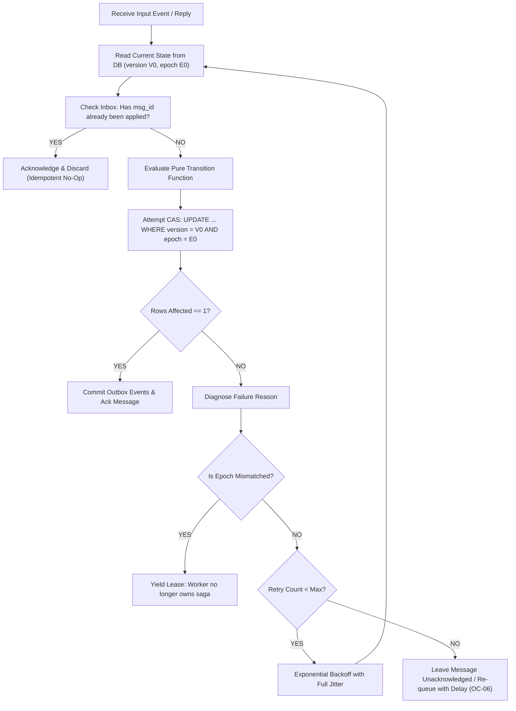
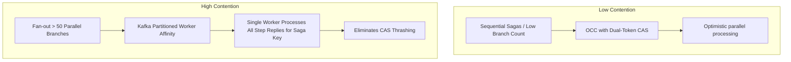

# Optimistic Concurrency Control — Architecture Diagrams & Workflows

## 1. Dual-Token CAS Transition Sequence

---

## 2. OCC Conflict Retry & Inbox Re-Check Loop

---

## 3. Contention Strategy Boundary (OCC vs Partition Serialization)

