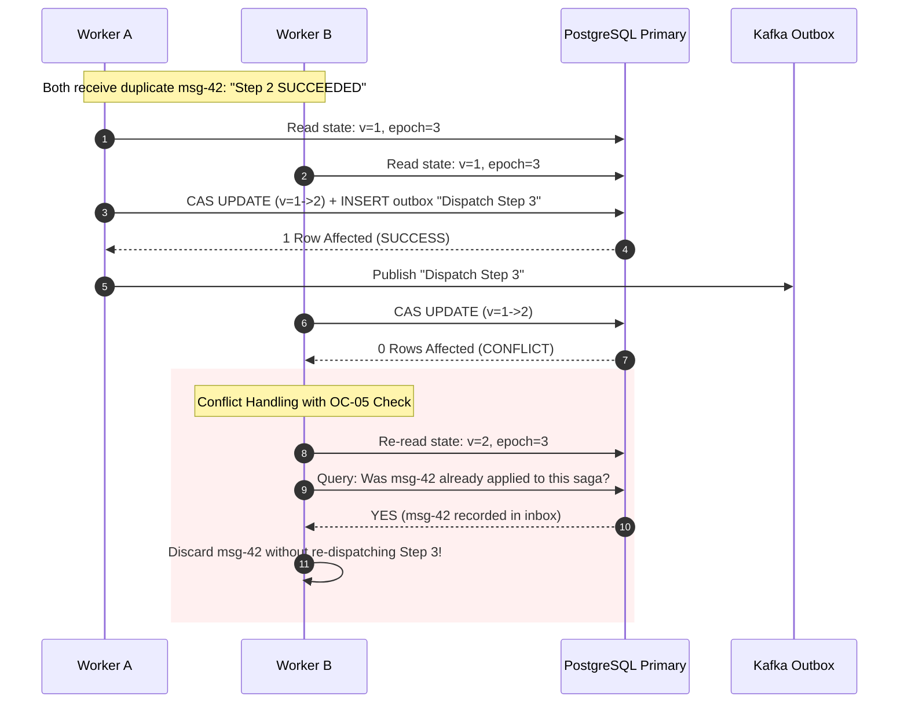

# Optimistic Concurrency Control — Failure Cases, Contention Storms & Mitigations

This document outlines failure modes, race conditions, edge cases, and architectural mitigations for the engine's Optimistic Concurrency Control (OCC) mechanism.

---

## 1. Failure Modes & Resilience Matrix

| Failure ID | Scenario / Trigger | Impact | Invariants Challenged | Architectural Mitigation & Detection |
|---|---|---|---|---|
| **FAIL-OC-001** | **Duplicate Transition on Conflict Retry**: Worker A and Worker B both receive identical step completion messages (Kafka redelivery). Worker A wins CAS. Worker B conflicts, re-reads new version, and re-executes the transition against the new version. | The next workflow step is dispatched a second time, or duplicate compensation commands are emitted. | **OC-05** | **Mitigation:** Pre-computation idempotency check. Inside the retry loop, before re-evaluating state transitions, Worker B queries the `inbox_messages` table for `(tenant_id, message_id)`. If present, Worker B acknowledges the message and exits cleanly without re-executing. |
| **FAIL-OC-002** | **Stale Lease Holder (Zombie Worker) Overwrite**: Worker A pauses due to a 45s GC pause; Worker B acquires lease (epoch increments). Worker A awakens, re-reads version, and attempts CAS. | If CAS checks only `version`, Worker A can commit invalid transitions despite having lost its lease. | **OC-01** | **Mitigation:** Dual-token CAS checking both `version` AND `epoch`. Because Worker B incremented `epoch` from 4 to 5, Worker A's update with `epoch = 4` matches 0 rows and fails immediately. |
| **FAIL-OC-003** | **Dropped Internal Engine Event on CAS Exhaustion**: Step reply encounters 3 consecutive CAS conflicts. Worker code treats exhaustion as "drop and log error". | Kafka offset is committed, but the step transition was never applied. The saga hangs waiting for a reply that will never arrive. | **OC-06** | **Mitigation:** Strict separation of client vs internal exhaustion: external HTTP requests return `409 Conflict`; internal Kafka engine messages are **never** dropped or acknowledged. The partition consumer pauses or routes the message to an immediate retry topic with backoff. |
| **FAIL-OC-004** | **Orphaned Child Mutation (Lost Step Update)**: Worker updates child table `saga_step_executions` without touching or locking `saga_instances`. Another worker simultaneously reads `saga_instances`, sees old version, and transitions saga to `COMPLETED`. | A completed step outcome is overwritten or ignored during saga completion decision. | **OC-02** | **Mitigation:** Every transaction modifying any step execution, timer, or compensation record must execute `UPDATE saga_instances SET version = version + 1 WHERE id = :id` within the exact same database transaction. |
| **FAIL-OC-005** | **Live-Lock Contention Storm in Parallel Fan-Out**: A workflow fans out to 50 parallel branches. All 50 branches complete within 10ms of each other and bombard PostgreSQL with CAS updates against the same saga root row. | Severe CAS thrashing; workers exhaust retries; high CPU load on PostgreSQL; throughput collapses. | **Section 2, E2.1** | **Mitigation:** Workflows with high fan-out must be partitioned by `saga_id` at the Kafka topic level so all step completion replies for a given saga are consumed sequentially by a single designated worker instance, eliminating concurrent writes entirely. |
| **FAIL-OC-006** | **Stale Snapshot Read from Read-Replica**: Orchestrator worker reads saga state from a read-replica suffering 250ms replication lag before attempting CAS on primary. | 100% of CAS attempts fail on primary because `expected_version` is always behind. | **OC-08** | **Mitigation:** All decision-making reads for state transitions must query the PostgreSQL primary node directly, bypassing asynchronous read replicas. |

---

## 2. Deep Dive: Duplicate Dispatch Prevention During CAS Retry



---

## 3. Prometheus Metrics & Alerting for OCC Contention

The engine instruments OCC behavior with the following Prometheus metrics:

* `saga_occ_cas_attempts_total{tenant_id, status="success|conflict"}`: Tracks CAS efficiency.
* `saga_occ_retry_exhaustion_total{tenant_id, saga_type}`: Incremented when an event exhausts max CAS retries.
* **Alert Rule:**
  ```yaml
  - alert: SagaOCCContentionHigh
    expr: rate(saga_occ_cas_attempts_total{status="conflict"}[5m]) / rate(saga_occ_cas_attempts_total[5m]) > 0.25
    for: 3m
    labels:
      severity: warning
    annotations:
      summary: "High OCC conflict rate detected (>25% aborts)"
      description: "Saga engine is experiencing high write contention on aggregate roots. Consider switching workflow type to partition serialization."
  ```

