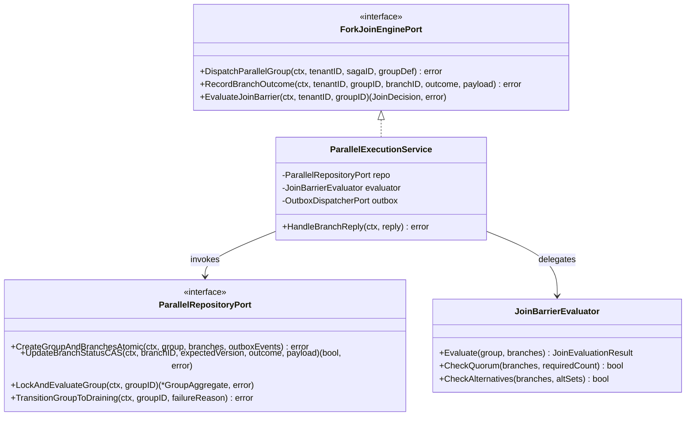
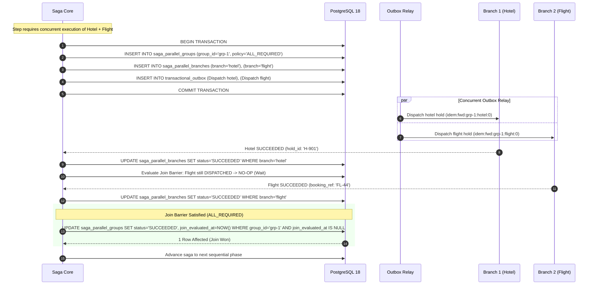
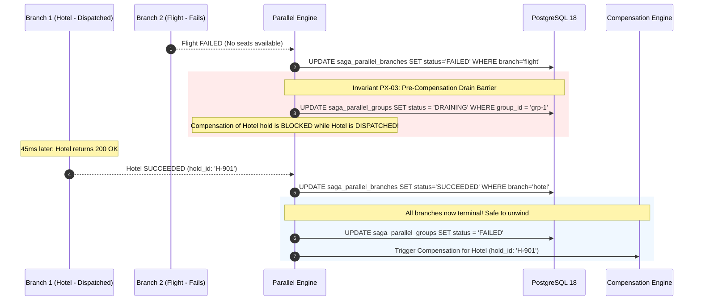
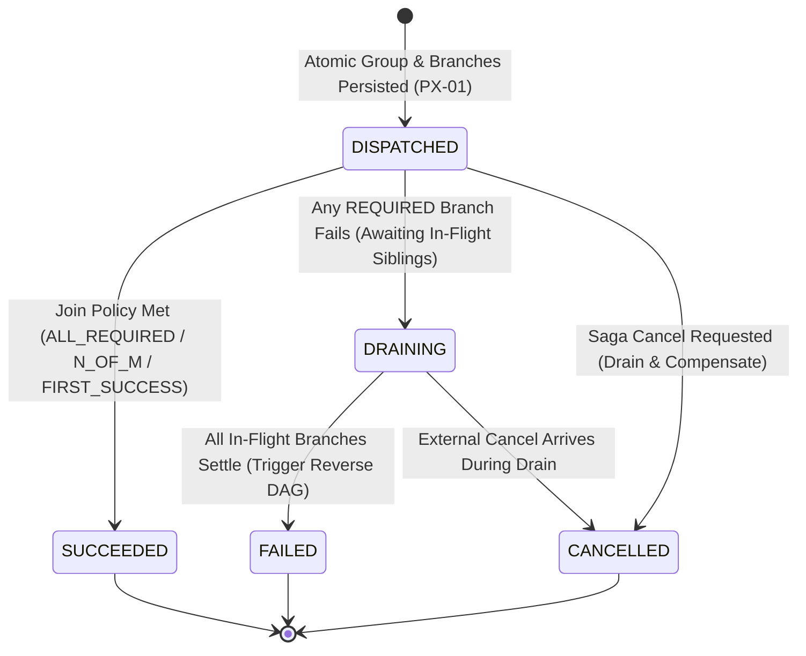

# Parallel Execution — Architectural & Visual Diagrams

This document contains architectural blueprints, component models, and execution workflows for the **High-Throughput Parallel (Fork-Join) Execution Engine**, supporting [ADR-0010](file:///home/btpl-lap-22/live/System-Architect/distributed-transaction-engine/docs/features/parallel-execution/adr.md) and [Business Logic Decision Tree v2](file:///home/btpl-lap-22/live/System-Architect/distributed-transaction-engine/docs/features/parallel-execution/business-logic.md).

---

## 1. High-Level Architecture (HLD): Parallel Fork-Join Engine

```mermaid
flowchart TB
    subgraph IngressGateway ["Saga Engine Ingress"]
        Orchestrator["Saga Orchestrator Core"] -->|Evaluate Step: PARALLEL_GROUP| ForkEngine["ParallelForkEngine"]
    end

    subgraph AtomicFork ["Atomic PostgreSQL Fork Transaction (PX-01)"]
        ForkEngine -->|1. INSERT Group Header| DB_Group[("saga_parallel_groups<br/>status: DISPATCHED, join: ALL_REQUIRED")]
        ForkEngine -->|2. Bulk INSERT N Branches| DB_Branches[("saga_parallel_branches<br/>status: DISPATCHED (N rows)")]
        ForkEngine -->|3. Bulk INSERT Outbox Commands| DB_Outbox[("transactional_outbox<br/>N dispatch commands")]
    end

    subgraph AsynchronousFabric ["Asynchronous Dispatch Fabric"]
        DB_Outbox --> Relay["Outbox Relay"]
        Relay -->|Fan-Out Dispatch| KafkaTopics["Kafka Worker Topics"]
        KafkaTopics --> Worker1["Branch 1: Hotel Booking"]
        KafkaTopics --> Worker2["Branch 2: Flight Booking"]
        KafkaTopics --> Worker3["Branch 3: Car Rental"]
    end

    subgraph JoinBarrierLayer ["Join Barrier & Drain Synchronization"]
        Worker1 -->|Reply: SUCCEEDED| JoinConsumer["Branch Outcome Consumer"]
        Worker2 -->|Reply: SUCCEEDED| JoinConsumer
        Worker3 -->|Reply: FAILED| JoinConsumer
        JoinConsumer -->|Evaluate Join Policy (PX-05)| JoinEvaluator["JoinBarrierEvaluator"]
        JoinEvaluator -->|All Required Met?| DB_Group
        JoinEvaluator -->|Required Branch Failed -> Enter DRAINING| DrainBarrier["Pre-Compensation Drain Barrier (PX-03)"]
    end
```

---

## 2. Low-Level Component Model (LLD)



---

## 3. Atomic Fork & Join Synchronization Sequence



---

## 4. Failure Drain Barrier Sequence (Pre-Compensation Safety)



---

## 5. Parallel Group Lifecycle State Machine



