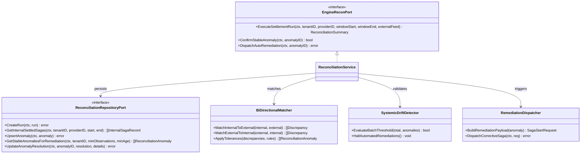
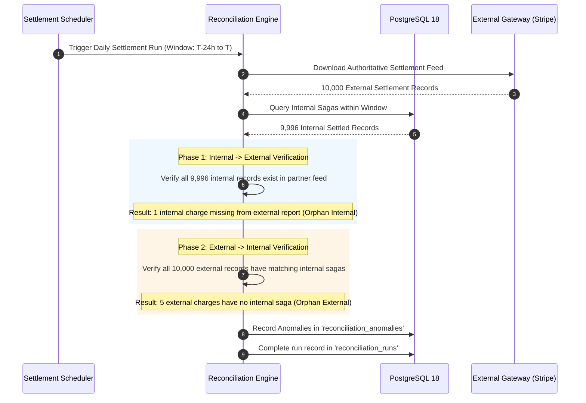
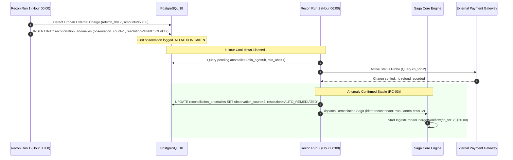
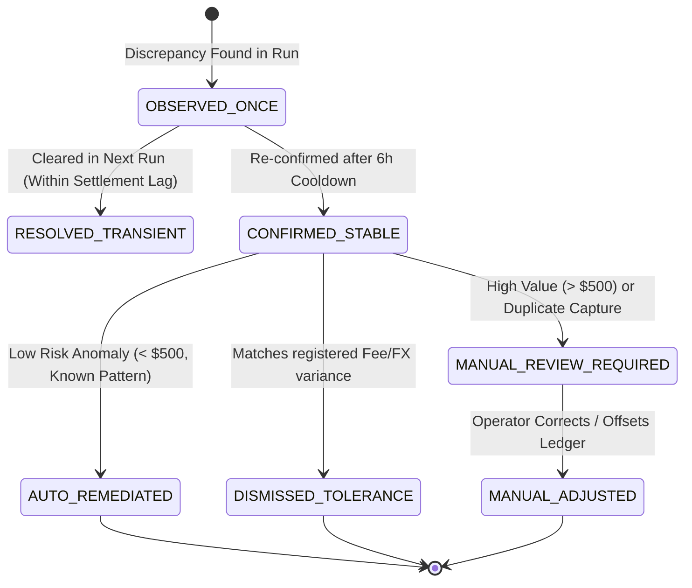

# Reconciliation Engine — Architectural & Visual Diagrams

This document contains architectural diagrams and execution workflows for the **Bi-Directional Financial Reconciliation Engine**, supporting [ADR-0007](file:///home/btpl-lap-22/live/System-Architect/distributed-transaction-engine/docs/features/reconciliation-engine/adr.md) and [Business Logic Decision Tree v2](file:///home/btpl-lap-22/live/System-Architect/distributed-transaction-engine/docs/features/reconciliation-engine/business-logic.md).

---

## 1. High-Level Architecture (HLD): Bi-Directional Ingestion Pipeline

```mermaid
flowchart TB
    subgraph ExternalSources ["External Providers & Banking Rails"]
        StripeReport["Stripe Settlement CSV / Feed"]
        BankFeed["Bank BAI2 / MT940 CAMT.053"]
        AdyenFeed["Adyen Financial Journal"]
    end

    subgraph IngestionAdapters ["Ingestion & Normalization Layer"]
        StripeAdapter["StripeSettlementParser"]
        BankAdapter["BankReportParser"]
        StripeReport --> StripeAdapter
        BankFeed --> BankAdapter
        AdyenFeed --> StripeAdapter
    end

    subgraph InternalSources ["Internal Transaction Datastores"]
        SagaStore[("PostgreSQL 18: saga_instances")]
        LedgerStore[("Accounting Ledger DB")]
    end

    subgraph ReconciliationCore ["Reconciliation Engine Core"]
        Matcher["Bi-Directional Matching Engine"]
        ToleranceRules["Fee & FX Tolerance Evaluator"]
        StabilityTracker["Two-Phase Anomaly Tracker"]
        
        Matcher --> ToleranceRules
        ToleranceRules --> StabilityTracker
    end

    IngestionAdapters -->|Normalized Settlement Records| Matcher
    InternalSources -->|Internal Completed/Failed Records| Matcher

    subgraph StorageAndAudit ["Audit & Anomaly Datastore"]
        StabilityTracker --> DB_Runs[("reconciliation_runs")]
        StabilityTracker --> DB_Anomalies[("reconciliation_anomalies")]
    end

    subgraph RemediationLayer ["Automated Remediation"]
        StabilityTracker -->|Stable Anomaly Confirmed (count >= 2)| RemediationDispatcher["Remediation Sagas Dispatcher"]
        RemediationDispatcher -->|Dispatch Corrective Outbox Event| SagaEngine["Saga Orchestrator Core"]
        StabilityTracker -->|Anomaly Rate > 5%| CircuitBreaker["Systemic Outage Circuit Breaker"]
        CircuitBreaker -->|P1 Alert| PagerDuty["On-Call & Finance Operations"]
    end
```

---

## 2. Low-Level Component Model (LLD)



---

## 3. Bi-Directional Matching Sequence Flow



---

## 4. Two-Phase Stable Anomaly Confirmation & Remediation



---

## 5. Anomaly Lifecycle State Machine



