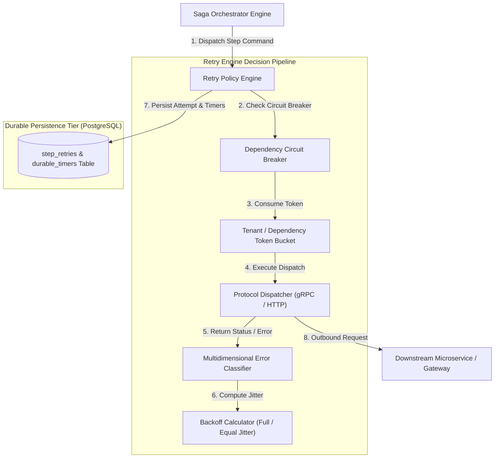
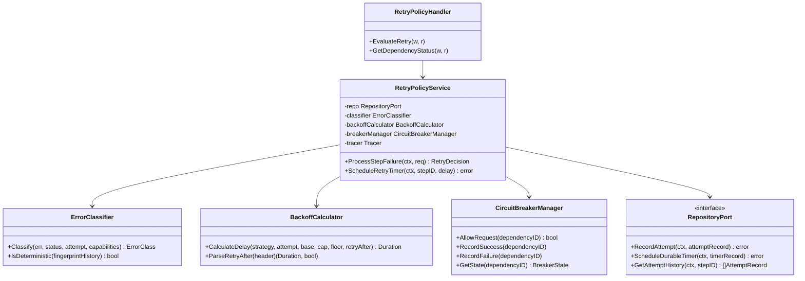
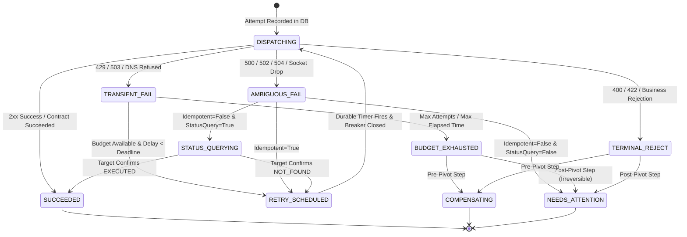
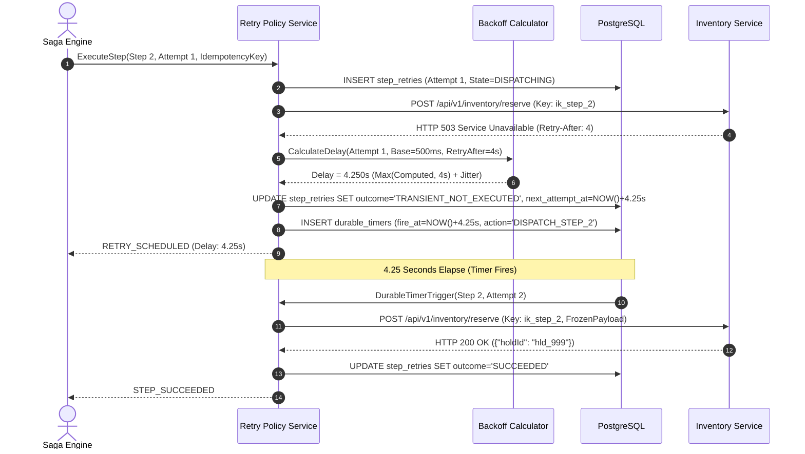
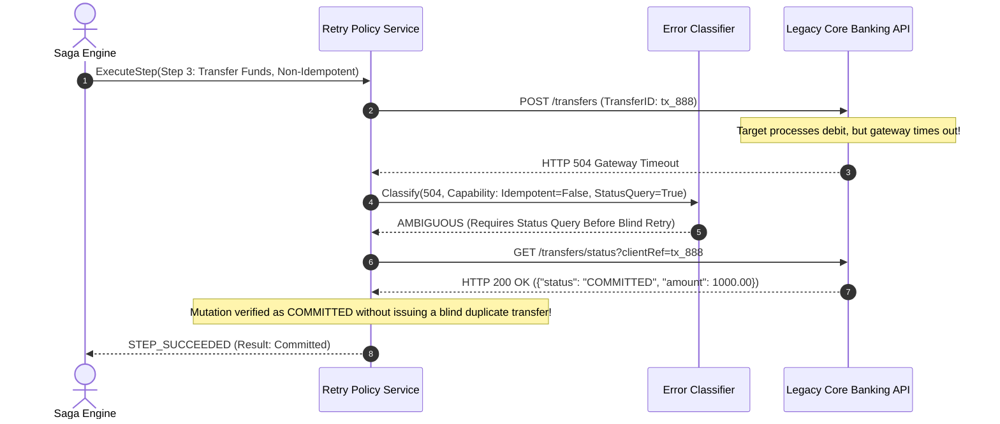
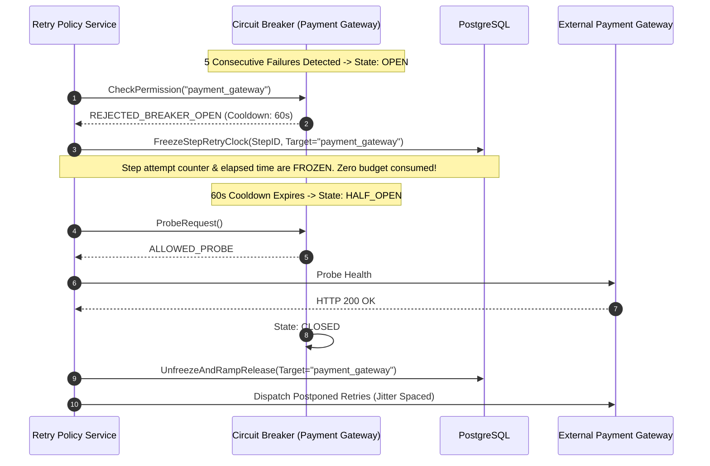

# Retry Policies — Architecture Diagrams

This document illustrates the High-Level Architecture, Component Topology, Finite State Machine, and Sequence Diagrams for the Deterministic Retry Policies feature.

---

## 1. High-Level Design (HLD)

The Retry Policies engine operates as the authoritative decision gate between the step execution dispatcher and downstream services.

---

## 2. Low-Level Component Architecture (LLD)

Hexagonal architecture separating classification rules, backoff calculators, circuit breakers, and persistence adapters.

---

## 3. Finite State Machine (FSM)

Lifecycle of a retry attempt from dispatch to resolution.

---

## 4. Sequence Diagram 1: Transient 503 with Jittered Backoff & `Retry-After`

---

## 5. Sequence Diagram 2: Ambiguous 504 on Non-Idempotent Step with Status Query

---

## 6. Sequence Diagram 3: Dependency Circuit Breaker & Budget Freezing

