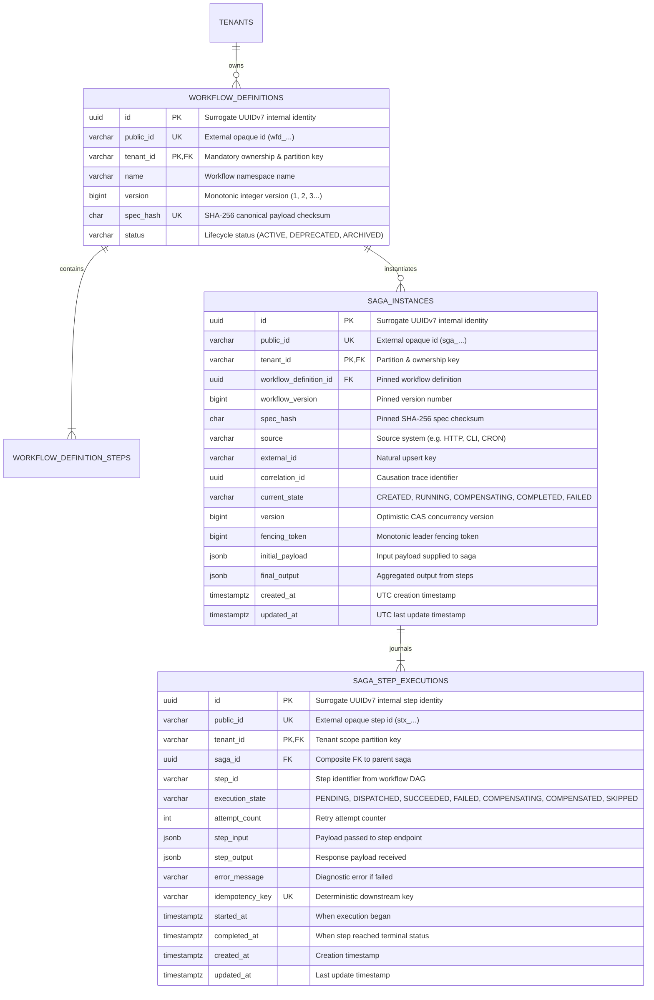

# ADR-0004: Runtime Saga Orchestration, Dynamic In-Degree DAG Traversal & Reverse Compensation Unwinding

| Field | Value |
|---|---|
| Status | Accepted |
| Date | 2026-11-03 |
| Deciders | Lead Systems Architect & Core Architecture Guild |
| Related Docs | [Business Logic & Decision Trees](file:///home/btpl-lap-22/live/System-Architect/distributed-transaction-engine/docs/features/saga-orchestration/business-logic.md) · [Diagrams](file:///home/btpl-lap-22/live/System-Architect/distributed-transaction-engine/docs/features/saga-orchestration/diagrams.md) · [Failure Cases & Mitigations](file:///home/btpl-lap-22/live/System-Architect/distributed-transaction-engine/docs/features/saga-orchestration/failure-cases.md) |
| Target Feature | [Saga Orchestration Feature](file:///home/btpl-lap-22/live/System-Architect/distributed-transaction-engine/src/features/saga-orchestration) |

---

## 1. Context & Problem Statement

Distributed multi-service transactions span disparate downstream microservices (e.g., flight bookings, hotel holds, payment captures, notifications). Because cross-service ACID transactions and two-phase commits (2PC) introduce prohibitive latency, lock contention, and single points of failure across network boundaries, the system must coordinate transactions via the Saga pattern.

Static registration and validation of workflow DAGs (governed by [ADR-0003](file:///home/btpl-lap-22/live/System-Architect/distributed-transaction-engine/docs/features/workflow-definitions/adr.md)) only verify structural topology at submission time. They do not execute transactions. A dedicated runtime engine is required to instantiate, execute, monitor, and compensate transactions.

Deploying a naive or ad-hoc execution loop introduces catastrophic operational hazards:
1. **Unsynchronized Parallel Execution**: Workflows often define multiple root steps or independent parallel branches (e.g. reserving flights and booking hotels simultaneously). Synchronous sequential execution wastes latency budgets and risks artificial timeouts.
2. **Cascading Partial Failures & Financial Drift**: If Step 3 (Payment Capture) fails after Step 1 (Flight) and Step 2 (Hotel) succeed, all preceding state mutations must be undone. Executing compensations out of topological order or attempting to compensate the pivot step corrupts downstream ledger states.
3. **Split-Brain Worker Collisions**: In an elastic Kubernetes cluster with multiple engine pods, multiple workers polling or recovering transactions simultaneously can double-dispatch steps or cause conflicting state transitions without optimistic concurrency control and leader fencing tokens.
4. **Non-Idempotent Network Retries**: If a downstream service hangs or a TCP socket resets during step dispatch, blindly retrying the HTTP/gRPC request without an opaque deterministic idempotency key causes duplicate charges or duplicate resource allocations.
5. **Workflow Version Drift**: If an operator deploys or deprecates a workflow definition while sagas are in-flight, running instances that do not freeze an immutable snapshot will crash due to schema mismatch or missing steps.

---

## 2. Decision Drivers & Architecture Invariants

* **Contract-First Inviolability (Rule 0 Guardrail 2)**: All saga ingress, step executions, and responses must adhere strictly to versioned OpenAPI specifications ([`src/api/contracts/openapi/v1.yaml`](file:///home/btpl-lap-22/live/System-Architect/distributed-transaction-engine/src/api/contracts/openapi/v1.yaml)).
* **Immutable Snapshot Pinning (Invariant S1)**: Every saga instance freezes a foreign-key reference to `(workflow_definition_id, workflow_version, spec_hash)`. Modifications or deprecations of registered workflow definitions never alter in-flight execution graphs.
* **Dynamic In-Degree Dependency Resolution (Invariant S3)**: Step execution uses dynamic in-degree tracking. Steps with in-degree 0 (roots) are dispatched concurrently. As each step reaches `SUCCEEDED`, the in-degree of downstream dependent steps is decremented atomically; when it reaches 0, the dependent step is dispatched immediately.
* **Richardson Reverse Topological Compensation (Invariant S4 & S5)**: When any forward step fails before the pivot transaction, the saga enters `COMPENSATING`. The orchestrator executes compensations strictly in reverse topological order of executed steps. Steps that never ran, were skipped, or are marked `is_pivot=true` are never compensated.
* **Optimistic Concurrency Control via CAS (Invariant S7)**: All state changes enforce monotonic version checks (`WHERE tenant_id = $1 AND id = $2 AND version = $3`), rejecting split-brain updates with `HTTP 409 Conflict`.
* **Deterministic Step Idempotency (Invariant S6)**: Every step execution derives an opaque deterministic idempotency key (`idemp_<saga_id>_<step_id>`) dispatched in HTTP headers (`Idempotency-Key`), preventing downstream double-execution.
* **Centralized Observability & Loki Compliance (Invariant S11 & S12)**: Every execution trace automatically generates OpenTelemetry root spans, propagates W3C `traceparent` headers, and emits structured JSON logs to stdout for Loki ingestion.

---

## 3. Considered Architectural Options

### Option 1: Distributed Choreography (Event-Driven Reactive Chaining)
* **Architecture**: Microservices publish events to Kafka/RabbitMQ (e.g. `OrderCreated`, `PaymentCaptured`); each service listens to predecessor events and decides whether to execute or compensate.
* **Pros**: Zero centralized orchestrator bottleneck; services remain loosely coupled.
* **Cons**:
  - Cyclic dependencies and deadlock bugs are distributed and nearly impossible to trace or debug.
  - No single source of truth for transaction state, progress, or diagnostic auditing.
  - Complex multi-branch DAGs with parallel joins require heavy distributed state aggregation in every service.
* **Verdict**: **Rejected for Core Financial Transactions**.

### Option 2: Hardcoded Stateful Go Routines in Memory
* **Architecture**: A Go goroutine spawns per saga, executes steps in a loop, and maintains state in local memory channels.
* **Pros**: Extremely low latency; trivial in-memory pointer manipulation.
* **Cons**:
  - Pod crashes, restarts, or node evictions destroy all in-flight transaction states.
  - Zero multi-node horizontal scalability.
  - Impossible to perform audit queries or historical state inspections across tenants.
* **Verdict**: **Rejected (Zero crash-resilience)**.

### Option 3: Centralized Hexagonal Orchestration with Relational Step Journaling & Dynamic In-Degree Traversal (Chosen)
* **Architecture**: A centralized orchestrator persists transaction state and individual step lifecycles into PostgreSQL tables (`saga_instances` and `saga_step_executions`). Steps are traversed via dynamic in-degree resolution, and failures trigger reverse topological rollbacks.
* **Pros**:
  - Complete crash recovery: every state transition is journaled to disk before network dispatch.
  - Multi-tenant data isolation with composite primary and foreign keys.
  - Provable acyclic termination and deterministic compensation order.
  - Integrated OpenTelemetry distributed tracing and Loki-compatible audit logging.
* **Verdict**: **Accepted**.

---

## 4. Entity-Relationship Model (ERD) & Relational Schema

Per [05-db-writing-rules.md](file:///home/btpl-lap-22/live/System-Architect/llm-obs-policies/rules/folder-structure/05-db-writing-rules.md), all identifiers enforce the 5 mandatory roles: internal surrogate UUIDv7 `id`, external opaque `public_id`, ownership partition key `tenant_id`, natural upsert key `source + external_id`, and causation `correlation_id`.



### Relational Constraints and Invariants DDL
```sql
-- 1. State machine integrity check on saga instance
CONSTRAINT saga_instances_state_ck CHECK (
    current_state IN ('CREATED', 'RUNNING', 'COMPENSATING', 'COMPLETED', 'FAILED')
);

-- 2. State machine integrity check on step execution journal
CONSTRAINT saga_step_executions_state_ck CHECK (
    execution_state IN ('PENDING', 'DISPATCHED', 'SUCCEEDED', 'FAILED', 'COMPENSATING', 'COMPENSATED', 'SKIPPED')
);

-- 3. Composite Foreign Key enforcing multi-tenant isolation
CONSTRAINT fk_saga_instances_workflow FOREIGN KEY (tenant_id, workflow_definition_id)
    REFERENCES workflow_definitions (tenant_id, id) ON DELETE RESTRICT;

-- 4. Step execution journal composite foreign key with cascade cleanup
CONSTRAINT fk_saga_step_executions_saga FOREIGN KEY (tenant_id, saga_id)
    REFERENCES saga_instances (tenant_id, id) ON DELETE CASCADE;

-- 5. Downstream Idempotency Uniqueness per Tenant
CONSTRAINT saga_step_executions_idempotency_uk UNIQUE (tenant_id, idempotency_key);
```

---

## 5. Detailed Technical Algorithms

### 5.1 Dynamic In-Degree Parallel Fan-Out Algorithm
```
Algorithm: Dynamic In-Degree DAG Traversal
Input: steps (List[StepDefinition]), initial_payload (JSON)
Output: execution_result (SagaInstance)

1. in_degree = Map[step_id -> int]
2. adj_list = Map[step_id -> List[step_id]]
3. For step in steps:
     in_degree[step.step_id] = len(step.dependencies)
     For dep in step.dependencies:
       adj_list[dep].append(step.step_id)

4. completed_steps = Set()
5. ready_queue = [s.step_id for s in steps if in_degree[s.step_id] == 0]

6. While len(completed_steps) < len(steps):
     If ready_queue is empty and len(completed_steps) < len(steps):
       Halt with Deadlock / Unresolvable Dependency Error

     For step_id in ready_queue:
       Mark step_id as DISPATCHED in DB journal
       result, err = DispatchStep(step_id, initial_payload)

       If err is nil:
         Mark step_id as SUCCEEDED in DB journal
         completed_steps.add(step_id)
         For neighbor in adj_list[step_id]:
           in_degree[neighbor] -= 1
           If in_degree[neighbor] == 0:
             ready_queue.append(neighbor)
       Else:
         Mark step_id as FAILED in DB journal
         Trigger ReverseTopologicalCompensation(step_id)
         Return FAILED

7. Transition saga state to COMPLETED
8. Return SagaInstance
```

### 5.2 Richardson Reverse Topological Compensation Algorithm
```
Algorithm: Reverse Topological Rollback
Input: steps (List[StepDefinition]), topo_order (List[string]), succeeded_steps (Set[string])

1. compensation_chain = []
2. For i = len(topo_order) - 1 down to 0:
     step_id = topo_order[i]
     If step_id in succeeded_steps and not steps[step_id].is_pivot:
       If steps[step_id].compensation_action != "":
         compensation_chain.append(step_id)

3. Update saga state to COMPENSATING via CAS version check

4. For comp_step_id in compensation_chain:
     Mark comp_step_id as COMPENSATING in DB journal
     err = CompensateStep(comp_step_id)
     If err is nil:
       Mark comp_step_id as COMPENSATED in DB journal
     Else:
       Retry with exponential backoff and jitter (never abort compensation)

5. Update saga state to FAILED
```

---

## 6. Observability, Metrics & Audit Trail

1. **W3C Distributed Tracing**:
   - Every incoming HTTP request passes through [`ObservabilityMiddleware`](file:///home/btpl-lap-22/live/System-Architect/distributed-transaction-engine/src/infra/observability/middleware.go).
   - Starts root span `saga.execute`.
   - Injects `X-Trace-Id` and `X-Span-Id` response headers.
2. **Loki-Compatible Structured JSON Logging**:
   - Logs emitted to standard out adhere to the schema:
     `{"timestamp":"...", "level":"INFO|WARN|ERROR", "service":"distributed-transaction-engine", "message":"...", "tenant_id":"...", "trace_id":"...", "span_id":"...", "attributes":{...}}`.
3. **Audit Trail**:
   - Step executions store exact inputs and outputs in JSONB columns (`step_input`, `step_output`).

---

## 7. Consequences & Trade-Off Analysis

### Positive Consequences
* **Deterministic Rollback Safety**: Mathematical guarantee that non-pivot steps are compensated in reverse topological order, eliminating out-of-sequence mutations.
* **True Parallel Throughput**: Independent branches run concurrently without artificial sequential barriers.
* **Zero Version Drift**: Active sagas are completely decoupled from subsequent workflow definition modifications.
* **Full Auditability**: PostgreSQL journals every step transition, attempt count, and payload for compliance and forensic debugging.

### Negative Consequences & Mitigations
* **Database I/O Overhead**: Persisting step state before network dispatch adds round-trip latency to the database.
  - *Mitigation*: Connection pooling and parameterized bulk updates minimize latency; data safety in distributed transactions strictly takes precedence over sub-millisecond throughput.
* **Compensation Service Availability Risk**: If a downstream service's compensation endpoint is down, rollback stalls.
  - *Mitigation*: Compensations retry indefinitely with exponential backoff and full jitter; unresolved rollbacks escalate to the Dead Letter Queue (DLQ).

---

## 8. Verification & Compliance Matrix

| Requirement | Implementation Component | Verification Test |
|---|---|---|
| **Multi-Root Dynamic Fanout** | `sagaRules.FindInitialExecutableSteps` | `TestRules_FindInitialExecutableSteps` |
| **Dependency Resolution** | `sagaRules.FindNextExecutableSteps` | `TestRules_FindNextExecutableSteps` |
| **Reverse Topological Compensation** | `sagaRules.ComputeReverseCompensationChain` | `TestRules_ComputeReverseCompensationChain` |
| **Happy Path Execution** | `SagaOrchestrationService.ExecuteSaga` | `TestSagaService_SuccessfulDAGExecution` |
| **Downstream Failure Rollback** | `SagaOrchestrationService.ExecuteSaga` | `TestSagaService_FailureAndReverseCompensation` |
| **End-to-End HTTP Lifecycle** | `SagaHandler` & `SagaRouter` | `TestEndToEnd_SagaHTTPExecutionLifecycle` |
| **OpenTelemetry & Loki Logging** | `ObservabilityMiddleware` | `TestObservabilityMiddleware` & E2E Header Checks |
| **Zero Comments in Source Code** | All Go files under `src/features/saga-orchestration/` | Automated AST / grep scanner |
