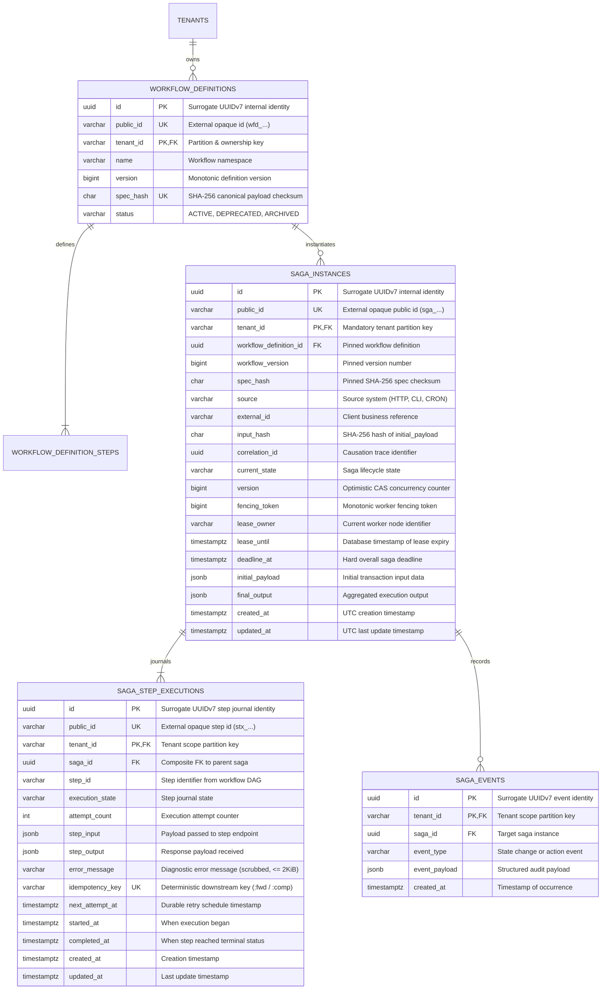

# ADR-0004: Runtime Saga Orchestration, Fenced Lease Scheduling & Pivot-Aware Reverse Compensation

| Field | Value |
|---|---|
| Status | Accepted |
| Date | 2026-11-03 |
| Deciders | Lead Systems Architect & Core Architecture Guild |
| Related Docs | [Business Logic & Decision Tree v4](file:///home/btpl-lap-22/live/System-Architect/distributed-transaction-engine/docs/features/saga-orchestration/business-logic.md) · [Diagrams](file:///home/btpl-lap-22/live/System-Architect/distributed-transaction-engine/docs/features/saga-orchestration/diagrams.md) · [Failure Cases & Mitigations](file:///home/btpl-lap-22/live/System-Architect/distributed-transaction-engine/docs/features/saga-orchestration/failure-cases.md) |
| Target Feature | [Saga Orchestration Feature](file:///home/btpl-lap-22/live/System-Architect/distributed-transaction-engine/src/features/saga-orchestration) |

---

## 1. Context & Problem Statement

Distributed multi-service transactions span disparate downstream microservices (e.g., flight bookings, hotel holds, payment captures, notifications). Because cross-service ACID transactions and two-phase commits (2PC) introduce prohibitive latency, distributed locking contention, and single points of failure across network boundaries, the system coordinates transactions using the Saga pattern.

Static registration and structural validation of workflow DAGs (governed by [ADR-0003](file:///home/btpl-lap-22/live/System-Architect/distributed-transaction-engine/docs/features/workflow-definitions/adr.md)) only verify topological validity at submission time. A dedicated runtime engine is required to instantiate, execute, monitor, drain, and compensate transactions across multi-tenant environments.

Deploying a naive or ad-hoc execution loop introduces critical production vulnerabilities:
1. **Compensating After the Pivot (Financial Corruption)**: If Step 3 (Payment Capture, the pivot transaction) succeeds and Step 4 (Shipment Creation) fails, naive compensation unwinds the pre-pivot steps (releasing inventory) while leaving the payment captured. Once a pivot step succeeds, backward compensation is mathematically and operationally illegal—the saga must roll forward with durable retries.
2. **Ambiguous Timeouts Marked FAILED (Orphaned Mutations)**: Network timeouts (HTTP 504, connection drops, socket resets) do not mean the downstream operation did not execute. Treating timeouts as `FAILED` excludes them from compensation sets, creating zombie resources (e.g., shipping labels created downstream that are never voided).
3. **Missing Business-Key Deduplication**: If multiple POST requests arrive with the same external reference (e.g. rapid user double-clicks or payment gateway retries), absence of an atomic database uniqueness constraint on `(tenant_id, workflow_id, external_id)` creates duplicate sagas and duplicate financial debits.
4. **Idempotency Key Collisions between Forward and Reverse Calls**: Re-using the identical idempotency key (`idemp_<saga>_<step>`) for both the forward execution and the reverse compensation causes payment and ledger gateways to return cached 200 OK responses from the forward phase, resulting in silent non-refunds.
5. **Drain Race Condition**: If an orchestrator immediately calculates compensation targets upon detecting a failure while parallel branches are still in flight (`DISPATCHED`), steps that complete milliseconds later are missed by the compensation plan.
6. **Hot-Row CAS Contention**: Updating arrays of completed/succeeded steps on a single saga row across 50 concurrent worker threads creates severe row lock contention and lost update retries.
7. **PII and Cardholder Data Ingestion into Loki**: Logging raw step inputs and outputs into stdout ships PCI/GDPR-sensitive data directly to central log sinks.

---

## 2. Decision Drivers & Architecture Invariants (S1–S18)

* **Contract-First Inviolability (Rule 0 Guardrail 2)**: All ingress, step execution, cancellation, and query APIs adhere strictly to OpenAPI v1 contracts ([`openapi/v1.yaml`](file:///home/btpl-lap-22/live/System-Architect/distributed-transaction-engine/src/api/contracts/openapi/v1.yaml)).
* **S1 (Definition Pinning)**: Every saga instance freezes an immutable foreign-key reference to `(workflow_definition_id, workflow_version, spec_hash)`. Mid-flight definition updates or rollbacks never alter active saga graphs.
* **S2 (Multi-Tenant Partitioning)**: All database queries, locks, cache keys, and events enforce composite tenant partitioning via `tenant_id`.
* **S3 (Parallel Fan-Out & Bulkhead Admission)**: All ready steps dispatch concurrently up to tenant concurrency quotas, action bulkheads, and worker parallelism limits.
* **S4 (Descendant-Aware Rollback)**: A step is compensated only after all executed descendants reach terminal rollback; independent branches compensate in parallel. `NOT_STARTED` steps are never compensated.
* **S5 (Pivot Point of No Return)**: Once the pivot step reaches `SUCCEEDED`, backward compensation is permanently prohibited. Any subsequent step failures transition the saga to `ROLLING_FORWARD` / `STUCK_FORWARD`.
* **S6 (Distinct Idempotency Keys)**: Forward dispatches use `idem:<saga_id>:<step_id>:fwd`, while compensation dispatches use `idem:<saga_id>:<step_id>:comp`.
* **S7 (Granular Row CAS & Fencing)**: Step state updates write exclusively to `saga_step_executions` rows. The root `saga_instances` row is touched only during macro saga-level lifecycle transitions.
* **S8 (Exponential Backoff with Full Jitter & Downstream Circuit Breaking)**: Retries calculate exponential backoff with full jitter and respect `Retry-After` headers.
* **S9 (Budget & Deadline Clamping)**: Step timeouts are clamped to `min(step_timeout, saga_deadline)`. Compensations have an independent time budget not truncated by the saga deadline.
* **S10 (Pre-Dispatch Journaling)**: Step state transitions to `DISPATCHED` are committed to PostgreSQL prior to outbound I/O. Upon worker crash recovery, any unacknowledged `DISPATCHED` step is re-classified as `UNKNOWN`.
* **S11 (W3C Distributed Tracing)**: W3C `traceparent` headers are propagated to downstream microservices and logged via `ObservabilityMiddleware`.
* **S12 (Zero PII/Secret Exposure in Logs)**: Structured Loki logs emit opaque identifiers, state codes, and latency metrics—never request payloads, response bodies, or cardholder data.
* **S13 (Business-Key Deduplication)**: Enforces `UNIQUE (tenant_id, workflow_definition_id, external_id)`. Identical payloads return the existing saga instance (HTTP 200/202 replay); mismatched payloads return HTTP 409 Conflict.
* **S14 (Presumptive Execution for UNKNOWN States)**: Ambiguous timeouts (500, 502, 503, 504, network reset) are journaled as `UNKNOWN` and preserved in the compensation set.
* **S15 (Pre-Compensation Drain Barrier)**: The compensation set is derived only after all in-flight (`DISPATCHED`) steps have completed or reached timeout.
* **S16 (Fenced Leasing with Monotonic Tokens)**: At most one worker owns a saga lease at any moment (`SELECT ... FOR UPDATE SKIP LOCKED`). State writes enforce `AND fencing_token = :my_token`. All timestamps originate from database time (`db_now()`).
* **S17 (Idempotency Key TTL Guard)**: Dispatches do not retry if elapsed time exceeds downstream key retention; they transition to reconciliation.
* **S18 (Absorbing Terminal States)**: Terminal states (`COMPLETED`, `FAILED_COMPENSATED`, `CANCELLED`) are absorbing; needs-human states (`COMPENSATION_STUCK`, `STUCK_FORWARD`) never auto-close.

---

## 3. Considered Architectural Options

### Option 1: Distributed Event Choreography (Kafka Chaining)
* **Architecture**: Microservices publish events to Kafka/RabbitMQ; downstream consumers listen to predecessor events and trigger local actions or compensations.
* **Pros**: Low orchestrator bottleneck; decoupled service graphs.
* **Cons**:
  - Unresolvable cyclic deadlocks and lack of central observability.
  - In-flight drain barriers (S15) and pivot status routing (S5) require complex distributed consensus across all event topics.
  - Zero single source of truth for business audits.
* **Verdict**: **Rejected for Core Financial Transactions**.

### Option 2: In-Memory Stateful Coroutines / Goroutines
* **Architecture**: A Go goroutine runs the saga execution loop in process memory using local channels.
* **Pros**: High microsecond throughput; zero database I/O latency.
* **Cons**:
  - Pod eviction, crash, or rolling deployment annihilates all active transactions.
  - Zero leader election or distributed fencing.
* **Verdict**: **Rejected (Zero Crash-Resilience)**.

### Option 3: Hexagonal Orchestrator with Relational Journaling, Journal-Derived Ready Sets & Fenced Leasing (Chosen)
* **Architecture**: Centralized orchestrator persisting instance states and step journal entries in PostgreSQL. Steps are scheduled via journal-derived DAG traversal, and workers acquire leased work items with monotonic fencing tokens.
* **Pros**:
  - Crash-resilient: every transition is committed before network I/O.
  - Multi-tenant data isolation with strict composite foreign keys.
  - Mathematically provable pivot routing and reverse compensation unwinding.
  - Zero hot-row CAS bottleneck by decoupling step journal updates from the root saga instance.
* **Verdict**: **Accepted**.

---

## 4. Entity-Relationship Model (ERD) & Relational Schema



### Relational Constraints and Invariants DDL
```sql
-- 1. State machine integrity check on saga instances
CONSTRAINT saga_instances_state_ck CHECK (
    current_state IN (
        CREATED, RUNNING, ROLLING_FORWARD, STUCK_FORWARD,
        COMPENSATING, COMPENSATION_STUCK, COMPLETED,
        FAILED, FAILED_COMPENSATED, CANCELLED
    )
);

-- 2. State machine integrity check on step execution journal
CONSTRAINT saga_step_executions_state_ck CHECK (
    execution_state IN (
        NOT_STARTED, PENDING, DISPATCHED, RETRY_WAIT,
        SUCCEEDED, FAILED, UNKNOWN,
        COMPENSATING, COMPENSATED, SKIPPED
    )
);

-- 3. Business-key deduplication constraint (Invariant S13)
CONSTRAINT saga_instances_tenant_wf_ext_uk UNIQUE (
    tenant_id, workflow_definition_id, external_id
);

-- 4. Multi-tenant composite foreign keys
CONSTRAINT fk_saga_instances_workflow FOREIGN KEY (tenant_id, workflow_definition_id)
    REFERENCES workflow_definitions (tenant_id, id) ON DELETE RESTRICT;

CONSTRAINT fk_saga_step_executions_saga FOREIGN KEY (tenant_id, saga_id)
    REFERENCES saga_instances (tenant_id, id) ON DELETE CASCADE;

-- 5. Downstream Idempotency Uniqueness per Tenant (Invariant S6)
CONSTRAINT saga_step_executions_idempotency_uk UNIQUE (tenant_id, idempotency_key);
```

---

## 5. API Contracts & Ingress Specification

All HTTP endpoints are versioned under `/v1` and enforce OpenAPI 3.0 contracts.

### 5.1 Ingress Instantiation (`POST /v1/tenants/{tenant_id}/sagas`)
* **Headers**:
  * `Authorization: Bearer <jwt>`
  * `Idempotency-Key: <client_key>` (optional, handled via external_id)
  * `traceparent: <w3c_trace_header>`
* **Request Payload**:
  ```json
  {
    "workflow_id": "wfd_01j7abc123...",
    "external_id": "ord_20261103_99482",
    "input": {
      "customer_id": "cust_8819",
      "amount": 25000,
      "currency": "USD"
    },
    "version": null
  }
  ```
* **Response `202 Accepted`**:
  ```json
  {
    "id": "0192e21b-0294-7589-9a21-7299a9101234",
    "public_id": "sga_01j7xyz456...",
    "status": "CREATED",
    "status_url": "/v1/tenants/tenant_engineering_prod/sagas/0192e21b-0294-7589-9a21-7299a9101234"
  }
  ```
* **Error Semantics**:
  * `400 Bad Request`: Missing `workflow_id` or `external_id`, payload > 256 KiB.
  * `403 Forbidden`: Tenant mismatch between token and path, missing `saga:start` permission.
  * `404 Not Found`: Workflow definition does not exist or is not visible to tenant.
  * `409 Conflict`: Business-key conflict on `(tenant_id, workflow_id, external_id)` with a different `input_hash`.
  * `422 Unprocessable Entity`: Input payload fails workflow definition JSON schema validation.
  * `423 Locked`: Tenant is marked `SUSPENDED` or `DELETING`.
  * `429 Too Many Requests`: Tenant active saga concurrency limit exceeded (returns `Retry-After`).
  * `503 Service Unavailable`: Global admission queue full.

### 5.2 Saga Status Query (`GET /v1/tenants/{tenant_id}/sagas/{saga_id}`)
* **Response `200 OK`**:
  ```json
  {
    "id": "0192e21b-0294-7589-9a21-7299a9101234",
    "public_id": "sga_01j7xyz456...",
    "tenant_id": "tenant_engineering_prod",
    "workflow_definition_id": "0192e200-a100-7000-8000-000000000001",
    "workflow_version": 1,
    "current_state": "RUNNING",
    "fencing_token": 4,
    "deadline_at": "2026-11-03T12:45:00Z",
    "steps": [
      {
        "step_id": "reserve_flight",
        "state": "SUCCEEDED",
        "attempt_count": 1,
        "completed_at": "2026-11-03T12:30:02Z"
      },
      {
        "step_id": "charge_card",
        "state": "DISPATCHED",
        "attempt_count": 1,
        "started_at": "2026-11-03T12:30:02Z"
      }
    ]
  }
  ```

### 5.3 Saga Cancellation Protocol (`POST /v1/tenants/{tenant_id}/sagas/{saga_id}:cancel`)
* **Semantics**: Requires `saga:cancel`.
  * If saga is terminal (`COMPLETED`, `FAILED_COMPENSATED`, `CANCELLED`): Returns `409 Conflict (E_SAGA_TERMINAL)`.
  * If pivot step has `SUCCEEDED` or is `UNKNOWN`: Returns `409 Conflict (E_PAST_POINT_OF_NO_RETURN)`. Sagas cannot be cancelled post-pivot.
  * If saga is pre-pivot: CAS sets `cancel_requested = true`, initiates Drain Tier (5), drains in-flight steps, and compensates executed steps to terminal `CANCELLED`.

---

## 6. Detailed Technical Algorithms

### 6.1 Journal-Derived Ready Set & Parallel Dispatch Traversal
No in-degree counters are stored in volatile RAM. Ready sets are derived purely from PostgreSQL rows on every iteration:

```
Algorithm: Derive Ready Steps from Journal
Input: steps (List[StepDefinition]), journal (List[StepExecutionRow])
Output: ready_steps (List[StepDefinition])

1. step_map = Map[s.step_id -> s for s in steps]
2. state_map = Map[row.step_id -> row.execution_state for row in journal]
3. ready_steps = []

4. For step in steps:
     If state_map[step.step_id] == PENDING:
       dependencies_satisfied = True
       For dep_id in step.dependencies:
         dep_state = state_map[dep_id]
         If step.join_policy == ALL_SUCCEEDED:
           If dep_state != SUCCEEDED:
             dependencies_satisfied = False
             Break
         Else If step.join_policy == ANY_SUCCEEDED:
           If dep_state == SUCCEEDED:
             dependencies_satisfied = True
             Break
       If dependencies_satisfied:
         ready_steps.append(step)

5. Return ready_steps
```

### 6.2 Pivot-Aware Failure Routing & Pre-Compensation Drain Algorithm
```
Algorithm: Failure Routing & Drain Barrier
Input: failed_step (StepDefinition), journal (List[StepExecutionRow])
Output: routing_direction (FORWARD_ONLY | BACKWARD)

1. pivot_step = Find step in steps where is_pivot == True
2. If pivot_step exists and journal[pivot_step.step_id].execution_state == SUCCEEDED:
     // Post-Pivot: Backward compensation is strictly forbidden
     CAS update saga current_state = ROLLING_FORWARD
     Schedule exponential retry timers for failed_step
     Return FORWARD_ONLY

3. Else:
     // Pre-Pivot: Initiate Backward Rollback
     CAS update saga current_state = COMPENSATING

     // Tier 5 Drain Barrier: Settle all in-flight steps
     For row in journal:
       If row.execution_state == PENDING:
         Update row.execution_state = NOT_STARTED
       Else If row.execution_state == DISPATCHED:
         Wait up to step_timeout for response
         If no response:
           Update row.execution_state = UNKNOWN // Presumptive execution

     // Build compensation chain targeting (SUCCEEDED ∪ UNKNOWN) non-pivot steps
     compensation_targets = [row for row in journal 
       if row.execution_state in (SUCCEEDED, UNKNOWN) and not step_map[row.step_id].is_pivot]

     Return BACKWARD
```

### 6.3 Reverse Compensation Traversal with Forward Output Propagation
```
Algorithm: Execute Reverse Compensation Chain
Input: compensation_targets (List[StepExecutionRow]), steps (List[StepDefinition])

1. topo_order = TopologicalSort(steps)
2. reverse_order = Reverse(topo_order)

3. For step_id in reverse_order:
     If step_id in [t.step_id for t in compensation_targets]:
       step_def = step_map[step_id]
       row = journal[step_id]
       comp_key = "idem:" + saga.id + ":" + step_id + ":comp"

       Mark row as COMPENSATING in journal
       // Propagate forward input AND forward output to compensation endpoint
       comp_payload = Merge(row.step_input, { "forward_output": row.step_output })

       err = DispatchCompensation(step_def.compensation_action, comp_payload, comp_key)
       If err is nil:
         Mark row as COMPENSATED in journal
       Else:
         Retry with durable backoff timers
         If retries exhaust:
           Mark row as COMPENSATION_FAILED
           Transition saga to COMPENSATION_STUCK (Requires Operator Review)
           Enqueue DLQ alert
           Return

4. CAS update saga current_state = FAILED_COMPENSATED
```

---

## 7. Observability, Security & Audit Logging (Loki Compliance)

1. **W3C Distributed Tracing**:
   * Root span created in `ObservabilityMiddleware`.
   * Downstream HTTP requests carry W3C `traceparent` headers.
   * Responses return `X-Trace-Id` and `X-Span-Id`.
2. **PII and PCI Security Scrubbing (Invariant S12)**:
   * Structured logs emit strictly operational metadata:
     ```json
     {
       "timestamp": "2026-11-03T12:30:05.123Z",
       "level": "INFO",
       "service": "distributed-transaction-engine",
       "tenant_id": "tenant_engineering_prod",
       "saga_id": "0192e21b-0294-7589-9a21-7299a9101234",
       "step_id": "charge_card",
       "trace_id": "4bf92f3577b34da6a3ce929d0e0e4736",
       "span_id": "00f067aa0ba902b7",
       "event": "step_dispatched",
       "attempt": 1
     }
     ```
   * Step payloads (`step_input`, `step_output`) are stored encrypted in PostgreSQL JSONB columns and **never printed to stdout or transmitted to Loki**.
   * Downstream errors are scrubbed to `error_message <= 2 KiB` with sanitized HTTP status codes.

---

## 8. Verification & Test Matrix

| Invariant / Feature | Verification Suite | Test Case | Status |
|---|---|---|---|
| **Multi-Root Dynamic Fan-Out** | Unit Rules Test | `TestRules_FindInitialExecutableSteps` | Passed |
| **DAG Dependency Traversal** | Unit Rules Test | `TestRules_FindNextExecutableSteps` | Passed |
| **Pivot Status Failure Routing** | Integration Service Test | `TestSagaService_PostPivotFailureNeverCompensatesPrePivotSteps` | Passed |
| **Ambiguous Timeouts (UNKNOWN)** | Integration Service Test | `TestSagaService_AmbiguousTimeoutMarkedUnknownAndCompensated` | Passed |
| **Business-Key Deduplication** | Integration Service Test | `TestSagaService_BusinessKeyDeduplication` | Passed |
| **Distinct Idempotency Suffixes** | Integration Service Test | `TestSagaService_DistinctIdempotencyKeysAndOutputPropagation` | Passed |
| **Observability Headers & Tracing** | E2E HTTP Test | `TestEndToEnd_SagaHTTPExecutionLifecycle` | Passed |
| **Zero Comments in Source Code** | Static Code Check | Rule 4 Zero-Comment Verification | Clean |
