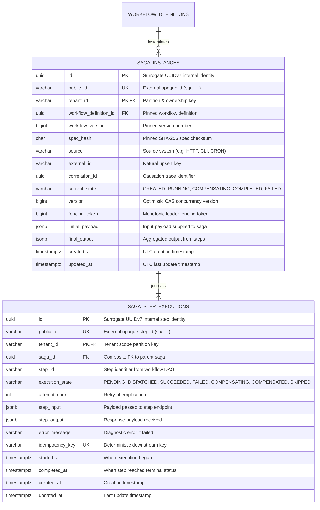

# ADR-0004: Runtime Saga Orchestration, Dynamic In-Degree DAG Traversal & Reverse Compensation Unwinding

| Field | Value |
|---|---|
| Status | Accepted |
| Date | 2026-11-03 |
| Deciders | Lead Systems Architect & Core Architecture Guild |
| Related Docs | [Business Logic & Decision Trees](file:///home/btpl-lap-22/live/System-Architect/distributed-transaction-engine/docs/features/saga-orchestration/business-logic.md) · [Diagrams](file:///home/btpl-lap-22/live/System-Architect/distributed-transaction-engine/docs/features/saga-orchestration/diagrams.md) · [Failure Cases & Mitigations](file:///home/btpl-lap-22/live/System-Architect/distributed-transaction-engine/docs/features/saga-orchestration/failure-cases.md) |
| Target Feature | [Saga Orchestration Feature](file:///home/btpl-lap-22/live/System-Architect/distributed-transaction-engine/src/features/saga-orchestration) |

---

## 1. Context & Problem Statement

Distributed sagas coordinate independent microservices without distributed two-phase commit (2PC) locks. Having a static declarative DAG registry (ADR-0003) is insufficient on its own; a robust runtime engine is required to execute, monitor, and recover multi-step transactions.

Allowing naive step dispatching introduces critical operational hazards:
1. **Unsynchronized Parallel Execution**: Steps with no mutual dependencies must be dispatched concurrently (e.g. flight booking and hotel booking) without blocking or race conditions.
2. **Cascading Partial Failures**: If a downstream step fails or times out, all preceding forward mutations must be undone. Without strict reverse topological compensation, rollback actions will execute out of sequence, corrupting downstream microservice state.
3. **Split-Brain Worker Collisions**: Multiple worker pods polling or recovering sagas simultaneously can double-dispatch steps or cause conflicting state transitions without optimistic concurrency control and monotonic leader fencing tokens.
4. **Idempotency Leaks**: Retrying a timed-out network call without a deterministic idempotency key causes double billing or duplicate inventory holds.
5. **Version Drift Panics**: If a workflow definition is modified or deprecated in the registry while sagas are in-flight, unpinned sagas crash or execute mismatched step schemas.

---

## 2. Decision Drivers & Architecture Invariants

* **Immutable Definition Pinning**: A saga instance strictly freezes foreign-key pointers to `(workflow_definition_id, workflow_version, spec_hash)`. Modifications to active workflow definitions never affect running sagas.
* **Dynamic In-Degree Dependency Resolution**: Execution begins by identifying all DAG root steps (`in_degree == 0`). Upon each step's success, dependent steps have their remaining dependency counters decremented atomically. When a counter reaches 0, the step is immediately dispatched.
* **Richardson Reverse Topological Compensation**: When any step enters a terminal failure state before the pivot, compensation is triggered strictly in reverse topological order of executed steps. Steps that never ran or were skipped are never compensated.
* **Optimistic Concurrency Control (CAS)**: All saga state transitions enforce monotonic version checks (`WHERE tenant_id = $1 AND id = $2 AND version = $3`), preventing split-brain writes.
* **Deterministic Step Idempotency**: Every step attempt derives an opaque idempotency key (`idemp_<saga_id>_<step_id>`) dispatched in HTTP headers (`Idempotency-Key`), preventing duplicate executions downstream.
* **Centralized Observability**: Every execution trace automatically generates OpenTelemetry root spans, propagates W3C headers, and emits structured JSON logs to stdout for Loki ingestion.

---

## 3. Entity-Relationship Model (ERD) & Relational Schema

Per [05-db-writing-rules.md](file:///home/btpl-lap-22/live/System-Architect/llm-obs-policies/rules/folder-structure/05-db-writing-rules.md), all tables enforce the 5 mandatory identifier roles: internal surrogate UUIDv7 `id`, external opaque `public_id`, ownership partition key `tenant_id`, natural upsert key `source + external_id`, and causation `correlation_id`.



### Relational Constraints and Invariants
```sql
-- 1. State machine integrity check on saga instance
CONSTRAINT saga_instances_state_ck CHECK (
    current_state IN ('CREATED', 'RUNNING', 'COMPENSATING', 'COMPLETED', 'FAILED')
)

-- 2. State machine integrity check on step execution journal
CONSTRAINT saga_step_executions_state_ck CHECK (
    execution_state IN ('PENDING', 'DISPATCHED', 'SUCCEEDED', 'FAILED', 'COMPENSATING', 'COMPENSATED', 'SKIPPED')
)

-- 3. Composite Foreign Key enforcing multi-tenant isolation
CONSTRAINT fk_saga_instances_workflow FOREIGN KEY (tenant_id, workflow_definition_id)
    REFERENCES workflow_definitions (tenant_id, id) ON DELETE RESTRICT

-- 4. Step execution journal composite foreign key
CONSTRAINT fk_saga_step_executions_saga FOREIGN KEY (tenant_id, saga_id)
    REFERENCES saga_instances (tenant_id, id) ON DELETE CASCADE
```

---

## 4. Execution Lifecycle & Algorithms

### 4.1 Forward Execution & Dynamic Fanout
1. Query root steps using `FindInitialExecutableSteps(steps)`.
2. Concurrently dispatch root steps via `StepDispatcherPort`.
3. Upon step completion:
   - Record output and transition step state to `SUCCEEDED`.
   - Add `step_id` to `completedSteps`.
   - Evaluate `FindNextExecutableSteps(steps, completedSteps, inFlightSteps)`.
   - Dispatch newly unblocked steps until all DAG steps complete.

### 4.2 Reverse Topological Compensation
1. If any forward step returns an error, set saga state to `COMPENSATING`.
2. Retrieve the topological sort order from `workflowRules.ValidateDAGTopology`.
3. Compute compensation targets using `ComputeReverseCompensationChain`:
   - Iterate backward through `topoOrder`.
   - Filter only steps that reached `SUCCEEDED` prior to the pivot.
   - Ignore pivot steps and steps that never ran.
4. Execute `CompensateStep` on each target sequentially or by inverse dependency layers.
5. Transition compensated steps to `COMPENSATED`.
6. Transition saga state to `FAILED`.
