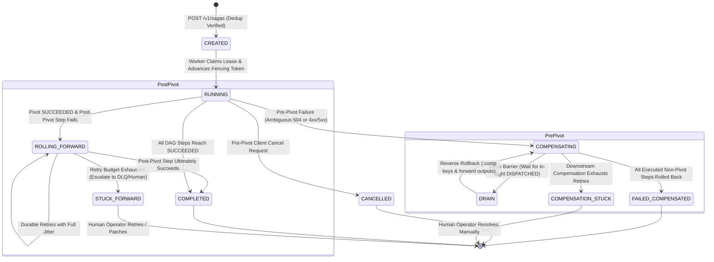

# Saga Orchestration Runtime — Architectural & Visual Diagrams

---

## 1. Hexagonal Runtime Architecture v4

```mermaid
flowchart TD
    subgraph Ingress [API Delivery & Observability]
        Client["Client / Upstream Gateway"]
        Mux["Observability Middleware (W3C Tracing, Span Ingestion & PII Scrubber)"]
        Handler["SagaHandler (HTTP REST /v1/tenants/{tenant_id}/sagas)"]
    end

    subgraph Core [Domain & Application Core]
        Svc["SagaOrchestrationService (Business-Key Dedup & Orchestrator)"]
        Rules["Saga Execution Rules (Journal-Derived DAG, Pivot Routing, Suffix Keys)"]
        StateM["Transaction State Machine (Fenced CAS FSM)"]
    end

    subgraph Ports [Infrastructure Ports]
        RepoPort["SagaRepositoryPort (GetSagaByExternalID, CAS Updates)"]
        WfPort["WorkflowDefinitionsRepositoryPort"]
        DispPort["StepDispatcherPort (Ambiguous HTTP 504 Classifier)"]
    end

    subgraph Adapters [Infrastructure Adapters]
        PgRepo["Postgres / Memory Saga Adapter (SKIP LOCKED Fencing)"]
        PgWf["Postgres / Memory Workflow Adapter"]
        HttpDisp["HTTP Step Dispatcher Adapter (:fwd and :comp Keys)"]
    end

    subgraph Storage [Databases & Downstream Services]
        PG[("PostgreSQL: saga_instances & saga_step_executions")]
        Downstream["Downstream Microservices (Payment, Inventory, CRM)"]
    end

    Client -->|POST /v1/tenants/{tenant_id}/sagas| Mux
    Mux --> Handler
    Handler --> Svc
    Svc --> Rules
    Svc --> StateM
    Svc --> RepoPort
    Svc --> WfPort
    Svc --> DispPort
    RepoPort --> PgRepo
    WfPort --> PgWf
    DispPort --> HttpDisp
    PgRepo --> PG
    PgWf --> PG
    HttpDisp --> Downstream
```

---

## 2. Dynamic In-Degree Parallel Fan-Out & Pivot Execution

```mermaid
graph TD
    subgraph Workflow DAG Definition
        R1["reserve_flight (In-Degree: 0)"]
        R2["reserve_hotel (In-Degree: 0)"]
        P["charge_card [PIVOT] (In-Degree: 2)"]
        C["create_shipment (In-Degree: 1)"]

        R1 --> P
        R2 --> P
        P --> C
    end

    subgraph Parallel Runtime Traversal (Journal-Derived)
        T0["1. DeriveReadySteps() from Postgres"] -->|In-Degree == 0| DispatchR["Dispatch R1 & R2 in Parallel with :fwd keys"]
        DispatchR -->|R1 SUCCEEDED in DB| W1["P: dependencies pending (R2 incomplete)"]
        DispatchR -->|R2 SUCCEEDED in DB| DispatchP["All dependencies satisfied: Dispatch charge_card [PIVOT]"]
        DispatchP -->|P SUCCEEDED: Point of No Return| DispatchC["Dispatch create_shipment [POST-PIVOT]"]
        DispatchC -->|C SUCCEEDED| Terminal["Saga Reaches Terminal COMPLETED"]
        DispatchC -->|C FAILS| PostPivotRollForward["Failure Routing (S5): Roll Forward with Durable Retries, NEVER Compensate"]
    end
```

---

## 3. Ambiguous Timeout Drain & Reverse Compensation Sequence Diagram

```mermaid
sequenceDiagram
    autonumber
    actor Client
    participant Engine as SagaOrchestrationService
    participant Flight as Flight Service
    participant Hotel as Hotel Service
    participant Payment as Payment Gateway
    participant Journal as PostgreSQL Journal

    Client->>Engine: POST /v1/tenants/t1/sagas (flight + hotel + payment)
    Engine->>Journal: Business-Key Dedup (tenant, workflow, external_id)
    alt Duplicate external_id with same input
        Engine-->>Client: 200 OK (Return Existing Saga Instance)
    else New Saga
        Engine->>Journal: INSERT saga_instances (CREATED)
        Engine-->>Client: 202 Accepted {id, public_id, status_url}
    end

    Engine->>Journal: CAS CREATED -> RUNNING

    par Parallel Pre-Pivot Dispatch
        Engine->>Flight: POST /reserve (Idempotency-Key: idem:<id>:flight:fwd)
        Engine->>Hotel: POST /book (Idempotency-Key: idem:<id>:hotel:fwd)
    and
    Flight-->>Engine: 200 OK {reservation_id: "fl_123"}
    Engine->>Journal: Mark flight SUCCEEDED (output recorded)

    Hotel-->>Engine: 504 Gateway Timeout (Ambiguous Network Drop)
    Engine->>Journal: Mark hotel UNKNOWN (Presumptive Execution)
    end

    Note over Engine,Journal: Tier 4 Failure Routing: Pivot NOT reached -> BACKWARD Rollback
    Note over Engine,Journal: Tier 5 Drain Barrier: In-flight calls drained; hotel preserved in rollback set

    Engine->>Journal: CAS RUNNING -> COMPENSATING

    rect rgb(240, 220, 220)
    Note over Engine,Hotel: Reverse Rollback with :comp Keys & Forward Outputs
    Engine->>Hotel: POST /cancel (Idempotency-Key: idem:<id>:hotel:comp)
    Hotel-->>Engine: 200 OK (Cleaned up held room)
    Engine->>Journal: Mark hotel COMPENSATED

    Engine->>Flight: POST /cancel (Idempotency-Key: idem:<id>:flight:comp, payload: {forward_output: {reservation_id: "fl_123"}})
    Flight-->>Engine: 200 OK (Released flight seat)
    Engine->>Journal: Mark flight COMPENSATED
    end

    Engine->>Journal: CAS COMPENSATING -> FAILED_COMPENSATED (Absorbing Terminal State)
```

---

## 4. Saga Lifecycle State Transition FSM (Production v4)


