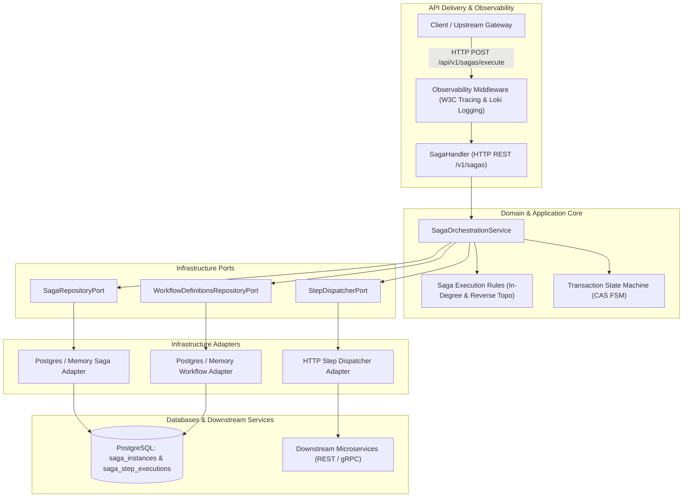
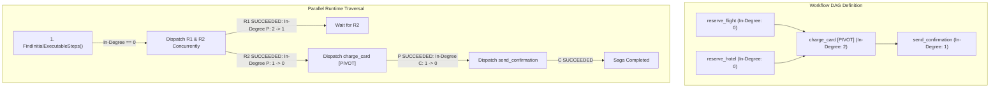
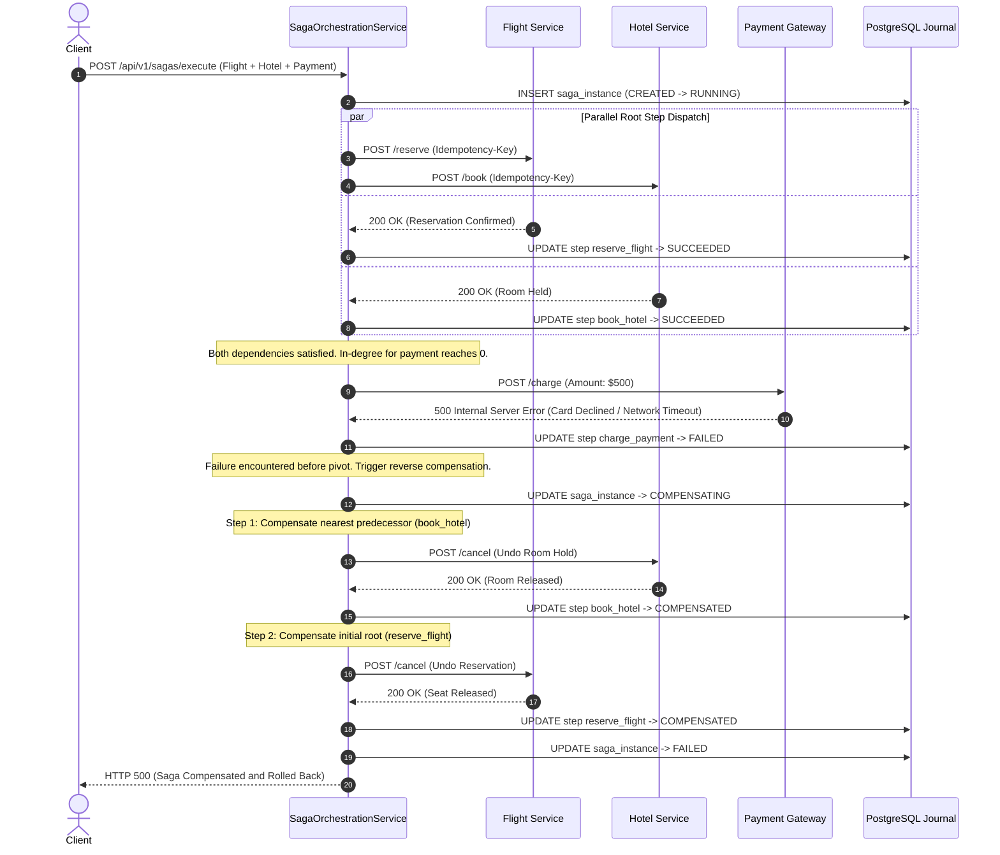

# Saga Orchestration Runtime — Architectural & Visual Diagrams

---

## 1. Hexagonal Runtime Architecture

---

## 2. Dynamic In-Degree Parallel Fan-Out

---

## 3. Reverse Compensation Sequence Diagram

