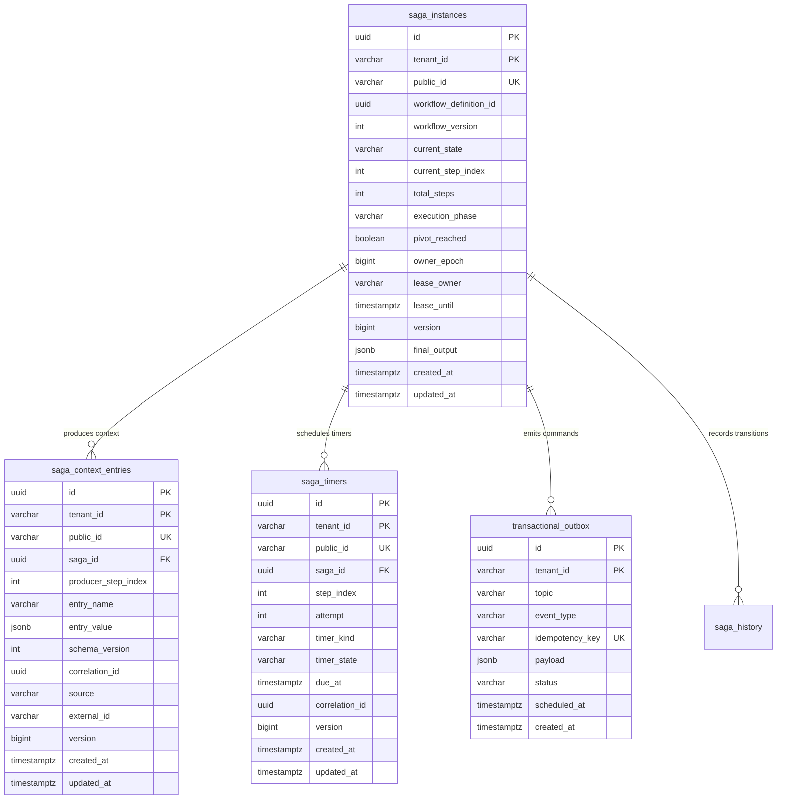

# ADR-0005: Deterministic Sequential Saga Orchestration, Atomic Outbox Dispatching, Pivot Boundaries & Durable Reverse Compensation

| Field | Value |
|---|---|
| Status | Accepted |
| Date | 2026-11-09 |
| Deciders | Lead Systems Architect & Core Architecture Guild |
| Related Docs | [Business Logic & Decision Tree v2](file:///home/btpl-lap-22/live/System-Architect/distributed-transaction-engine/docs/features/sequential-execution/business-logic.md) · [Diagrams](file:///home/btpl-lap-22/live/System-Architect/distributed-transaction-engine/docs/features/sequential-execution/diagrams.md) · [Failure Cases & Mitigations](file:///home/btpl-lap-22/live/System-Architect/distributed-transaction-engine/docs/features/sequential-execution/failure-cases.md) · [Migration 0005](file:///home/btpl-lap-22/live/System-Architect/distributed-transaction-engine/database/migrations/sql/0005_create_sequential_execution_tables.sql) |
| Target Feature | [Sequential Execution Feature](file:///home/btpl-lap-22/live/System-Architect/distributed-transaction-engine/src/features/sequential-execution) |

---

## 1. Context & Problem Statement

Distributed transaction management coordinates asynchronous, multi-service workflows across independent network boundaries (e.g., identity verification, risk scoring, reserve funds, payment capture, third-party logistics, notification dispatch). Because cross-service Two-Phase Commit (2PC) or distributed locking introduces severe lock contention, network bottlenecks, and single points of catastrophic failure across microservices, the platform coordinates distributed transactions using the Saga pattern.

General Directed Acyclic Graph (DAG) orchestration engines (such as in [ADR-0004](file:///home/btpl-lap-22/live/System-Architect/distributed-transaction-engine/docs/features/saga-orchestration/adr.md)) support concurrent branch fan-out and dynamic in-degree evaluations. However, a massive class of core financial, fulfillment, and stateful business processes **strictly forbids speculative parallelism**. These processes demand strict, deterministic **Sequential Execution**:

1. **Strict Upstream Data Dependencies**: Step $N+1$ cannot formulate its input schema without the validated, authoritative output of Step $N$. For example, an accounting ledger entry cannot be submitted before a specific account authorization token and transaction reference ID are generated by the core banking service.
2. **Resource Serialization & Lock Thrashing**: Concurrently dispatching operations that target the same entity (such as debiting an inventory balance or updating a customer wallet) produces catastrophic optimistic lock conflicts (`409 Conflict`), lost update anomalies, and deadlocks in downstream datastores.
3. **Cascading Irreversible Side Effects**: Speculatively dispatching dependent actions in parallel requires costly, high-risk compensation cascades if an earlier prerequisite check fails (e.g., dispatching physical delivery to a courier before fraud screening completes).
4. **Definite Linear Reversibility**: When a pre-pivot step fails, compensation must happen in exact reverse chronological order ($N-1 \to N-2 \to \dots \to 0$), ensuring that downstream systems unwind in the exact inverse order of resource allocation.

Deploying an ad-hoc or naive sequential execution loop introduces fatal production vulnerabilities:
* **The Dual-Write Trap (Data Loss)**: Updating saga state in PostgreSQL and subsequently calling a message broker (Kafka/RabbitMQ) or HTTP RPC out-of-band. If the orchestrator pod crashes or gets evicted between the database commit and the network dispatch, the state machine advances in storage while the downstream step command is lost forever.
* **The Post-Pivot Compensation Disaster (Financial Corruption)**: If Step 2 (Capture Payment, the pivot step) succeeds, and Step 3 (Book Fulfillment) fails, naive backward compensation triggers refunds and inventory releases while the payment capture remains committed, or vice-versa. Once a pivot step succeeds, backward compensation is mathematically and operationally prohibited. The saga must roll forward with durable retries.
* **The Ambiguous Timeout Trap (Orphaned Mutations)**: Network drops, HTTP 504 gateway timeouts, or TCP socket resets do not mean the downstream operation did not execute. Classifying ambiguous timeouts as `FAILED` and triggering reverse compensation produces duplicate operations, financial double-debits, or orphaned downstream allocations.
* **Zombie Worker Split-Brain (State Machine Incoherence)**: If an orchestrator worker suffers a transient network partition or garbage collection pause, another worker may steal the lease. If the partitioned worker resumes and issues state transitions without monotonic fencing token checks, it corrupts the execution journal.
* **Context Tampering & Race Conditions**: Sharing mutable state dictionaries across steps leads to state corruption, race conditions, and zero audit traceability.

---

## 2. Decision Drivers & Architecture Invariants (SQ-01 – SQ-15)

The sequential execution engine is governed by fifteen core invariants:

* **SQ-01 (Zero In-Memory State)**: No saga state lives only in volatile memory. Every state transition, step counter, context payload, and timer is persisted to PostgreSQL before any side effect is triggered. Orchestrator workers are fully stateless.
* **SQ-02 (Conditional State Transitions via CAS)**: Every state mutation is executed via a conditional `UPDATE` asserting `(tenant_id = :tenant, id = :id, version = :expected_version, owner_epoch = :expected_epoch)`. If rows affected is zero, the transaction aborts, preventing lost updates and split-brain writes.
* **SQ-03 (Strict Transactional Outbox Dispatch)**: A step command is dispatched exclusively via the `transactional_outbox` table committed within the same atomic database transaction as the `DISPATCHED` state transition. No direct network RPC or message publishing occurs from service logic.
* **SQ-04 (Deterministic Step Idempotency Keys)**: Every step execution carries a deterministic idempotency key formatted as:
  $$\text{idemp\_fwd\_} \langle \text{tenant\_id} \rangle \_ \langle \text{saga\_id} \rangle \_ \langle \text{step\_index} \rangle \_ \langle \text{attempt} \rangle$$
  Compensation calls carry a distinct key:
  $$\text{idemp\_comp\_} \langle \text{tenant\_id} \rangle \_ \langle \text{saga\_id} \rangle \_ \langle \text{step\_index} \rangle \_ \langle \text{attempt} \rangle$$
* **SQ-05 (Ambiguity Invariant: Timeout $\neq$ Failure)**: Downstream network timeouts transition the step to `UNKNOWN`. Compensation is strictly blocked until an explicit active probe or status query resolves the real downstream state.
* **SQ-06 (Durable Timers for All Waiting States)**: Every `DISPATCHED`, `WAITING`, or `RETRY_SCHEDULED` transition inserts a durable row in `saga_timers` within the same database transaction. No in-memory `time.Sleep` or ephemeral timers are permitted.
* **SQ-07 (Strict Step Categorization & Ordering)**: Workflow steps are categorized as `COMPENSABLE`, `PIVOT`, or `RETRIABLE`. Definitions must satisfy:
  $$\text{COMPENSABLE}^* \longrightarrow \text{PIVOT}^{\{0,1\}} \longrightarrow \text{RETRIABLE}^*$$
  A compensable step can never follow a pivot or retriable step.
* **SQ-08 (The Pivot Point of No Return)**: Once the pivot step transitions to `SUCCEEDED`, reverse compensation is permanently illegal. Any subsequent step failure forces `ROLL_FORWARD` execution (exponential backoff retries until completion or audited operator manual resolution).
* **SQ-09 (Strict Reverse-Ordered Compensation)**: When a pre-pivot step fails permanently, executed compensable steps unwind strictly in reverse index order ($N-1 \to 0$). Compensation steps must be idempotent and retried to completion.
* **SQ-10 (Deterministic Late-Reply Policy)**: Replies arriving for already-compensated or terminal sagas are validated against an inbox deduplication journal. Out-of-phase replies are logged and routed to a Dead-Letter Queue (DLQ).
* **SQ-11 (Single Ownership Fencing)**: Each active saga is owned by at most one worker pod at any instant via `(owner_id, owner_epoch, lease_until)`. Monotonically increasing epochs fence off zombie workers.
* **SQ-12 (Specification Pinning)**: Every running saga instance pins an immutable reference to `(workflow_definition_id, workflow_version, spec_hash)`. Live schema or definition updates never alter in-flight executions.
* **SQ-13 (Namespaced, Append-Only Step Context)**: Step outputs are written as immutable records into `saga_context_entries` keyed by `(tenant_id, saga_id, producer_step_index, entry_name)`. Direct in-place mutation of prior context entries is forbidden.
* **SQ-14 (Audited Operator Governance)**: Manual interventions (pause, resume, retry, force-complete, abandon) require authenticated operator IDs, cryptographic reason strings, and append-only audit trail logging.
* **SQ-15 (Tenant Isolation & Partitioning)**: All database queries, outbox topics, cache keys, and audit journals enforce composite tenant partitioning via `tenant_id`.

---

## 3. Considered Architectural Options

### Option 1: Synchronous In-Memory Thread Loop
* **Architecture**: Orchestrator holds an active thread/goroutine that iterates through steps sequentially, invoking HTTP/gRPC endpoints synchronously.
* **Pros**: Low code complexity; microsecond latency between steps; no message broker overhead.
* **Cons**:
  - Pod eviction, OOM kill, or deployment wipes out in-memory state; transactions remain stranded in unknown states.
  - Long-running transactions hold open TCP sockets and OS threads, causing thread pool exhaustion.
  - Zero durable recovery, lease fencing, or restartability.
* **Verdict**: **Rejected (Fatal Reliability Flaw)**.

### Option 2: Choreographed Event Chaining
* **Architecture**: Microservices publish domain events to Kafka topics; downstream services consume the event, perform their local action, and emit the subsequent event.
* **Pros**: Highly decentralized; no central orchestrator bottleneck.
* **Cons**:
  - Linear flow logic is scattered across independent codebases, creating high cognitive load and zero centralized visibility.
  - Enforcing pivot boundaries and reverse compensation across 10+ services requires complex distributed state tracking and introduces unresolvable cyclic deadlocks.
  - Handling ambiguous timeouts and active status probing in a pure choreography model is virtually impossible.
* **Verdict**: **Rejected for Core Financial Workflows**.

### Option 3: General DAG Engine Forced into Sequential Mode
* **Architecture**: Reusing the general DAG runtime (ADR-0004) with strict dependencies $0 \to 1 \to 2 \dots \to N$.
* **Pros**: Single code path for both DAG and sequential execution.
* **Cons**:
  - DAG engine maintains dynamic in-degree calculation matrices, parallel fan-out concurrency bulkheads, and complex join barriers that introduce unnecessary computational and storage overhead for strictly linear flows.
  - Step index progression and reverse unwinding in a DAG engine requires graph traversal queries rather than lightweight scalar integer increments and decrements.
* **Verdict**: **Rejected as Default Runtime (Used only for complex multi-branch workflows)**.

### Option 4: Relational Sequential Orchestrator with Transactional Outbox & Durable Timers (Selected)
* **Architecture**: A dedicated sequential execution engine utilizing PostgreSQL for state machine journaling, transactional outbox dispatching, durable timer scheduling, and append-only context propagation.
* **Pros**:
  - Provable consistency and complete immunity to dual-write bugs.
  - Deterministic linear progression with scalar step index tracking (`current_step_index`).
  - Native pivot protection and strictly ordered reverse compensation.
  - Built-in crash recovery via monotonic epoch fencing and database-driven lease expiration.
* **Verdict**: **Adopted**.

---

## 4. Entity-Relationship Model (ERD) & Relational Schema

The sequential engine builds upon migration `0005_create_sequential_execution_tables.sql` and the core saga infrastructure.



### Relational Schema DDL & Invariants
```sql
-- Core sequential columns added to saga_instances
ALTER TABLE saga_instances ADD COLUMN IF NOT EXISTS current_step_index INT NOT NULL DEFAULT 0;
ALTER TABLE saga_instances ADD COLUMN IF NOT EXISTS total_steps INT NOT NULL DEFAULT 0;
ALTER TABLE saga_instances ADD COLUMN IF NOT EXISTS execution_phase VARCHAR(32) NOT NULL DEFAULT 'FORWARD';
ALTER TABLE saga_instances ADD COLUMN IF NOT EXISTS pivot_reached BOOLEAN NOT NULL DEFAULT FALSE;
ALTER TABLE saga_instances ADD COLUMN IF NOT EXISTS owner_epoch BIGINT NOT NULL DEFAULT 1;

ALTER TABLE saga_instances DROP CONSTRAINT IF EXISTS saga_instances_execution_phase_ck;
ALTER TABLE saga_instances ADD CONSTRAINT saga_instances_execution_phase_ck CHECK (
    execution_phase IN ('FORWARD', 'COMPENSATING', 'ROLL_FORWARD')
);

-- Immutable, namespaced context entries
CREATE TABLE IF NOT EXISTS saga_context_entries (
    id UUID NOT NULL,
    public_id VARCHAR(32) NOT NULL,
    tenant_id VARCHAR(64) NOT NULL,
    saga_id UUID NOT NULL,
    producer_step_index INT NOT NULL,
    entry_name VARCHAR(128) NOT NULL,
    entry_value JSONB NOT NULL DEFAULT '{}'::jsonb,
    schema_version INT NOT NULL DEFAULT 1,
    correlation_id UUID NOT NULL,
    source VARCHAR(64) NOT NULL DEFAULT 'SYSTEM',
    external_id VARCHAR(128) NOT NULL,
    version BIGINT NOT NULL DEFAULT 1,
    created_at TIMESTAMPTZ NOT NULL DEFAULT NOW(),
    updated_at TIMESTAMPTZ NOT NULL DEFAULT NOW(),
    CONSTRAINT pk_saga_context_entries PRIMARY KEY (tenant_id, id),
    CONSTRAINT saga_context_entries_tenant_id_id_uk UNIQUE (tenant_id, id),
    CONSTRAINT saga_context_entries_public_id_uk UNIQUE (tenant_id, public_id),
    CONSTRAINT saga_context_entries_saga_step_name_uk UNIQUE (tenant_id, saga_id, producer_step_index, entry_name),
    CONSTRAINT saga_context_entries_public_id_ck CHECK (public_id ~ '^ctx_[0-9a-zA-Z]{26}$'),
    CONSTRAINT saga_context_entries_entry_name_ck CHECK (entry_name = btrim(entry_name) AND entry_name <> ''),
    CONSTRAINT saga_context_entries_step_index_ck CHECK (producer_step_index >= 0),
    CONSTRAINT fk_saga_context_entries_saga FOREIGN KEY (tenant_id, saga_id)
        REFERENCES saga_instances (tenant_id, id) ON DELETE CASCADE
);

-- Durable timers for step timeouts and retry backoffs
CREATE TABLE IF NOT EXISTS saga_timers (
    id UUID NOT NULL,
    public_id VARCHAR(32) NOT NULL,
    tenant_id VARCHAR(64) NOT NULL,
    saga_id UUID NOT NULL,
    step_index INT NOT NULL,
    attempt INT NOT NULL DEFAULT 1,
    timer_kind VARCHAR(32) NOT NULL,
    timer_state VARCHAR(32) NOT NULL DEFAULT 'PENDING',
    due_at TIMESTAMPTZ NOT NULL,
    correlation_id UUID NOT NULL,
    source VARCHAR(64) NOT NULL DEFAULT 'SYSTEM',
    external_id VARCHAR(128) NOT NULL,
    version BIGINT NOT NULL DEFAULT 1,
    created_at TIMESTAMPTZ NOT NULL DEFAULT NOW(),
    updated_at TIMESTAMPTZ NOT NULL DEFAULT NOW(),
    CONSTRAINT pk_saga_timers PRIMARY KEY (tenant_id, id),
    CONSTRAINT saga_timers_tenant_id_id_uk UNIQUE (tenant_id, id),
    CONSTRAINT saga_timers_public_id_uk UNIQUE (tenant_id, public_id),
    CONSTRAINT saga_timers_unique_trigger UNIQUE (tenant_id, saga_id, step_index, attempt, timer_kind),
    CONSTRAINT saga_timers_public_id_ck CHECK (public_id ~ '^tmr_[0-9a-zA-Z]{26}$'),
    CONSTRAINT saga_timers_kind_ck CHECK (timer_kind IN ('STEP_TIMEOUT', 'RETRY_BACKOFF', 'SAGA_DEADLINE')),
    CONSTRAINT saga_timers_state_ck CHECK (timer_state IN ('PENDING', 'FIRED', 'CANCELLED', 'EXPIRED')),
    CONSTRAINT fk_saga_timers_saga FOREIGN KEY (tenant_id, saga_id)
        REFERENCES saga_instances (tenant_id, id) ON DELETE CASCADE
);

CREATE INDEX IF NOT EXISTS idx_saga_timers_due ON saga_timers (tenant_id, timer_state, due_at);
CREATE INDEX IF NOT EXISTS idx_saga_context_saga ON saga_context_entries (tenant_id, saga_id);
```

---

## 5. API Contracts & Ingress Specification

All ingress and management endpoints follow OpenAPI v1 guidelines, adhering to tenant isolation and idempotency standards.

### 5.1 Ingress Instantiation
`POST /api/v1/tenants/{tenant_id}/sagas/sequential`

**Request Headers**:
- `Idempotency-Key`: `string` (UUID v4 or deterministic client transaction key)
- `X-Correlation-ID`: `string` (UUID v4)

**Request Body**:
```json
{
  "workflowDefinitionId": "wf_def_01JBM8Z5A00000000000000001",
  "externalId": "order_checkout_9823411",
  "source": "CHECKOUT_SERVICE",
  "payload": {
    "customerId": "cust_88291",
    "amount": 249.99,
    "currency": "USD"
  }
}
```

**Response (HTTP 202 Accepted)**:
```json
{
  "id": "7b8f9e20-9cb1-4f1e-9df1-80a13d7a8e01",
  "publicId": "saga_01JBM9A1Z00000000000000001",
  "tenantId": "tenant_prod_us_east",
  "workflowDefinitionId": "wf_def_01JBM8Z5A00000000000000001",
  "currentState": "RUNNING",
  "currentStepIndex": 0,
  "totalSteps": 4,
  "phase": "FORWARD",
  "pivotReached": false,
  "version": 1,
  "ownerEpoch": 1,
  "createdAt": "2026-11-09T12:00:00Z",
  "updatedAt": "2026-11-09T12:00:00Z"
}
```

### 5.2 Status Query Endpoint
`GET /api/v1/tenants/{tenant_id}/sagas/sequential/{saga_id}`

**Response (HTTP 200 OK)**:
```json
{
  "id": "7b8f9e20-9cb1-4f1e-9df1-80a13d7a8e01",
  "publicId": "saga_01JBM9A1Z00000000000000001",
  "tenantId": "tenant_prod_us_east",
  "workflowDefinitionId": "wf_def_01JBM8Z5A00000000000000001",
  "currentState": "RUNNING",
  "currentStepIndex": 2,
  "totalSteps": 4,
  "phase": "FORWARD",
  "pivotReached": true,
  "version": 5,
  "ownerEpoch": 1,
  "context": {
    "step_0_auth": {"authCode": "AUTH_OK_12984"},
    "step_1_reserve": {"reservationId": "RES_77192"},
    "step_2_capture": {"chargeId": "CH_991823"}
  },
  "updatedAt": "2026-11-09T12:00:05Z"
}
```

---

## 6. Detailed Technical Algorithms

### 6.1 Transactional Forward Dispatch Algorithm
The forward dispatch algorithm commits state updates, durable context entries, timeout timers, and outbox command messages within a single database transaction.

```
Algorithm 1: Forward Dispatch with Atomic Outbox
Input: tenant_id, saga_id, step_index, input_payload, expected_version, owner_epoch
Output: Success or ConflictError

1: BEGIN TRANSACTION
2:   // Step 1: Optimistic CAS Update on saga instance
3:   rows_affected ← UPDATE saga_instances 
4:                    SET current_step_index = step_index,
5:                        current_state = 'WAITING_STEP',
6:                        version = expected_version + 1,
7:                        updated_at = NOW()
8:                    WHERE tenant_id = tenant_id 
9:                      AND id = saga_id 
10:                     AND version = expected_version 
11:                     AND owner_epoch = owner_epoch;
12:  IF rows_affected == 0 THEN
13:     ROLLBACK;
14:     RETURN ConflictError("Stale version or owner epoch conflict");
15:  END IF;
16:
17:  // Step 2: Insert durable timeout timer
18:  INSERT INTO saga_timers (id, tenant_id, saga_id, step_index, attempt, timer_kind, due_at)
19:  VALUES (gen_uuid(), tenant_id, saga_id, step_index, 1, 'STEP_TIMEOUT', NOW() + step_timeout);
20:
21:  // Step 3: Enqueue dispatch command into transactional outbox
22:  idemp_key ← ComputeForwardKey(tenant_id, saga_id, step_index, attempt=1);
23:  INSERT INTO transactional_outbox (id, tenant_id, topic, event_type, idempotency_key, payload)
24:  VALUES (gen_uuid(), tenant_id, step_command_topic, 'DISPATCH_STEP', idemp_key, input_payload);
25:
26: COMMIT TRANSACTION;
27: RETURN Success;
```

### 6.2 Ambiguous Timeout & Unknown Resolution Algorithm
Enforces Invariant SQ-05: Timeouts never trigger premature compensation.

```
Algorithm 2: Ambiguous Timeout Resolution
Input: tenant_id, saga_id, step_index, attempt, owner_epoch
Output: Transition to SUCCEEDED, NOT_EXECUTED, or NEEDS_ATTENTION

1: idemp_key ← ComputeForwardKey(tenant_id, saga_id, step_index, attempt);
2: UPDATE saga_instances SET current_state = 'RESOLVING_UNKNOWN' WHERE id = saga_id AND tenant_id = tenant_id;
3:
4: // Active probing of downstream worker service
5: probe_result ← DownstreamService.QueryStatusByIdempotencyKey(idemp_key);
6:
7: SWITCH probe_result.status DO:
8:    CASE 'COMPLETED':
9:       // Downstream executed successfully during network silence
10:      PersistContextEntry(tenant_id, saga_id, step_index, probe_result.output);
11:      CancelTimer(tenant_id, saga_id, step_index, 'STEP_TIMEOUT');
12:      AdvanceToNextStep(step_index + 1);
13:   CASE 'NOT_FOUND' OR 'REJECTED':
14:      // Confirmed no side effects executed downstream
15:      CancelTimer(tenant_id, saga_id, step_index, 'STEP_TIMEOUT');
16:      IF CanCompensate(saga.phase, saga.pivot_reached) THEN
17:         InitiateReverseCompensation(step_index - 1);
18:      ELSE
19:         TransitionToRollForward(step_index);
20:      END IF;
21:   DEFAULT:
22:      // Still unreachable or ambiguous; escalate to operator
23:      ScheduleRetryOrEscalate(tenant_id, saga_id, step_index, attempt + 1);
24: END SWITCH;
```

### 6.3 Reverse Compensation Traversal Algorithm
Executes strictly in reverse chronological order ($N-1 \to 0$) for pre-pivot failures.

```
Algorithm 3: Strict Reverse Compensation Traversal
Input: tenant_id, saga_id, failing_step_index
Precondition: saga.pivot_reached == false

1: target_index ← failing_step_index - 1;
2: WHILE target_index >= 0 DO:
3:    step_def ← GetStepDefinition(target_index);
4:    IF step_def.nature == 'COMPENSABLE' THEN
5:       comp_key ← ComputeCompKey(tenant_id, saga_id, target_index);
6:       BEGIN TRANSACTION;
7:          UPDATE saga_instances SET execution_phase = 'COMPENSATING', current_step_index = target_index;
8:          INSERT INTO transactional_outbox (topic, event_type, idempotency_key, payload)
9:          VALUES (comp_topic, 'COMPENSATE_STEP', comp_key, GetStepOutput(target_index));
10:      COMMIT TRANSACTION;
11:      
12:      WaitForCompensationCompletion(target_index);
13:   END IF;
14:   target_index ← target_index - 1;
15: END WHILE;
16:
17: UPDATE saga_instances SET current_state = 'FAILED_COMPENSATED';
```

---

## 7. Observability, Tracing & Loki Compliance

1. **W3C Distributed Tracing**: Every saga dispatch and outbox message injects W3C `traceparent` headers. Distributed traces span ingress APIs, orchestrator state machine updates, outbox tailers, and downstream worker handlers.
2. **Zero PII in Logs (Loki Compliance)**:
   - Request and response payloads are encrypted in `saga_context_entries` using tenant-specific AES-GCM keys.
   - Central stdout logs emit only: `tenant_id`, `saga_public_id`, `step_index`, `state`, `duration_ms`, and sanitized error codes.
   - Any sensitive payload exceeding 16KB is offloaded to object storage using the Claim-Check pattern (`s3://saga-payloads/{tenant_id}/{saga_id}/{step_index}`), storing only the signed URI in PostgreSQL.
3. **Key Prometheus Metrics**:
   - `saga_sequential_execution_duration_seconds{tenant, workflow, phase}`
   - `saga_sequential_step_transitions_total{tenant, workflow, from_state, to_state}`
   - `saga_unknown_resolution_duration_seconds{tenant, workflow}`
   - `saga_pivot_reached_total{tenant, workflow}`
   - `saga_compensation_duration_seconds{tenant, workflow}`
   - `saga_needs_attention_gauge{tenant, workflow}`

---

## 8. Implementation Gap Analysis & Remediation Plan

[Certain] An architectural inspection of the current implementation in [`distributed-transaction-engine/src/features/sequential-execution/`](file:///home/btpl-lap-22/live/System-Architect/distributed-transaction-engine/src/features/sequential-execution/) identifies three critical architectural gaps that must be remediated:

1. **Gap 1: Out-of-Band Dispatch Dual-Write Violation (SQ-03)**:
   - *Current Code*: [`sequential-execution.service.go`](file:///home/btpl-lap-22/live/System-Architect/distributed-transaction-engine/src/features/sequential-execution/service/sequential-execution.service.go#L76-L144) calls `s.dispatcher.DispatchStep` directly after committing `UpdateSagaCAS`.
   - *Remediation*: Refactor `PostgresSequentialExecutionRepositoryAdapter` to insert outbound command rows into `transactional_outbox` within the exact same PostgreSQL transaction block as `UpdateSagaCAS`.
2. **Gap 2: Missing `RESOLVING_UNKNOWN` State in Machine (SQ-05)**:
   - *Current Code*: [`sequential-execution.machine.go`](file:///home/btpl-lap-22/live/System-Architect/distributed-transaction-engine/src/features/sequential-execution/domain/machines/sequential-execution.machine.go#L90-L134) only evaluates binary `isRetryable` flags, forcing non-retryable network timeouts straight into `COMPENSATING`.
   - *Remediation*: Introduce `OutcomeUnknown` handling to transition the saga to `RESOLVING_UNKNOWN` and emit an active probe command before determining compensation eligibility.
3. **Gap 3: Missing Durable Timer Registration (SQ-06)**:
   - *Current Code*: Timers are triggered via in-memory mock dispatcher calls rather than atomic inserts into `saga_timers`.
   - *Remediation*: Add `saga_timers` insert statements to the atomic CAS transaction in the PostgreSQL repository adapter.

---

## 9. Verification & Test Matrix

| Test Suite | File Reference | Target Invariant | Coverage Description |
|---|---|---|---|
| Step Ordering Rule Tests | [`sequential-execution.rules_test.go`](file:///home/btpl-lap-22/live/System-Architect/distributed-transaction-engine/src/features/sequential-execution/tests/sequential-execution.rules_test.go) | SQ-07, SQ-08 | Verifies rejection of workflows placing compensable steps after pivot or retriable steps. |
| State Machine Tests | [`sequential-execution.machine_test.go`](file:///home/btpl-lap-22/live/System-Architect/distributed-transaction-engine/src/features/sequential-execution/tests/sequential-execution.machine_test.go) | SQ-01, SQ-08, SQ-09 | Verifies bi-directional transitions, forward completion, and reverse compensation index calculation. |
| CAS Concurrency & Fencing | Integration Test | SQ-02, SQ-11 | Validates that concurrent updates with mismatched `version` or `owner_epoch` return `409 Conflict`. |
| Outbox Atomicity Chaos | Chaos Test | SQ-03 | Injects SIGKILL immediately following DB commit to verify that no message loss occurs upon worker restart. |
| Ambiguous Timeout Probe | Integration Test | SQ-05 | Simulates HTTP 504 timeouts to verify progression to `RESOLVING_UNKNOWN` and active polling. |

