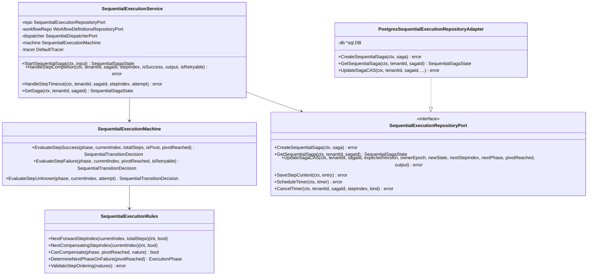
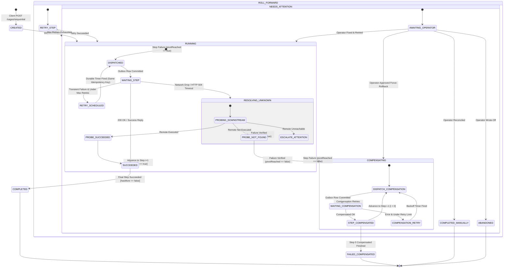
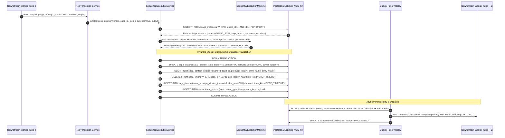
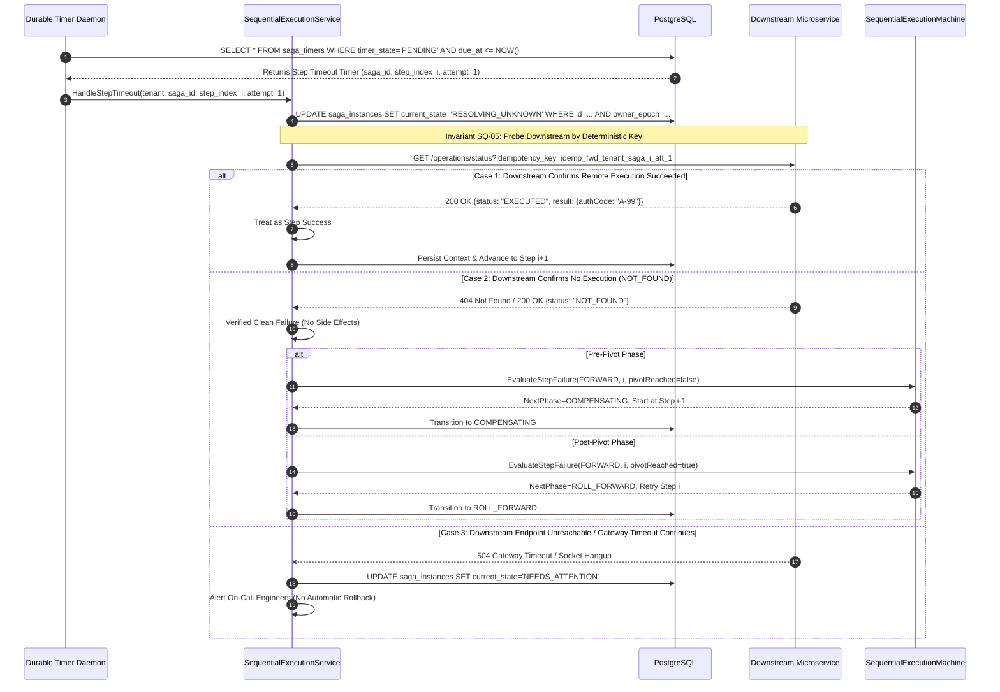
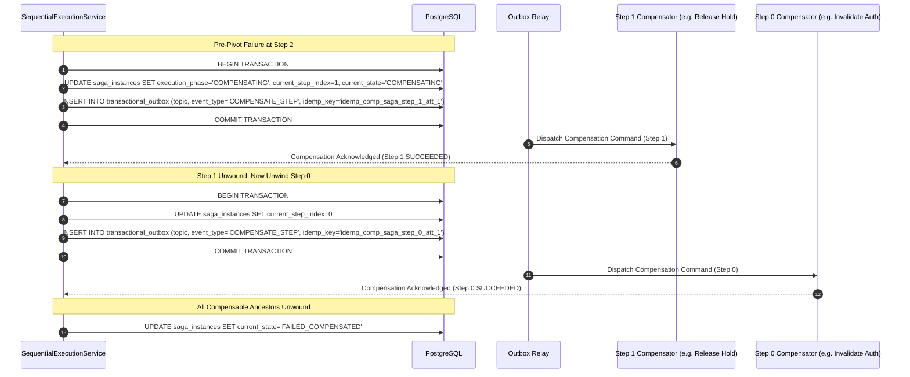
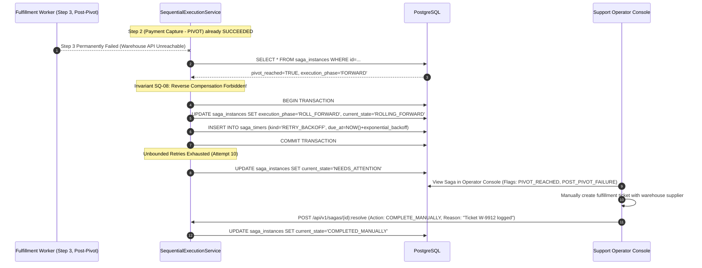
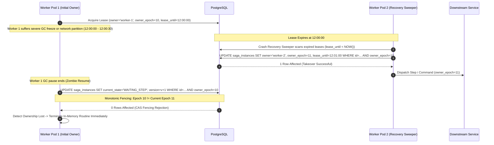

# Sequential Saga Execution — Architectural & Visual Diagrams

This document contains high-level and low-level architectural diagrams for the **Sequential Execution Engine** in the Distributed Transaction Engine platform, supporting [ADR-0005](file:///home/btpl-lap-22/live/System-Architect/distributed-transaction-engine/docs/features/sequential-execution/adr.md) and [Business Logic Tree v2](file:///home/btpl-lap-22/live/System-Architect/distributed-transaction-engine/docs/features/sequential-execution/business-logic.md).

---

## 1. High-Level Architecture (HLD): Hexagonal Outbox Model

The sequential execution runtime utilizes a hexagonal architecture pattern where the orchestrator engine is decoupled from transport infrastructure via PostgreSQL tables, providing zero dual-write vulnerability and persistent auditability.

```mermaid
flowchart TB
    subgraph IngressLayer ["Ingress & Client Layer"]
        Client["Client / External Ingress"] -->|POST /api/v1/tenants/{tenant}/sagas/sequential| API["API Gateway / Router"]
        API -->|Invoke Service| Service["SequentialExecutionService"]
    end

    subgraph CoreEngine ["Domain Core (Hexagonal Center)"]
        Service -->|Evaluate Transitions| Machine["SequentialExecutionMachine"]
        Machine -->|Enforce Invariants SQ-01..15| Rules["SequentialExecutionRules"]
    end

    subgraph PortsAdapters ["Infrastructure Ports & Adapters"]
        Service -->|Persist State & Outbox| RepoPort["SequentialExecutionRepositoryPort"]
        RepoPort -->|PostgreSQL Adapter| PGAdapter["PostgresSequentialExecutionRepositoryAdapter"]
        Service -->|Emit Commands| DispPort["SequentialDispatcherPort"]
        DispPort -->|Outbox Adapter| OutboxAdapter["TransactionalOutboxDispatcherAdapter"]
    end

    subgraph StorageLayer ["PostgreSQL ACID Datastore"]
        PGAdapter -->|Atomic CAS UPDATE| DB_Instances[("saga_instances")]
        PGAdapter -->|Append Immutable Entry| DB_Context[("saga_context_entries")]
        PGAdapter -->|Schedule Due Time| DB_Timers[("saga_timers")]
        OutboxAdapter -->|Atomic INSERT with CAS| DB_Outbox[("transactional_outbox")]
    end

    subgraph TransportLayer ["Asynchronous Message Plane"]
        DB_Outbox -->|WAL Log Tailing / Debezium| OutboxRelay["Outbox Relay Daemon"]
        OutboxRelay -->|Publish Command| KafkaBroker["Kafka Step Command Topics"]
        KafkaBroker -->|Consume Command| Microservice["Downstream Step Worker"]
        Microservice -->|Acknowledge / Complete| ReplyQueue["Reply Event Topic"]
        ReplyQueue -->|Idempotent Ingestion| InboxConsumer["Orchestrator Reply Consumer"]
        InboxConsumer -->|Dispatch Event| Service
    end

    subgraph BackgroundDaemons ["Engine Resiliency Fleet"]
        TimerPoller["Durable Timer Poller"] -->|Poll due_at <= NOW| DB_Timers
        TimerPoller -->|Trigger Timeout Event| Service
        Sweeper["Crash Recovery Sweeper"] -->|Takeover Expired Leases| DB_Instances
    end
```

---

## 2. Low-Level Component & Service Engine (LLD)

This diagram details the internal package layout, class relationships, and repository query interfaces governing the feature.



---

## 3. Comprehensive State Machine Transition Model (FSM)

The sequential saga finite state machine manages forward progression, unknown outcome resolution, pre-pivot reverse compensation, and post-pivot roll-forward execution.



---

## 4. End-to-End Happy Path Forward Execution Sequence

This sequence traces step $i$ completing, context being recorded, and step $i+1$ being atomically dispatched via the transactional outbox.



---

## 5. Ambiguous Timeout & Unknown Resolution Sequence

Demonstrates strict enforcement of **Invariant SQ-05 (Timeout $\neq$ Failure)**. Network timeouts trigger active probing rather than speculative compensation.



---

## 6. Pre-Pivot Reverse Compensation Flowchart & Sequence

Illustrates **Invariants SQ-08 and SQ-09**: when Step 2 fails before the pivot point, completed Steps 1 and 0 are rolled back in exact reverse order ($1 \to 0$).



---

## 7. Post-Pivot Failure Roll-Forward & Operator Escalation

Enforces **Invariant SQ-08 (The Pivot Point of No Return)**: after a pivot step succeeds, failure in downstream steps triggers persistent retries and human escalation, never rollback.



---

## 8. Monotonic Epoch Fencing & Zombie Worker Prevention

Demonstrates **Invariants SQ-02 and SQ-11**: worker crash recovery, lease stealing, and fencing off zombie workers using monotonic epochs.



