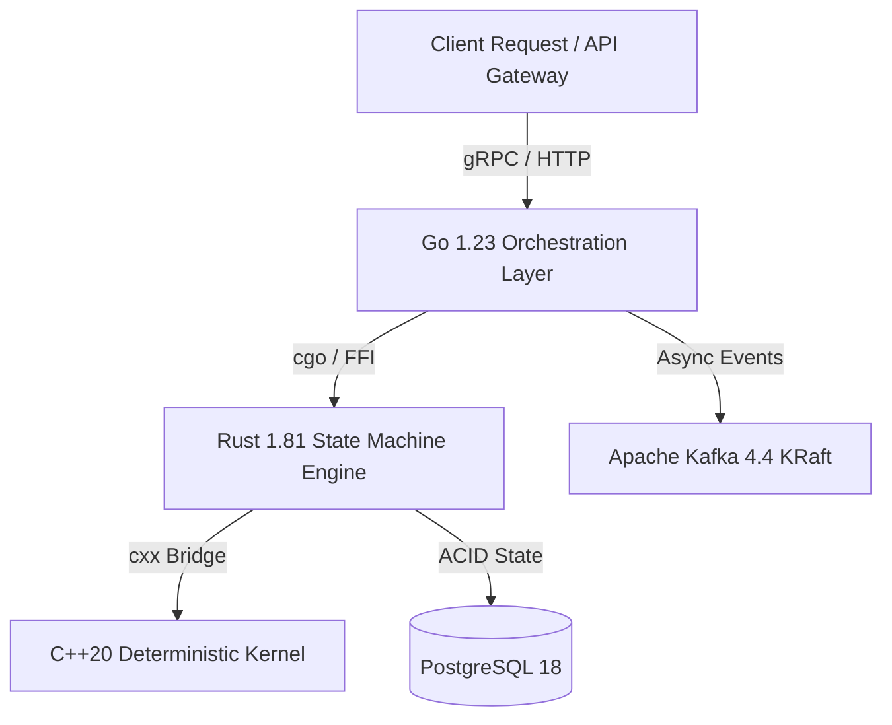

# ADR-0001: Polyglot Execution Runtime for Saga Orchestration

| Field | Value |
|---|---|
| Status | Accepted |
| Date | 2026-11-02 |
| Deciders | Core Architecture Guild |
| Related ADRs | [ADR-0002](file:///home/btpl-lap-22/live/System-Architect/distributed-transaction-engine/docs/tech-stack/ADR-0002-dual-tier-datastore-strategy.md), [ADR-0003](file:///home/btpl-lap-22/live/System-Architect/distributed-transaction-engine/docs/tech-stack/ADR-0003-kraft-event-fabric.md) |
| Related System | [Distributed Transaction Engine Architecture](file:///home/btpl-lap-22/live/System-Architect/distributed-transaction-engine/docs/features/saga-orchestration/adr.md) |

---

## 1. Context

The Distributed Transaction Engine coordinates mission-critical multi-step distributed sagas, dual-phase commits, and compensating actions across diverse internal platforms. 

Monolithic single-language architectures introduce critical compromises:
1. Pure Go garbage collector pauses induce jitter in sub-millisecond deterministic transaction rollback kernels.
2. Pure Rust lacks the mature network/gRPC concurrency and developer velocity required for top-level distributed workflow coordination.
3. Pure C++ introduces excessive developer overhead and memory safety risk for user-facing API handlers.

---

## 2. Decision Drivers

| Driver | Why It Matters |
|---|---|
| Zero Memory Safety Vulnerabilities in State Core | State transitions must guarantee non-null, leak-free persistence |
| Deterministic Rollback Latency (< 1ms P99) | Mathematical compensation kernels must not experience GC pauses |
| High Concurrency gRPC & Workflow Orchestration | Top-level saga coordination must handle 100k+ concurrent connections |
| Native FFI Interoperability | Runtime bridge must not introduce network serialization overhead |

---

## 3. Considered Options

| Option | Pros | Cons | Cost/Effort |
|---|---|---|---|
| **Option A: Pure Go (1.23)** | Fast developer onboarding, mature net/http & gRPC | Non-deterministic GC pause spikes (>15ms P99) during heavy load | Low |
| **Option B: Pure Rust (1.81)** | Safe memory management, zero-cost abstractions | Slower feature velocity for high-level workflow graph scheduling | Medium-High |
| **Option C: Polyglot (Go + Rust + C++)** | Best tool for each layer: Go for concurrency, Rust for state, C++ for math | Requires strict C-ABI / FFI boundaries | Medium |

---

## 4. Decision Outcome

**Chosen option:** **Option C: Polyglot Architecture**

1. **Go 1.23 Layer (`src/`):** Exposes high-throughput gRPC/REST APIs, coordinates Kafka event streaming, and schedules saga workflow DAGs.
2. **Rust 1.81 Layer (`rust-modules/`):** Manages the core transaction state machine, invariants validation, and transactional outbox persistence via `cxx`/FFI.
3. **C++20 Layer (`cpp-modules/`):** Executes latency-critical compensation algorithms and numerical ledger calculations with zero garbage collection.

---

## 5. Architectural Topology Diagram

---

## 6. Failure Modes and Mitigation

| Failure Scenario | Detection Mechanism | Immediate Mitigation | Automated Recovery |
|---|---|---|---|
| FFI Memory Boundary Corruption | Valgrind / ASan automated CI probes | Immediate process panic and Kubernetes pod restart | Outbox log replay from PostgreSQL 18 snapshot |
| Go GC Latency Spike | Prometheus `go_gc_duration_seconds` | Traffic throttling via Caddy ingress rate limiter | GOGC auto-tuning |
