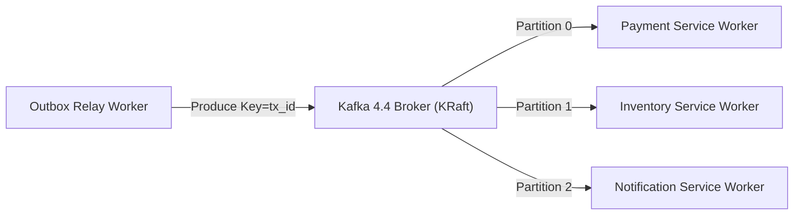

# ADR-0003: Apache Kafka KRaft Event Fabric

| Field | Value |
|---|---|
| Status | Accepted |
| Date | 2026-11-02 |
| Deciders | Core Architecture Guild |
| Related ADRs | [ADR-0002](file:///home/btpl-lap-22/live/System-Architect/distributed-transaction-engine/docs/tech-stack/ADR-0002-dual-tier-datastore-strategy.md), [ADR-0004](file:///home/btpl-lap-22/live/System-Architect/distributed-transaction-engine/docs/tech-stack/ADR-0004-lgtm-opentelemetry-observability.md) |
| Related System | [Transactional Outbox](file:///home/btpl-lap-22/live/System-Architect/distributed-transaction-engine/docs/features/transactional-outbox/adr.md) |

---

## 1. Context

Distributed saga participants must communicate asynchronously through an immutable, ordered event log. 

ZooKeeper-dependent event brokers introduce operational complexity, dual-quorum split-brain risks, and slow failover times. KRaft mode in Kafka 4.4 removes external coordination dependencies.

---

## 2. Decision Drivers

| Driver | Why It Matters |
|---|---|
| Zero External Consensus Daemons | Removes ZooKeeper management overhead and JVM drift |
| Strict Partition-Level Ordering | Guarantees saga state transition events arrive in execution order |
| High-Throughput Replay Capability | Enables event sourcing recovery after participant failure |

---

## 3. Decision Outcome

**Chosen option:** **Apache Kafka 4.4.0 in KRaft Mode**

- **Consensus:** Built-in Raft metadata quorum (KRaft).
- **Partitioning:** Key-based partitioning hashed on `transaction_id` ensures sequential order per saga.

### Service Credentials & Access

```env
# Apache Kafka 4.4 KRaft
KAFKA_CLUSTER_ID=4L622nShTUiAnsYh0mqveQ
KAFKA_BROKER_ID=1
KAFKA_BOOTSTRAP_SERVERS=127.0.0.1:9092
KAFKA_INTERNAL_BOOTSTRAP_SERVERS=kafka:9092
```

### CLI Verification & Testing Commands

To produce and consume a test event directly inside the running container:

```bash
docker exec dist_tx-kafka-1 /bin/bash -c "echo 'infra-smoke-test' | /opt/kafka/bin/kafka-console-producer.sh --bootstrap-server localhost:9092 --topic smoke-test && /opt/kafka/bin/kafka-console-consumer.sh --bootstrap-server localhost:9092 --topic smoke-test --partition 0 --offset 0 --max-messages 1"
```

---

## 4. Architectural Diagram


