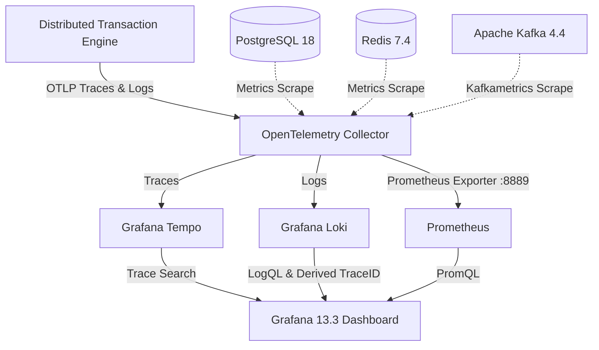

# ADR-0004: LGTM Observability Stack and OpenTelemetry Ingestion Fabric

| Field | Value |
|---|---|
| Status | Accepted |
| Date | 2026-11-02 |
| Deciders | Core Architecture Guild |
| Related ADRs | [ADR-0001](file:///home/btpl-lap-22/live/System-Architect/distributed-transaction-engine/docs/tech-stack/ADR-0001-polyglot-execution-runtime.md), [ADR-0003](file:///home/btpl-lap-22/live/System-Architect/distributed-transaction-engine/docs/tech-stack/ADR-0003-kraft-event-fabric.md) |
| Related System | [Distributed Tracing](file:///home/btpl-lap-22/live/System-Architect/distributed-transaction-engine/docs/features/distributed-tracing/adr.md) |

---

## 1. Context

Debugging distributed saga failures across polyglot microservices without cross-cutting correlation IDs leads to excessive MTTR. 

Vendor-proprietary agents create lock-in and complicate local development. Standardizing on OpenTelemetry (OTel) provides unified tracing, metrics, and logs across all execution layers.

---

## 2. Decision Outcome

**Chosen option:** **OpenTelemetry Collector + LGTM Stack (Loki, Grafana, Tempo, Prometheus)**

- **Collector:** `otel/opentelemetry-collector-contrib:0.108.0` receives OTLP via gRPC (`:4317`) and HTTP (`:4318`), scrapes PostgreSQL, Redis, and Kafka metrics (`kafkametrics` receiver), and forwards signals to backend engines.
- **Traces:** Grafana Tempo 2.6.0 stores trace spans with parquet columnar storage.
- **Logs:** Grafana Loki 3.1.1 ingests structured logs with automatic trace-to-log correlation via `trace_id` derived fields.
- **Metrics:** Prometheus 2.54 scrapes exported collector metrics on `:8889` under the `otel_*` namespace.
- **Visualization:** Grafana 13.3 correlates traces, logs, and metrics in a unified dashboard.

### Service Credentials & Access

```env
# Grafana UI
GRAFANA_URL=http://localhost:3000
GRAFANA_ADMIN_USER=admin
GRAFANA_ADMIN_PASSWORD=admin

# Prometheus
PROMETHEUS_URL=http://localhost:9090

# OpenTelemetry Collector
OTEL_HTTP_ENDPOINT=http://127.0.0.1:4318
OTEL_GRPC_ENDPOINT=http://127.0.0.1:4317
OTEL_HEALTH_CHECK=http://127.0.0.1:13133/
OTEL_METRICS_EXPORT=http://127.0.0.1:8889/metrics

# Loki & Tempo
LOKI_URL=http://localhost:3100
TEMPO_URL=http://localhost:3200
```

---

## 3. Observability Architecture Diagram


