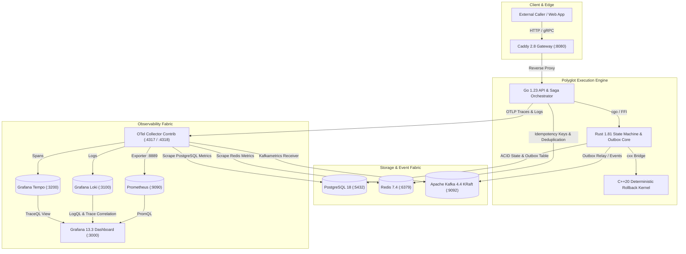

# Technology Stack & Infrastructure Architecture

| Property | Specification |
|---|---|
| Document Type | Platform Architecture Standard & ADR Suite |
| Directory Location | `docs/features/tech-stack/` |
| Primary Datastore | PostgreSQL 18-bookworm (Debian cluster layout) |
| Cache & Dedup | Redis 7.4-bookworm (allkeys-lru memory cache) |
| Event Fabric | Apache Kafka 4.4.0 (KRaft mode, ZooKeeper-less) |
| Observability Stack | LGTM (Grafana 13.3, Loki 3.1, Tempo 2.6, Prometheus 2.54, OTel Collector 0.108) |
| Ingress Proxy | Caddy 2.8-alpine |

---

## 1. Quick Start & Bootstrap Commands

To deploy and verify the entire technology stack with a single command:

```bash
# 1. Bring up all 9 infrastructure services
./scripts/run/infra.sh up

# 2. Run end-to-end trace, log, PostgreSQL, and Kafka verification
./scripts/run/infra.sh test

# 3. View status across all containers
./scripts/run/infra.sh status
```

---

## 2. Infrastructure Access, Endpoints & Service Credentials

| Service | Host Port | Internal Docker URL | Authentication & Credentials | Purpose / Access Command |
|---|---|---|---|---|
| **Grafana Dashboard** | `3000` | `http://grafana:3000` | **User:** `admin`<br>**Password:** `admin` | Web UI at [http://localhost:3000](http://localhost:3000) (Traces, Logs, Metrics) |
| **Prometheus** | `9090` | `http://prometheus:9090` | Anonymous (No auth) | Target status at [http://localhost:9090/targets](http://localhost:9090/targets) |
| **PostgreSQL 18** | `5432` | `db:5432` | **User:** `postgres`<br>**Password:** `supersecretpgpassword`<br>**Database:** `dist_tx_engine` | CLI access: `docker exec -it dist_tx-db-1 psql -U postgres -d dist_tx_engine` |
| **Apache Kafka 4.4** | `9092` | `kafka:9092` | Anonymous (KRaft mode)<br>**Cluster ID:** `4L622nShTUiAnsYh0mqveQ` | CLI verification: `docker exec dist_tx-kafka-1 /opt/kafka/bin/kafka-topics.sh --bootstrap-server localhost:9092 --list` |
| **OTel Ingestion (HTTP)** | `4318` | `http://otel-collector:4318` | Anonymous | Ingest spans: `POST http://127.0.0.1:4318/v1/traces`<br>Ingest logs: `POST http://127.0.0.1:4318/v1/logs` |
| **OTel Ingestion (gRPC)** | `4317` | `otel-collector:4317` | Anonymous | High-performance gRPC OTLP receiver |
| **OTel Health Check** | `13133` | `http://otel-collector:13133` | Anonymous | Readiness probe at [http://localhost:13133/](http://localhost:13133/) (`{"status":"Server available"}`) |
| **OTel Prometheus Metrics** | `8889` | `http://otel-collector:8889` | Anonymous | Scraped by Prometheus at [http://localhost:8889/metrics](http://localhost:8889/metrics) |
| **Tempo (Traces)** | `3200` | `tempo:3200` | Anonymous | Queried directly via Grafana Tempo Datasource |
| **Loki (Logs)** | `3100` | `loki:3100` | Anonymous | Queried directly via Grafana Loki Datasource |
| **Redis 7.4** | `6379` | `cache:6379` | Anonymous | CLI access: `docker exec -it dist_tx-cache-1 redis-cli ping` |
| **Caddy Ingress Gateway** | `8080` | `proxy:80` | Anonymous | Public HTTP gateway at [http://localhost:8080/](http://localhost:8080/) |

---

## 3. Technology Stack ADR Index

All detailed architecture records are housed in this feature directory:

1. [ADR-0001: Polyglot Execution Runtime for Saga Orchestration](file:///home/btpl-lap-22/live/System-Architect/distributed-transaction-engine/docs/features/tech-stack/ADR-0001-polyglot-execution-runtime.md)
   - Go 1.23 Orchestration + Rust 1.81 State Machine + C++20 Rollback Kernel.
2. [ADR-0002: Dual-Tier Datastore Strategy](file:///home/btpl-lap-22/live/System-Architect/distributed-transaction-engine/docs/features/tech-stack/ADR-0002-dual-tier-datastore-strategy.md)
   - PostgreSQL 18 ACID Durability + Redis 7.4 Sub-Millisecond Idempotency Caching.
3. [ADR-0003: Apache Kafka KRaft Event Fabric](file:///home/btpl-lap-22/live/System-Architect/distributed-transaction-engine/docs/features/tech-stack/ADR-0003-kraft-event-fabric.md)
   - ZooKeeper-less Kafka 4.4 cluster, partition hashing on `transaction_id`, and test commands.
4. [ADR-0004: LGTM Observability Stack and OpenTelemetry Ingestion Fabric](file:///home/btpl-lap-22/live/System-Architect/distributed-transaction-engine/docs/features/tech-stack/ADR-0004-lgtm-opentelemetry-observability.md)
   - OpenTelemetry Collector, Tempo tracing, Loki logging, Prometheus metrics, and Grafana dashboards.

---

## 4. End-to-End System Architecture Diagram


