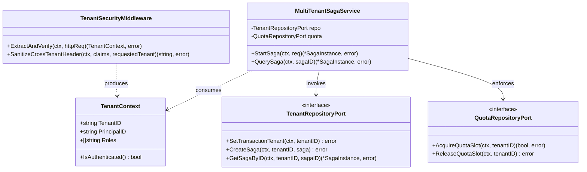
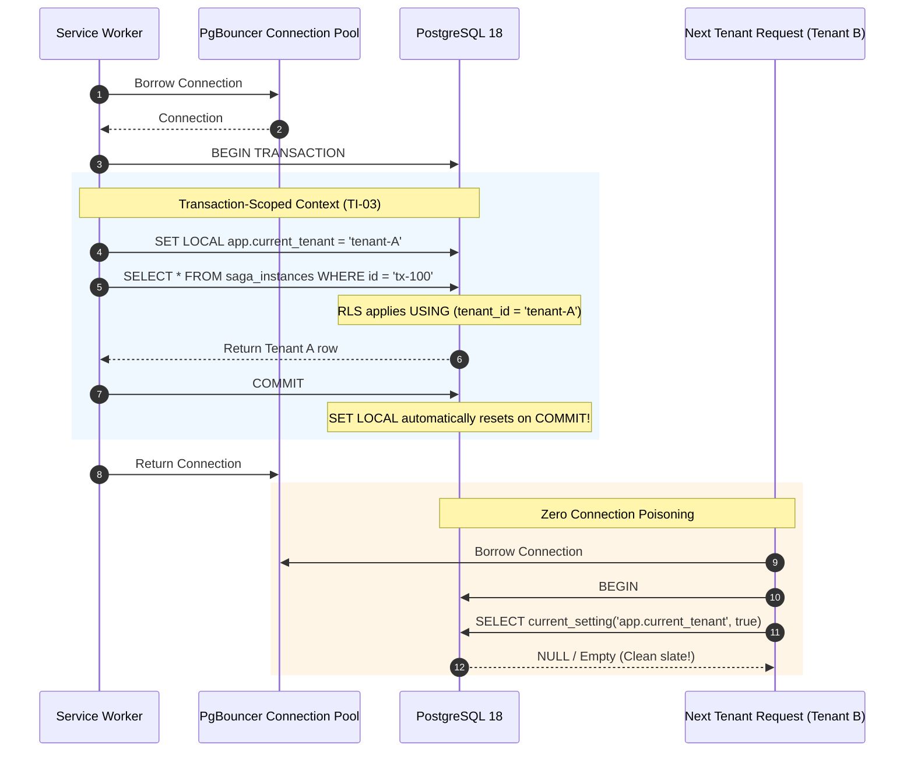
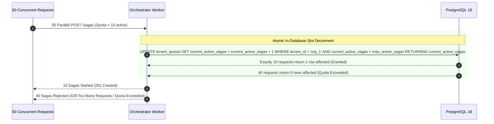
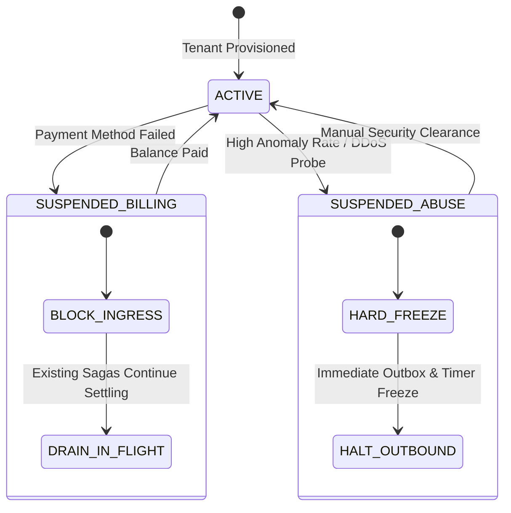

# Tenant Isolation — Architectural & Visual Diagrams

This document illustrates the multi-tier defense-in-depth isolation blueprints, component models, and sequence workflows for the **Multi-Tenant Isolation Subsystem**, supporting [ADR-0009](file:///home/btpl-lap-22/live/System-Architect/distributed-transaction-engine/docs/features/tenant-isolation/adr.md) and [Business Logic Decision Tree v2](file:///home/btpl-lap-22/live/System-Architect/distributed-transaction-engine/docs/features/tenant-isolation/business-logic.md).

---

## 1. High-Level Architecture (HLD): Multi-Tier Defense-in-Depth

```mermaid
flowchart TB
    subgraph IngressLayer ["Ingress & Identity Gateway"]
        ClientA["Tenant A Client"] -->|JWT (sub: userA, tenant: org_1)| Gateway["API Gateway / Middleware"]
        ClientB["Attacker (JWT: org_2, X-Tenant: org_1)"] --> Gateway
        Gateway -->|Extract Identity-Derived Tenant (TI-01)| Authenticator["Token Claims Extractor"]
        Authenticator -->|Inject TenantContext: org_1| ContextFilter["Tenant Context Scope"]
    end

    subgraph ServiceLayer ["Orchestrator Service Layer"]
        ContextFilter --> Service["MultiTenantSagaService"]
        Service -->|1. Atomic Quota Reservation (TI-08)| QuotaManager["Atomic Quota Guard"]
        Service -->|2. App-Level Predicate: WHERE tenant_id = 'org_1'| RepoPort["TenantAwareRepository"]
    end

    subgraph DatabaseLayer ["PostgreSQL 18 Multi-Tenant Layer"]
        RepoPort -->|BEGIN TRANSACTION| DB_Conn["Pooled DB Connection"]
        DB_Conn -->|SET LOCAL app.current_tenant = 'org_1' (TI-03)| RLS_Engine["PostgreSQL RLS Engine"]
        RLS_Engine -->|FORCE ROW LEVEL SECURITY (TI-04)| Table_Sagas[("saga_instances<br/>PRIMARY KEY (tenant_id, id)")]
        RLS_Engine -->|WITH CHECK Policy: Blocks writes to other tenants| Table_Sagas
        DB_Conn -->|COMMIT TRANSACTION (auto-clears SET LOCAL)| PgBouncer["PgBouncer Pool"]
    end
```

---

## 2. Low-Level Component Model (LLD)



---

## 3. Transaction-Scoped RLS Execution & Connection Pool Recycling



---

## 4. Atomic Quota Reservation Sequence (Eliminating Check-Then-Act Race)



---

## 5. Tenant Status Lifecycle & Suspension State Machine



