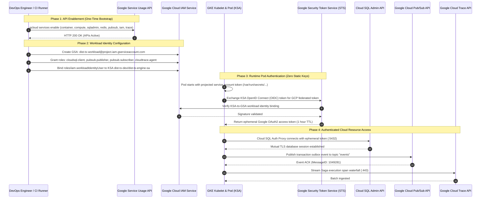
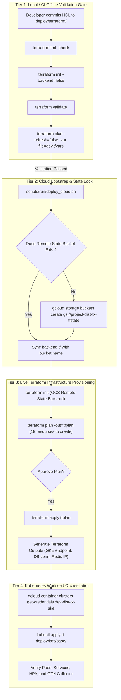
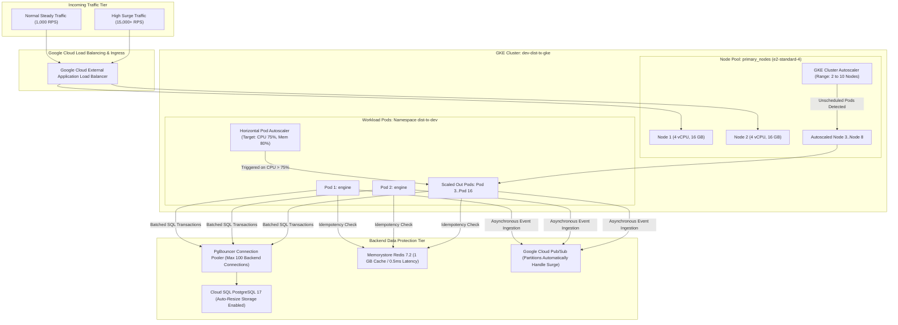
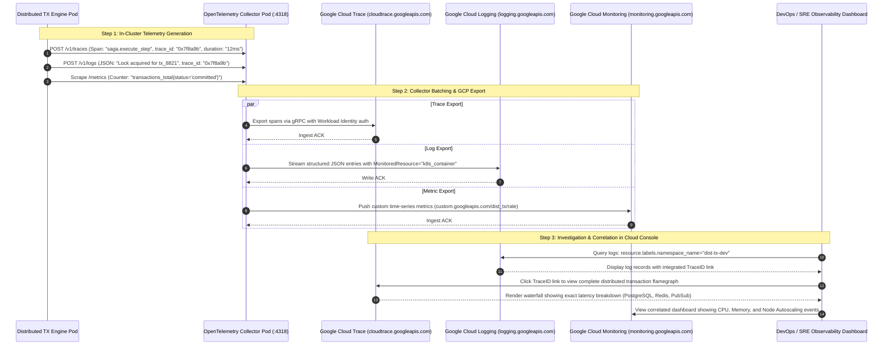
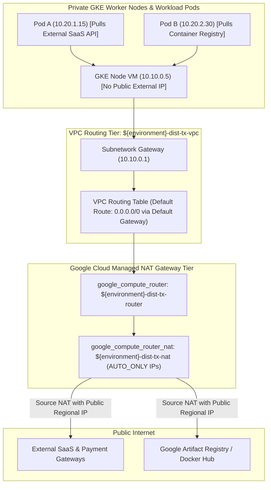
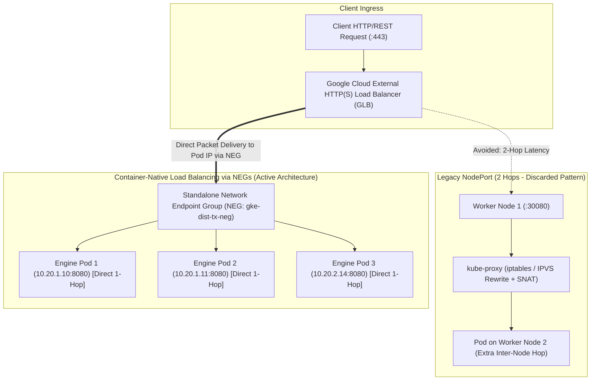
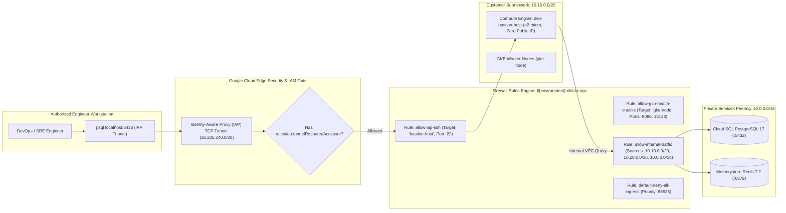

# Google Cloud Platform & Terraform Architecture Diagrams

This document contains detailed architectural diagrams illustrating the GCP network topology, API enablement & IAM authorization, live production execution flow, scaling mechanics, and cloud telemetry pipeline.

---

## 1. VPC Network Topology & Private Service Access Architecture

This diagram visualizes how Google Cloud VPC, Subnetworks, Secondary CIDRs, and Service Networking Peering interconnect GKE nodes, pods, Cloud SQL, and Memorystore Redis without any public IPs.

```mermaid
graph TB
    subgraph "External Clients & Ingress Tier"
        InternetUsers["External Microservices & Web Clients"]
        CloudArmor["Google Cloud Armor (WAF & DDoS Defense)"]
        ExternalLB["Global External HTTP(S) Load Balancer (Static IPv4/v6)"]
    end

    subgraph "Google Cloud VPC: ${environment}-dist-tx-vpc"
        subgraph "Customer Subnetwork: ${environment}-dist-tx-subnet"
            NodeSubnet["Primary Node CIDR: 10.10.0.0/20 (GKE Worker Node VMs)"]
            PodSecondary["Secondary Pod CIDR: 10.20.0.0/16 (VPC-Native Pods)"]
            SvcSecondary["Secondary Service CIDR: 10.30.0.0/20 (ClusterIPs)"]
        end

        subgraph "Private Services Peering Allocation: 10.0.0.0/16"
            GlobalAlloc["google_compute_global_address: private-ip-alloc"]
            VpcPeeringLink["Service Networking Peering Link (servicenetworking.googleapis.com)"]
        end
    end

    subgraph "Google-Managed Tenant VPC Network"
        CloudSQL["Cloud SQL PostgreSQL 17 (Private IP: 10.0.0.5)"]
        RedisInstance["Memorystore Redis 7.2 (Private IP: 10.0.0.10)"]
    end

    subgraph "Google Managed Control Plane"
        GkeMaster["GKE Control Plane Master (API Server :443)"]
    end

    InternetUsers --> CloudArmor --> ExternalLB
    ExternalLB -->|Forward to NodePort| NodeSubnet
    NodeSubnet -->|Routes traffic into| PodSecondary
    PodSecondary -->|Service Discovery| SvcSecondary

    GlobalAlloc --> VpcPeeringLink
    VpcPeeringLink <== Internal SDN Private Peering ==> CloudSQL & RedisInstance

    PodSecondary -->|TLS Encrypted SQL via Auth Proxy Sidecar| CloudSQL
    PodSecondary -->|Direct TCP Lock Fencing (:6379)| RedisInstance
    NodeSubnet -.->|Private Master Endpoint| GkeMaster
```

---

## 2. API Enablement, IAM Roles & Workload Identity Federation

This sequence diagram details how required Google Cloud APIs are activated and how an engine pod inside GKE authenticates to Google Cloud services without static service account keys.



---

## 3. Terraform Lifecycle: Verification, Dry-Run & Production Apply

This diagram maps the CI/CD pipeline and the transition from offline dry-run verification to live production deployment.



---

## 4. Live Production Scaling: Cluster Autoscaler & HPA Under Surge

This diagram visualizes how traffic surges trigger scaling across both the compute node pool and individual application pods while protecting database connection capacity.



---

## 5. End-to-End Cloud Observability & Distributed Tracing Fabric

This sequence diagram illustrates how telemetry generated inside GKE is collected by the OpenTelemetry Collector and forwarded to Google Cloud Observability suites (Cloud Trace, Cloud Logging, Cloud Monitoring).



---

## 6. Route Tables, Cloud NAT & Outbound Egress Architecture

This diagram visualizes how private GKE worker nodes and pods with zero public IPs securely route outbound traffic through Cloud Router and Cloud NAT without allowing inbound connections.



---

## 7. Ingress Container-Native Load Balancing via Network Endpoint Groups (NEGs)

This diagram contrasts legacy two-hop NodePort routing with Google Cloud container-native NEG direct-to-pod routing.



---

## 8. Firewall Security Hierarchy & Compute Engine IAP Bastion Host Access

This diagram illustrates the multi-tier firewall rule hierarchy and how engineers connect to private Cloud SQL and Redis through the Identity-Aware Proxy (IAP) bastion host.


