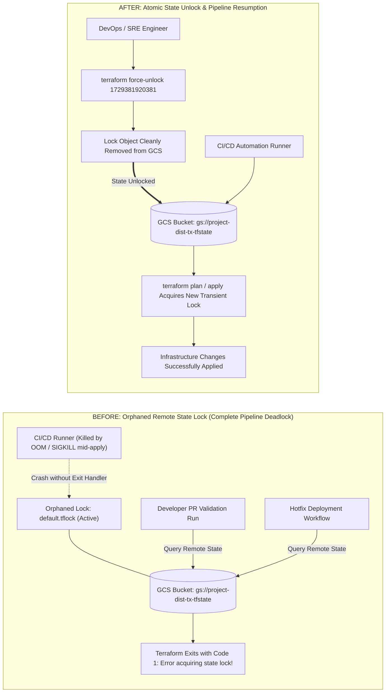
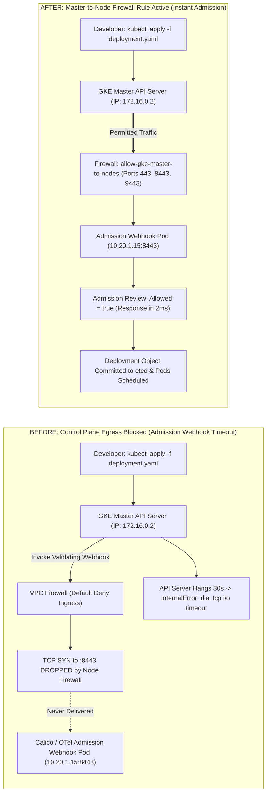
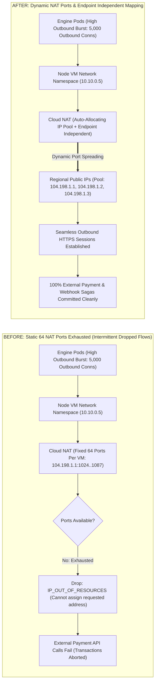
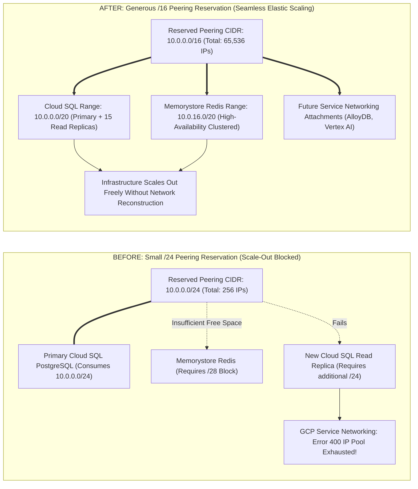

# Google Cloud & Terraform Failure-First Root Cause Analysis & Deep-Dive Runbook

This document details critical real-world failure modes encountered in Google Cloud Platform infrastructure provisioning via Terraform for the Distributed Transaction Engine. For each failure mode, this guide covers the real-user scenario, root cause, exact recovery runbook, and an exhaustive, side-by-side Before-vs-After architecture diagram illustrating packet paths, state transitions, and component interactions.

---

## 1. Terraform Remote State Lock Deadlock (`Error acquiring the state lock`)

### A. Real-User Scenario
During a CI/CD automated deployment, an agent runner crashes abruptly (OOM or runner timeout) during a `terraform apply`. When any team member tries to run a new deployment or PR verification, Terraform immediately terminates with:
```
Error: Error acquiring the state lock
Lock Info:
  ID:        1729381920381
  Path:      gs://project-dist-tx-tfstate/terraform/state/default.tflock
  Who:       runner-482@ci-worker-node-1
  Created:   2026-11-02 08:30:15 UTC
```
All production deployments and hotfixes are completely paralyzed.

### B. Root Cause
Terraform places a lock object in Google Cloud Storage when any write operation begins. Because the process was forcefully killed via SIGKILL without a clean exit handler, the lock file remained orphaned in the GCS bucket, permanently rejecting subsequent operations.

### C. How Real Engineers Solve It
```bash
# 1. Inspect the exact lock ID from the Terraform error output
export LOCK_ID="1729381920381"

# 2. Force-unlock the remote GCS state
terraform force-unlock "${LOCK_ID}"

# 3. If force-unlock fails due to API permissions, remove the lock object directly via gcloud:
gcloud storage rm "gs://${PROJECT_ID}-dist-tx-tfstate/terraform/state/default.tflock"
```

### D. Side-by-Side: Before vs. After Failure Resolution



---

## 2. GKE Private Cluster Admission Webhook Freeze

### A. Real-User Scenario
Engineers enable private cluster mode (`enable_private_nodes = true`). When deploying workloads with admission webhooks (such as Calico NetworkPolicy, cert-manager, or OTel Operator), running `kubectl apply` hangs indefinitely and crashes after 30 seconds with:
```
Error from server (InternalError): Internal error occurred: 
failed calling webhook "validate.calico.org": failed to call webhook: 
Post "https://calico-webhook.calico-system.svc:443/validate": dial tcp 10.20.1.15:443: i/o timeout
```

### B. Root Cause
In private GKE clusters, the control plane master resides in an isolated Google-managed VPC with CIDR `172.16.0.0/28`. Because the custom VPC has zero default inbound firewall rules, worker node VMs drop incoming TCP connections from the master to ports 443, 10250, 8443, and 9443. The Kubernetes API server cannot contact the admission webhook running inside the worker node pod.

### C. How Real Engineers Solve It
1. **Immediate Firewall Addition via gcloud**:
   ```bash
   gcloud compute firewall-rules create dev-allow-gke-master-to-nodes \
       --network="${ENVIRONMENT}-dist-tx-vpc" \
       --action=ALLOW \
       --direction=INGRESS \
       --source-ranges="172.16.0.0/28" \
       --rules="tcp:443,tcp:10250,tcp:8443,tcp:9443" \
       --target-tags="gke-node"
   ```
2. **Permanent Terraform Declaration**: Added resource `google_compute_firewall.allow_gke_master_to_nodes` to [deploy/terraform/main.tf](file:///home/btpl-lap-22/live/System-Architect/distributed-transaction-engine/deploy/terraform/main.tf).

### D. Side-by-Side: Before vs. After Failure Resolution



---

## 3. Cloud NAT Port Allocation Exhaustion (`IP_OUT_OF_RESOURCES`)

### A. Real-User Scenario
During high-traffic transaction surges, engine pods make external outbound HTTPS calls to third-party banking APIs, webhooks, and OIDC auth providers. Intermittently, outbound requests fail with:
```
dial tcp: lookup api.stripe.com: i/o timeout
connect: cannot assign requested address
```
Cloud NAT metrics show dropped flows with status `DROPPED_OUT_OF_RESOURCES`.

### B. Root Cause
Each worker node VM is allocated a fixed number of source ports (default 64) for outbound NAT mapping. When thousands of concurrent outbound connections are opened by engine pods, the node VM runs out of available ephemeral source port tuples, dropping outbound TCP packets.

### C. How Real Engineers Solve It
1. **Immediate Cloud NAT Configuration via gcloud**:
   ```bash
   gcloud compute routers nats update dev-dist-tx-nat \
       --router=dev-dist-tx-router \
       --region=us-central1 \
       --min-ports-per-vm=128 \
       --enable-endpoint-independent-mapping
   ```
2. **Permanent Terraform Fix**: Configured `enable_endpoint_independent_mapping = true` and dynamic IP allocation in `google_compute_router_nat.nat`.

### D. Side-by-Side: Before vs. After Failure Resolution



---

## 4. Private Service Peering CIDR Exhaustion

### A. Real-User Scenario
As database usage grows, the operations team tries to create a Cloud SQL read replica or provision a new Memorystore Redis instance. The Terraform apply fails with:
```
Error: Error creating Instance: googleapi: Error 400: IP pool exhausted for peering.
The reserved peering range "dev-private-ip-alloc" has insufficient available addresses.
```

### B. Root Cause
The initial Terraform configuration allocated a small `/24` subnet (only 256 IPs). Cloud SQL requires a minimum `/24` per instance family, and Memorystore Redis requires additional dedicated sub-ranges. Sizing the initial peering reservation too small prevents expanding storage replicas.

### C. How Real Engineers Solve It
```bash
# 1. Inspect existing allocated peering range
gcloud compute addresses describe dev-private-ip-alloc --global

# 2. Reserve an expansive /16 range (65,536 IPs) in Terraform:
# resource "google_compute_global_address" "private_ip_address" {
#   prefix_length = 16
# }

# 3. Update the Service Networking connection peering range
gcloud services vpc-peerings update \
    --service=servicenetworking.googleapis.com \
    --ranges=dev-private-ip-alloc \
    --network=dev-dist-tx-vpc
```

### D. Side-by-Side: Before vs. After Failure Resolution


