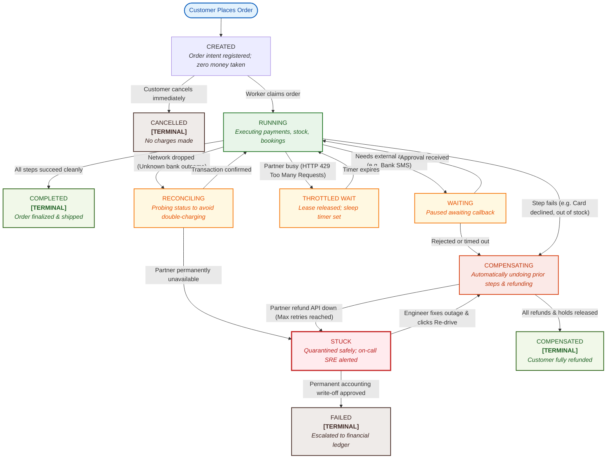
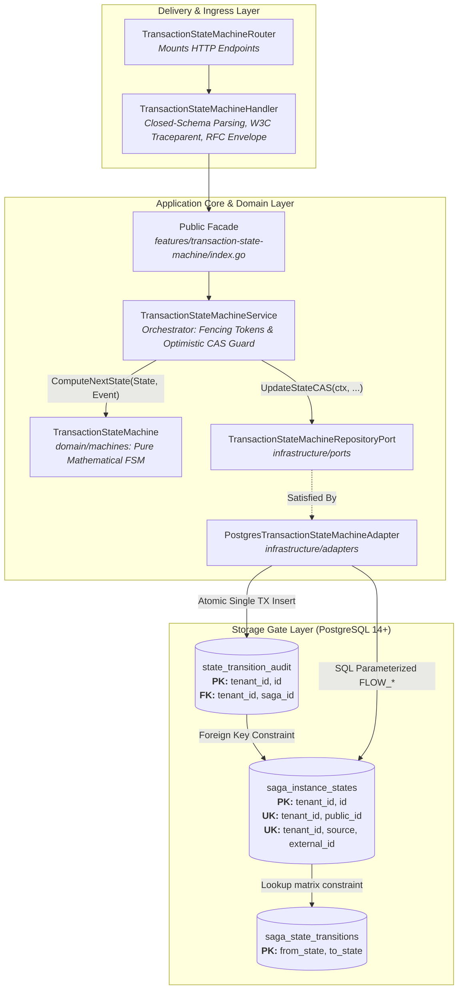
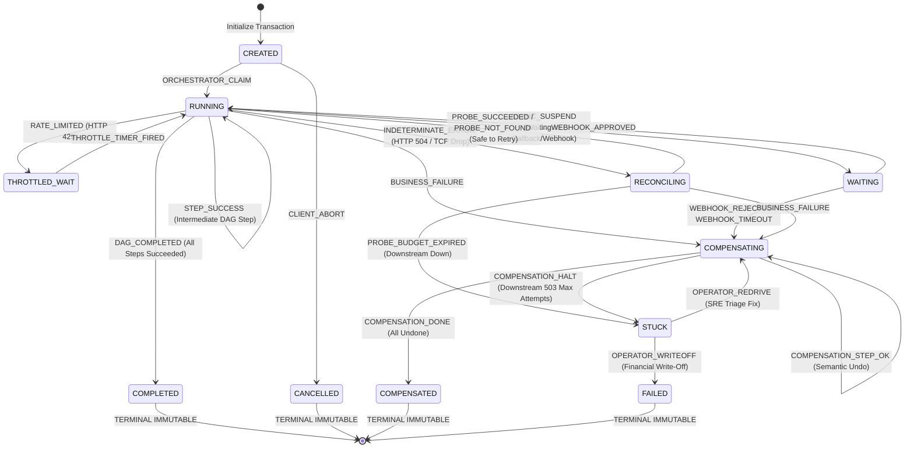
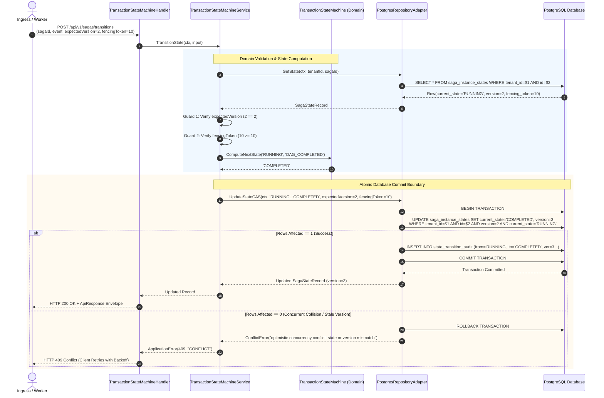
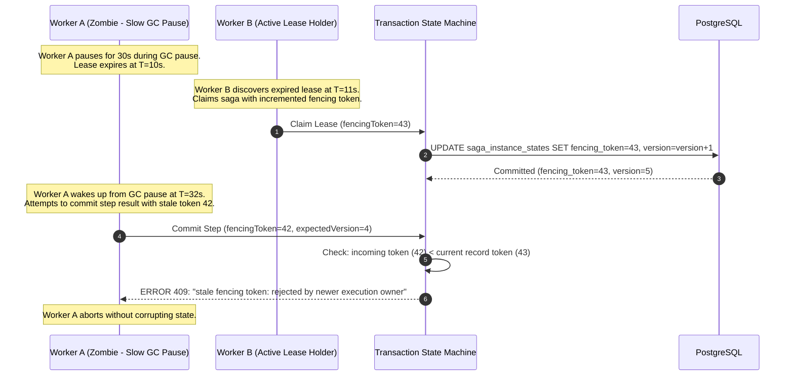

# Transaction State Machine — Visual Architecture & Process Flow Diagrams

This document illustrates how the transaction state machine works, featuring both intuitive diagrams for business and non-technical stakeholders and in-depth engineering sequence diagrams.

---

## 1. Non-Technical / Business Overview: How an Order Travels Through the System

Imagine an e-commerce order or a travel booking. The transaction engine works like a smart digital traffic controller. It guarantees that an order either completely finishes or completely cancels, with zero money or inventory lost.

### The Plain-English Journey of a Transaction

### Business State Plain-English Glossary

* **CREATED**: The customer just clicked "Submit". The order intent is registered, but no money has been taken and no inventory held yet.
* **RUNNING**: The engine is actively coordinating steps (e.g., deducting points, charging credit card, notifying warehouse).
* **WAITING**: The engine paused safely while waiting for an external event (such as a 3D-Secure SMS bank authorization code or identity check).
* **THROTTLED WAIT**: The bank or partner asked us to slow down. The engine steps back without burning server resources until the timer expires.
* **RECONCILING**: A network hiccup occurred and we aren't sure if the bank processed the charge or not. Instead of guessing or double-charging, the engine pauses to safely check the bank's records first.
* **COMPENSATING**: A step failed (e.g., card declined or hotel room sold out). The engine is actively undoing any earlier steps in reverse order (releasing holds, issuing refunds).
* **STUCK**: A partner service broke and won't respond to refunds after multiple attempts. The order is quarantined safely so an on-call engineer can inspect it without risk of runaway loops.
* **COMPLETED (Terminal)**: Success! The transaction finished 100% cleanly.
* **CANCELLED (Terminal)**: The user cancelled before execution started. Zero charges were made.
* **COMPENSATED (Terminal)**: Rollback succeeded 100%. The customer was refunded and all held resources were freed.
* **FAILED (Terminal)**: The transaction was formally written off by an authorized operator.

---

## 2. Technical Hexagonal Component Architecture

---

## 3. Engineering State Machine Transition Topology

---

## 4. Concurrency Safety: Compare-And-Swap (CAS) Sequence Diagram

---

## 5. Zombie Worker Fencing Sequence

