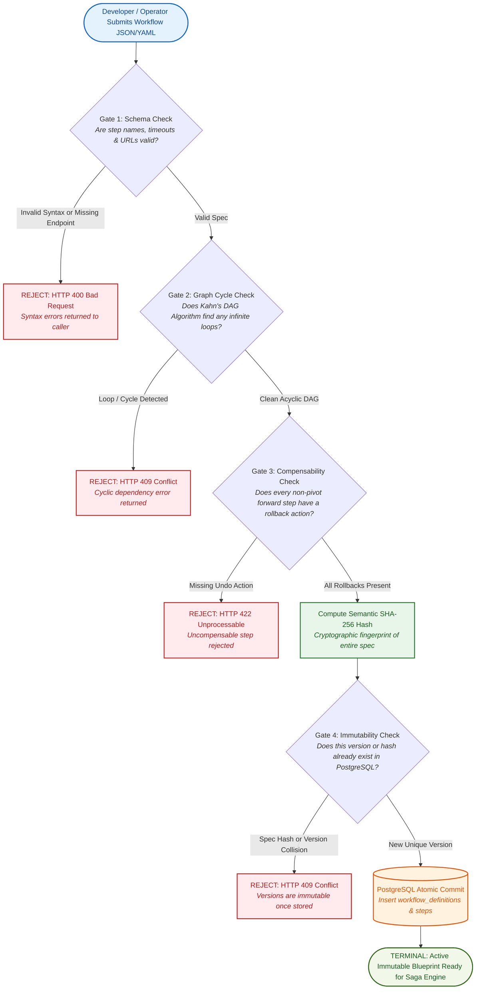
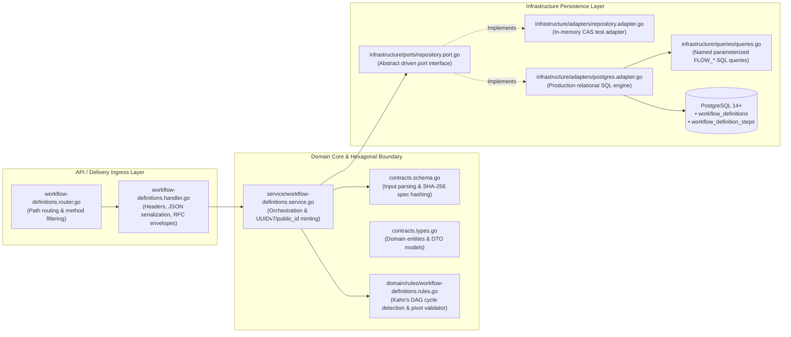
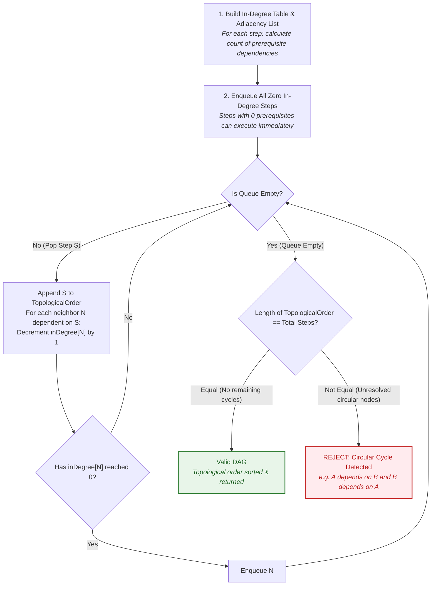
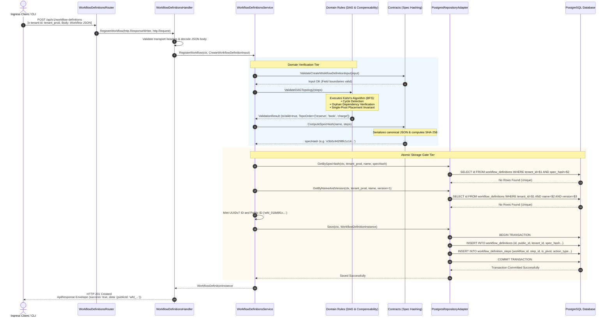
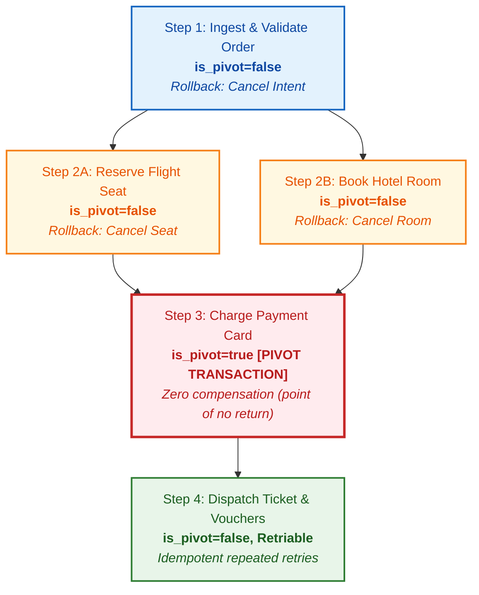

# Workflow Definitions — Visual Architecture, Internal Engine Mechanics & Process Flow Diagrams

This document illustrates the internal architecture, mathematical graph algorithms, data contracts, and end-to-end execution flow of the **Workflow Definitions subsystem**.

---

## 1. Non-Technical / Business Overview: The Blueprint of a Distributed Workflow

Before an airline can book a seat, charge a credit card, or reserve a hotel room, the engine must know the exact rules of engagement: what steps run first, which run in parallel, and who cleans up if a payment fails.

---

## 2. Hexagonal Subsystem Topology & Internal Component Flow

The subsystem strictly adheres to the stateless hexagonal core pattern:

---

## 3. Internal Mechanics: Kahn's DAG Cycle Detection Algorithm

The mathematical core of graph validation uses Kahn's algorithm (Topological BFS) to guarantee that incoming workflows contain zero circular dependencies and compute the exact execution order.

---

## 4. End-to-End Registration & Verification Sequence Diagram

This sequence represents what happens when a client invokes `POST /api/v1/workflow-definitions`:

---

## 5. Diamond Dependency Resolution (Parallel Fan-Out & Join)

Workflows frequently split into concurrent branches and join before reaching the critical pivot point:

### Compensability Boundary Rules
1. **Pre-Pivot Steps (Steps 1, 2A, 2B)**: Compensable. If Step 2B fails, Step 2A is rolled back via its declared `CANCEL_SEAT` action, and Step 1 via `Cancel Intent`.
2. **Pivot Step (Step 3)**: The point of no return. If Step 3 succeeds, the saga *must* finish forward. Rollback is impossible once money is settled.
3. **Post-Pivot Steps (Step 4)**: Must be idempotent and retriable until success.

