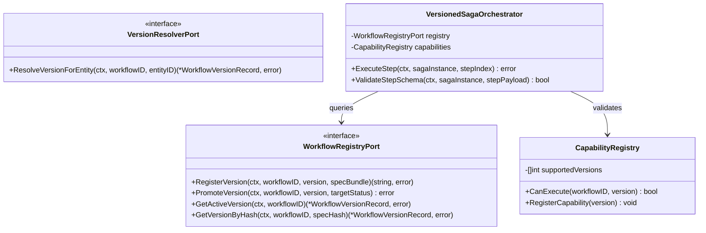
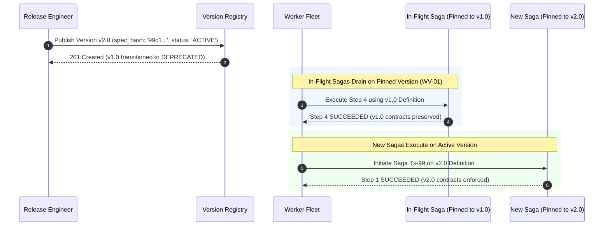
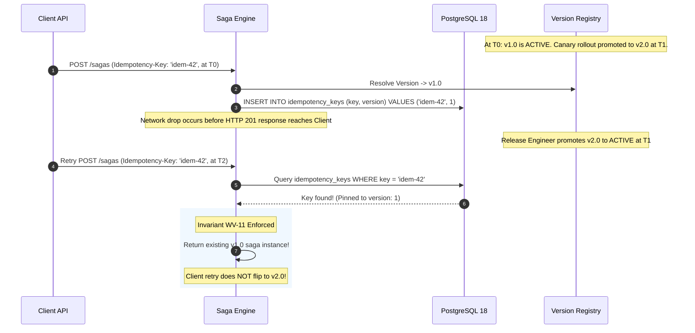
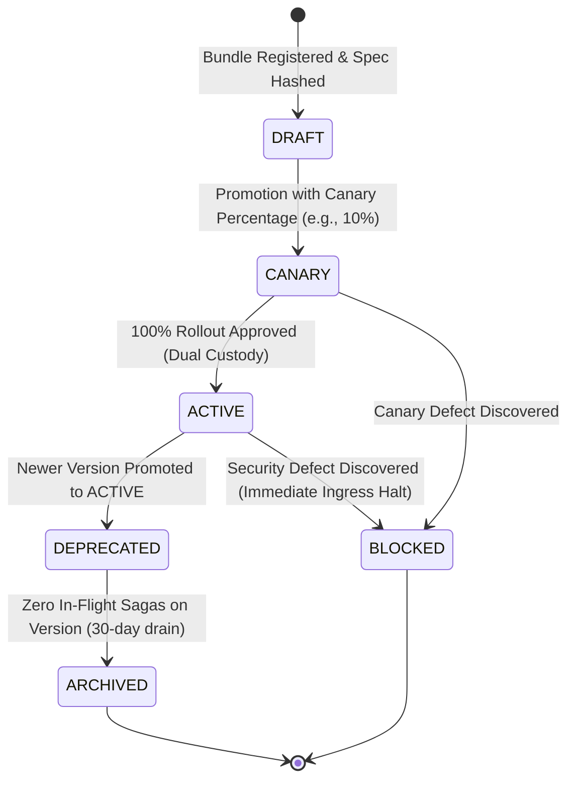

# Workflow Versioning — Architectural & Visual Diagrams

This document illustrates the architectural blueprints, component relationships, and rollout workflows for the **Immutable Workflow Versioning Subsystem**, supporting [ADR-0011](file:///home/btpl-lap-22/live/System-Architect/distributed-transaction-engine/docs/features/workflow-versioning/adr.md) and [Business Logic Decision Tree v2](file:///home/btpl-lap-22/live/System-Architect/distributed-transaction-engine/docs/features/workflow-versioning/business-logic.md).

---

## 1. High-Level Architecture (HLD): Immutable Version Registry & Worker Engine

```mermaid
flowchart TB
    subgraph RegistryLayer ["Workflow Version Registry (PostgreSQL 18)"]
        V1_Bundle[("v1.0 Bundle<br/>spec_hash: 0a8f...<br/>status: DEPRECATED")]
        V2_Bundle[("v2.0 Bundle<br/>spec_hash: 99c1...<br/>status: ACTIVE")]
    end

    subgraph ClientIngress ["Client Ingress & Rollout Engine"]
        ClientReq["Client POST /sagas"] --> Router["Rollout Version Resolver"]
        Router -->|1. Resolve Active Version (v2.0)| RegistryLayer
        Router -->|2. Pin Immutable Spec Hash| Starter["Saga Initiation Service"]
    end

    subgraph SagaStorage ["Saga Storage & Pinning (WV-01)"]
        Starter -->|INSERT with workflow_version=2, spec_hash='99c1...'| SagaTable[("saga_instances")]
    end

    subgraph HeterogeneousWorkers ["Capability-Aware Worker Fleet (WV-16)"]
        SagaV1["Older Saga Tx-10 (Pinned to v1.0)"] -->|Lease Claimed by| WorkerA["Worker Pod A (Capabilities: v1.0, v2.0)"]
        SagaV2["Newer Saga Tx-20 (Pinned to v2.0)"] -->|Lease Claimed by| WorkerB["Worker Pod B (Capabilities: v2.0)"]
    end
```

---

## 2. Low-Level Component Model (LLD)



---

## 3. Zero-Downtime Blue/Green Rollout Sequence with In-Flight Drain



---

## 4. Idempotent Start Version Consistency (Invariant WV-11)



---

## 5. Workflow Version Lifecycle State Machine



