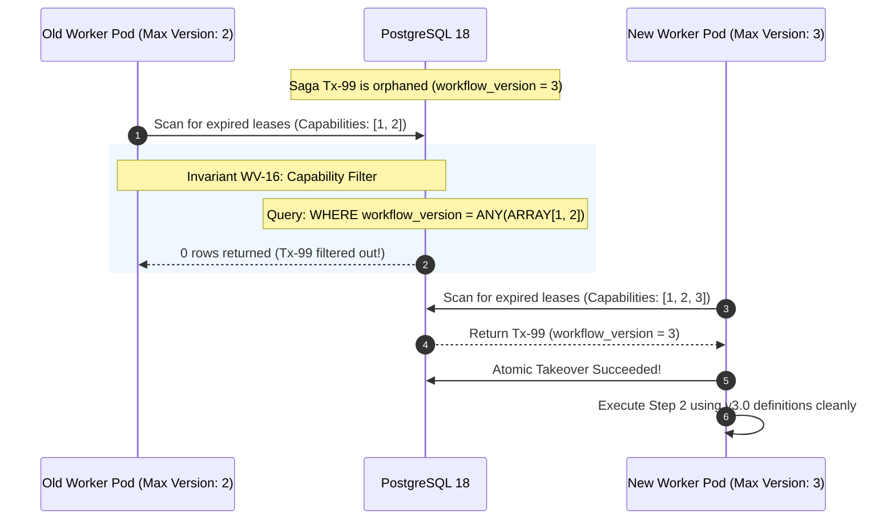

# Workflow Versioning — Failure Cases, Rollout Races & Mitigations

This document details failure cases, rollout race conditions, and mitigation architectures for the Immutable Workflow Versioning Subsystem.

---

## 1. Failure Modes & Resilience Matrix

| Failure ID | Scenario / Trigger | Direct Impact | Invariants Challenged | Architectural Mitigation & Detection |
|---|---|---|---|---|
| **FAIL-WV-001** | **Version Oscillation on Start Retry**: Client initiates saga during a 10% canary rollout; network drops before client receives ACK. Meanwhile, canary is promoted to 100%. Client retries with same idempotency key. | If version is re-resolved, client creates or binds to v2.0 instead of v1.0, or duplicate sagas are initiated across conflicting schemas. | **WV-11, E13.1** | **Mitigation:** Version pinning in idempotency store. The resolved version number is stored inside `idempotency_keys` in the same database transaction as saga creation. Any subsequent retry returns the existing saga pinned to its original version. |
| **FAIL-WV-002** | **Silent Un-Pinning via Live External State**: A saga is pinned to v1.0, but Step 3 queries a live database table for currency conversion fee rates that were updated yesterday. | The saga behaves according to new business logic despite being pinned to v1.0, breaking backward compatibility. | **WV-10** | **Mitigation:** Bundle-contained state snapshotting. All fee schedules, timeout thresholds, and step bindings must be packaged directly inside the version bundle JSON or snapshotted into `saga_instances.context` at saga start. Steps are forbidden from querying live configuration tables. |
| **FAIL-WV-003** | **Incapable Worker Claiming Unsupported Version**: Worker Pod A is running an older binary that only supports up to v2.0. Version v3.0 is deployed. Pod A claims an expired lease on a v3.0 saga. | Worker Pod A cannot decode the step action definition, causing panic or false failure. | **WV-16** | **Mitigation:** Capability-aware lease filtering. Worker lease polling queries PostgreSQL with capability constraints: `WHERE workflow_version = ANY(:supported_worker_versions)`. Older worker pods skip leases for versions they cannot interpret. |
| **FAIL-WV-004** | **Rollback to Deprecated Version with Stripped Workers**: A critical bug is found in v2.0; engineers attempt immediate rollback to v1.0. However, v1.0 worker dependencies were already undeployed from Kubernetes. | No workers exist in the cluster capable of executing v1.0 sagas, freezing the entire platform. | **E14.5** | **Mitigation:** Mandatory N-1 support window. Cluster deployment policies require that worker fleets maintain capability support for the active version AND the previous active version for at least 30 days before deprecation. |
| **FAIL-WV-005** | **Simultaneous Promotion Race**: Two release engineers promote competing version candidates to `ACTIVE` at the exact same millisecond. | Split-brain routing where different worker nodes observe different `ACTIVE` versions. | **WV-15, E14.1** | **Mitigation:** Optimistic concurrency control on the registry. Promoting a version requires an atomic CAS: `UPDATE workflow_version_registry SET status = 'ACTIVE' WHERE workflow_id = :id AND status = 'CANARY' AND version = :v`. Exactly one promotion wins. |

---

## 2. In-Depth Failure Drill: Incapable Worker Interception



---

## 3. Operator Runbook: Emergency Version Blocking

When a critical security vulnerability or infinite loop is identified in version `v2.4`:

1. **Immediately block the version from new saga starts:**
   ```sql
   UPDATE workflow_version_registry 
   SET status = 'BLOCKED', canary_percentage = 0 
   WHERE workflow_id = 'order_fulfillment' AND version = 4;
   ```
2. **Halt active sagas running on the blocked version:**
   ```sql
   UPDATE saga_instances 
   SET status = 'PAUSED_BLOCKED_VERSION' 
   WHERE workflow_id = 'order_fulfillment' AND workflow_version = 4 AND status = 'RUNNING';
   ```
3. **Deploy hotfix version `v2.5` and migrate paused instances via intervention API:**
   `POST /api/v1/sagas/bulk-migrate-version` with `{"from_version": 4, "to_version": 5}`.

